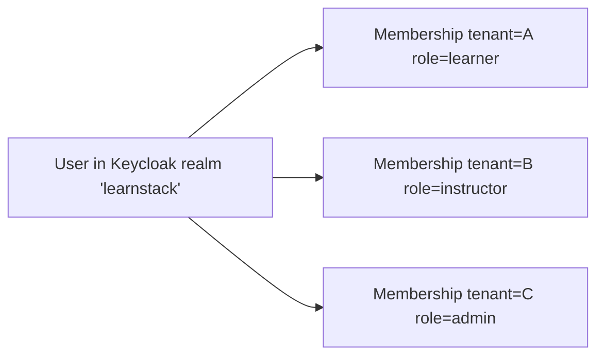
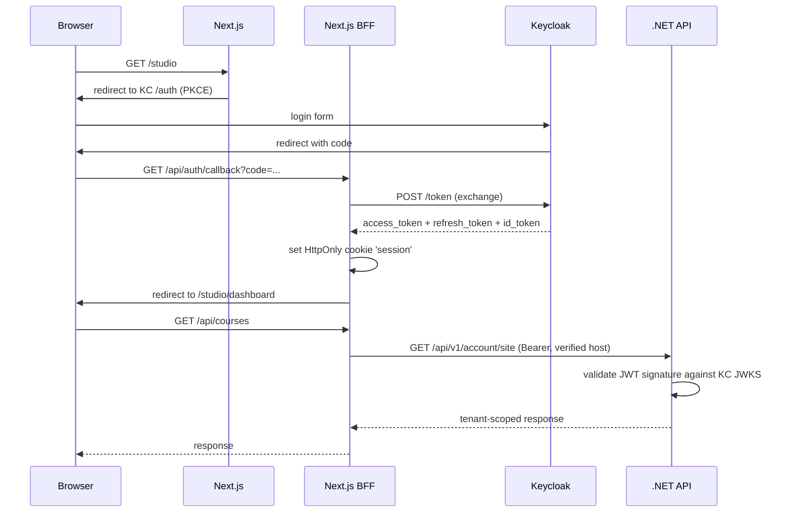
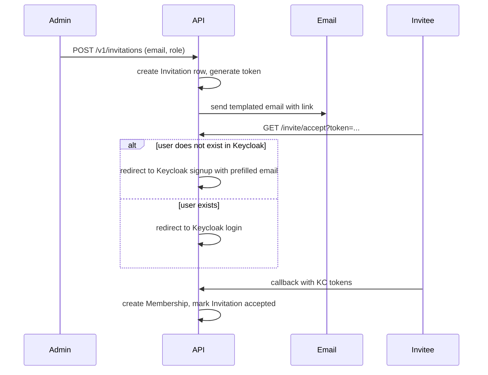

# Identity and Authentication

LearnStack delegates user authentication to a self-hosted identity provider rather than building one inside the .NET application. The default provider is **Keycloak** (Authentik is the documented alternative). The decision and the trade-offs are recorded in [ADR 0004 — Authentication Strategy](../decisions/0004-authentication-strategy.md).

This document covers what lives where: in Keycloak vs in LearnStack, how multi-tenant identity works, how tokens flow, and how SSO/OIDC integrations land later.

**Implementation boundary — 2026-10-12.** The flows and application identity
model below are target architecture. The dev realms exist, but API JWT validation,
tenant claim mappers, a BFF session and mirrored users/memberships are not shipped.
Current public sites use host-based anonymous admission without forwarding cookies
or credentials. [Phase 02b's entry verification](../roadmap/phase-02b-events-auth.md#p02b-0-entry-verification-2026-10-12)
records the baseline; G10–G13/G20 settle token shape, resolution, session custody
and lifetimes before their first consumers. Phase 03 owns the identity domain.

**P02b-5 decision Accepted — 2026-10-19.**
[ADR-0064](../decisions/0064-tenant-api-authentication-boundary.md) and its
[decision package](../roadmap/phase-02b-events-auth.md#p02b-5-decision-package-2026-10-19)
authorize scalar identity claims, one closed authenticated read and additional
subject accounting. All five implementation steps and their two independent
review rounds are complete and merged through PR #33 on 2026-10-20; the
[merge closeout](../roadmap/phase-02b-events-auth.md#p02b-5-merge-and-closeout-2026-10-20)
owns delivery, correction reviews and final-source qualification. Authentication
and authorization registration activate together with the closed surface in Step 4.
Realm reconciliation and BFF sessions remain P02b-6/P02b-7.

**P02b-6 decision Accepted — 2026-10-21.** The
[accepted package](../roadmap/phase-02b-events-auth.md#p02b-6-decision-package-2026-10-20)
authorizes four implementation steps for real issuance, protected seed attributes,
non-destructive development reconciliation, exact callbacks and issuance TTL.
Steps 1–3 supply the committed fresh-import scopes/profile/client definition,
typed identity manifest, bounded warm reconciliation and shared seed/demo entry.
Their local reviews and actual lifecycle qualification are complete. Step 4
delivers the approved account capability and complete provider/API security
proofs after both independent review rounds and verified corrections; its
[record](../roadmap/phase-02b-events-auth.md#p02b-6-step-4--real-identity-qualification-and-closeout-2026-10-21)
owns final-source qualification. G13's BFF session part
stays Open for P02b-7. The
[development realm guide](../../infra/keycloak/README.md) owns exact callbacks,
private sources and current upgrade status.

**Assertion diagnostics Accepted — 2026-10-20.**
[ADR-0065](../decisions/0065-bounded-tenant-assertion-diagnostics.md) admits 600
rejected-assertion audit attempts per independently defended host tenant per API
instance per first-request-anchored monotonic minute. The API singleton shares
allowance across scoped recorders and all actors/sources/dimensions; failed
writes spend permits. Suppression retains the refusal, closed counters and one
attributed Warning without a durable row or database call. An attacker can
exhaust another tenant's recording allowance; later actors lose durable evidence
within that window, and aggregate real-time log volume remains unbounded.
Admitted events remain MUST; tenant `AuditConfig` cannot override the allowance
or general mutation durability. Subject quota remains separate.
[ADR-0066](../decisions/0066-bounded-tenant-subject-admission.md), Accepted —
2026-10-20, selects its 4096 retained issuer/subject partitions shared across
all tenants/hosts, bounded idle-only cleanup and distinct quota/capacity/fault
signals. Occupied live slots can deny other tenants' new subjects; there is no
reserved share or end-to-end throughput promise. Its implementation has local
runtime/exported proofs; the
[implementation record](../roadmap/phase-02b-events-auth.md#adr-0066-acceptance-and-implementation-2026-10-20)
owns independent reviews and final-source CI qualification.
ADR-0065 also ratifies
process-wide native HTTP/DNS metric
projection and ordinary dependency-attribution loss while preserving ordinary
traces/logs. Acceptance precedes dependent budget implementation; the
[2026-10-20 remediation record](../roadmap/phase-02b-events-auth.md#p02b-5-external-review-remediation-2026-10-20)
owns current implementation and proof status.

**API activation — P02b-5 Step 4, 2026-10-19.** The production API now installs
that strict bearer boundary and exposes exact `GET /api/v1/account/site`.
The [Step 4 record](../roadmap/phase-02b-events-auth.md#p02b-5-step-4--atomic-http-activation-and-contracts-2026-10-19)
owns validation and review status. This updates the API-validation part of the
2026-10-12 baseline above; P02b-6 owns the realm's issuance changes, P02b-7 the
BFF session and Phase 03 the application identity model. Public transport stays
anonymous.

## Why Not Build It Ourselves

Email + password + refresh tokens + invitation flow + password reset + email verification + audit + future SSO + future MFA is a large, security-sensitive surface. Each of these pieces is non-trivial in isolation and easy to get subtly wrong. Off-the-shelf identity systems have been hardened against the entire OWASP authentication catalogue; replicating that hardening costs months of engineering and ongoing vigilance.

The chosen identity provider:

- Implements OIDC (Authorization Code with PKCE), refresh tokens, and standard logout.
- Supports email/password, social logins, SAML, and OIDC federation.
- Has a battle-tested admin UI for user management.
- Is self-hostable (we control the data, the deployment, the upgrades).

The cost is one more service to operate. That is acceptable: self-hosted infrastructure is the platform's stated preference (see [README](../../README.md)) and the operational load fits within current team capacity.

## What Lives Where

| Concern | Keycloak | LearnStack |
|---|---|---|
| User credentials (password hash, MFA factors) | yes | no |
| OIDC tokens (issuance, signing keys) | yes | no |
| Federation with social/SAML/OIDC providers | yes | no |
| Email verification, password reset emails | yes (or LearnStack via SMTP delegation) | no |
| Global `User` record (canonical identity, email) | mirrored | source for application data |
| `Membership` (per-tenant role, permissions) | no | yes |
| Roles, permissions inside a tenant | no | yes |
| Invitations | no | yes |
| Audit log of identity events | yes (own) | yes (mirrored for cross-events) |
| Profile (display name, photo, bio, preferences) | minimal | yes |

The split keeps Keycloak focused on authentication (knowing who you are) and LearnStack focused on authorisation and domain context (what you can do in which tenant).

## Multi-Tenant Identity Model

A user is **global**. A user has a `Membership` in zero or more tenants. The same email can be a learner in tenant A and an instructor in tenant B without two accounts.

Two realm strategies were considered:

- **Single tenant realm, scalar active scope** (chosen). The `learnstack` realm
  is the required issuer for the ADR-0064 profile: opaque `sub`, stable UUID `user_id`, optional
  scalar UUID `tenant_id` and optional scalar UUID `organization_id`. It carries
  no authoritative membership array or application-role grant. P02b-6 supplies
  admin-controlled attributes/mappers and real issuance proof; the committed realm
  export issues that profile. Phase 03 owns live memberships.
- **Realm-per-tenant**. Cleaner isolation, but a user with memberships in multiple tenants needs separate accounts; user discovery and SSO get more complex.

The single tenant realm matches the global-user, tenant-scoped membership model.
The separate `learnstack-hub` realm remains the operator boundary. Realm-per-tenant
is not part of the accepted API profile; a different issuer strategy needs a new
decision before its first consumer.

## Token Flow

Key details:

- **PKCE only.** No implicit flow, no client secrets in the browser.
- **Cookies, not localStorage.** Tokens never enter JavaScript; the BFF holds them.
- **Short access token TTL.** [Security Standards](../standards/11-security.md#authentication)
  owns the accepted issuance rule; P02b-6's realm export/reconciler owns its
  executable value and enforcement. ADR-0064 bounds API acceptance; P02b-7 owns
  BFF refresh and session lifetimes.
- **JWKS rotation.** API validates tokens against Keycloak's JWKS endpoint, with key caching and rotation handling built into the .NET OIDC middleware.

## Tenant Resolution Across Identity

When a user logs in, they may have multiple memberships. HTTP tenant authority
comes only from the independent verified host and validated active-scope claims,
reconciled by ADR-0036. A selector or cookie may suggest a later token reissue;
it never selects API scope. Phase 03 owns membership-aware tenant switching.
See [27-custom-domain-tls.md](27-custom-domain-tls.md) for host verification/TLS.

The JWT carries a `tenant_id` claim for the active session; LearnStack rejects requests where the host-derived tenant disagrees with the claim. That rejection is not a fallback rule but the general shape of resolution — every authoritative signal is resolved independently and the request proceeds only on their intersection. The full matrix, including the organization dimension and the platform-host case, is [ADR-0036](../decisions/0036-tenant-resolution-trusted-inputs.md). See also [Tenant Isolation](09-tenant-isolation.md).

## Roles and Permissions

Roles live in LearnStack, not in Keycloak. Keycloak does not know what an "instructor" is. The reasons:

- Tenant-scoped roles. A user can be an admin in one tenant and a learner in another. Encoding all of this in Keycloak realm roles bloats tokens and couples authorisation to authentication.
- Permission evolution. Permissions change as the product evolves; iterating in LearnStack is faster than via Keycloak's role API.
- Resource-scoped authorisation. "This instructor can edit *their own* courses" cannot be expressed as a flat role claim.

Mechanism:

- `Membership` carries one or more `Role` references.
- `Role` carries `Permission`s (atomic capabilities like `course.publish`, `enrollment.create`).
- Resource-scoped checks (`course.edit` is allowed only when `course.owner_id == current_user.id`) live in policy classes, evaluated in the application layer.

The API uses opaque `sub` for external identity/subject accounting and UUID
`user_id` for actor attribution, with scalar active-scope claims. Email and
realm/client roles grant no application authority. Phase 03 owns permission
resolution; P02b-5 exposes only its closed nonsensitive read while application
authorization is still pass-through.

## Invitations

Invitations are owned by LearnStack:

Edge cases:

- **Invitee uses a different email at Keycloak signup.** The invitation token is bound to the email; mismatched signup is rejected.
- **Invitation expires.** Default TTL 14 days, configurable per tenant.
- **Invitation revoked.** Tenant admin can revoke; accepting a revoked invitation is rejected.

## SSO and Federation

Tenant-specific SSO is enabled per tenant. Implementation:

- A tenant can configure a SAML or OIDC identity provider in Keycloak (admin API).
- The tenant's public site shows "Sign in with {tenant}" on the login page.
- Users authenticating via tenant SSO land in the LearnStack realm; their Keycloak account is federated, and LearnStack creates or matches a `Membership` based on the email.

This does not require LearnStack code changes per tenant; it is a configuration in Keycloak that LearnStack exposes via a tenant-admin UI.

## MFA

MFA is a Keycloak responsibility. Enforced for:

- Platform admin accounts (mandatory).
- Tenant admin accounts (configurable, defaults to mandatory).
- Other roles (tenant choice).

LearnStack reads the `amr` claim to know whether MFA was used; sensitive operations can require a recent-MFA assertion.

## Logout

- Browser logout clears the session cookie and calls Keycloak's end-session endpoint with the `id_token_hint`.
- Keycloak revokes the refresh token and clears its SSO session.
- Other LearnStack sessions for the same user are not affected unless the user explicitly signs out everywhere.

## Audit

Two audit streams:

- **Keycloak audit** — login success/failure, password change, MFA enroll, account lock. Retained inside Keycloak.
- **LearnStack `AuditLog`** — role change, permission change, invitation, tenant setting change, platform admin bypass. Owned by LearnStack.

Mirrored events (e.g. `user.created`) are propagated via Keycloak webhooks into LearnStack so cross-system queries are possible.

## Local Development

Local Keycloak runs in Docker Compose, in the default profile of
[`infra/compose/dev.yml`](../../infra/compose/dev.yml), and imports the `learnstack` and
`learnstack-hub` realms from `infra/keycloak/realms/` at first start. The imports carry
the four tenant personas that the
[realm guide](../../infra/keycloak/README.md) lists, with stable actor/tenant UUIDs
and host-appropriate optional organization UUIDs, and the separate operator in
`learnstack-hub`. No
platform-admin user belongs in `learnstack`, because operators are the `learnstack-hub`
population
([ADR-0004 Amendment 1](../decisions/0004-authentication-strategy.md#amendment-1--learnstack-hub-realm-for-operators-2026-05-18)).

`make seed` checks both realm readiness gates, converges application seed data,
then awaits the same bounded tenant-realm reconciliation used by `make demo`.
The direct `LearnStack.Tools.Seeder` entry remains application-data-only. It
provisions `demo-english` and `demo-yoga` through the request path
([Phase 02a Packet 7](../roadmap/phase-02a-kernel-tenancy.md#delivery-record-packet-7)),
and a re-run is idempotent.

G12's [accepted package](../roadmap/phase-02b-events-auth.md#p02b-6-decision-package-2026-10-20)
owns the non-destructive warm upgrade and its named account-console adjustment.
The realm guide owns the exact local procedure and refusal boundaries. G10 is
Accepted: one token carries at most one active tenant. A user in both tenants
also needs `Membership`, which [Phase 03](../roadmap/phase-03-identity-admin.md)
delivers. BFF custody and sessions remain P02b-7.

## Risks

- **Keycloak as a bottleneck for sign-in.** Mitigated by running Keycloak in HA from the start, using PostgreSQL (not the dev H2) as its store, and caching JWKS.
- **Token scope versus live membership.** ADR-0064 accepts one scalar active
  tenant and optional organization, never a memberships array. Phase 03 owns
  live membership checks and switching through reissued tokens; a signed scope
  alone does not prove current membership or immediate revocation.
- **Migration path away from Keycloak.** Unlikely, but: usernames + emails are stable, so a migration to Authentik or a custom provider is mechanical. Refresh tokens would not migrate; users would re-authenticate.
- **Federation complexity.** Per-tenant SSO requires careful admin UX to avoid misconfiguration; tenant admins should not be able to break their own login by removing the only IdP.
