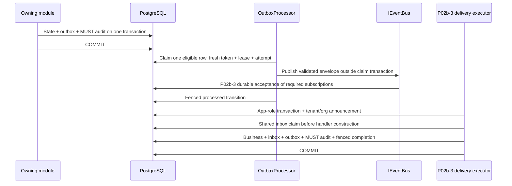

# Events and Outbox

Events allow modules to collaborate without cross-module database coupling. This document
defines the event types, the outbox pattern, the claim protocol that makes concurrent
dispatch safe, and how dispatch reaches subscribers — in process today, through Dapr
pub/sub to Kafka when the trigger for that adapter fires (ADR-0010 Amendment 1 +
ADR-0038 + ADR-0035).

## Decision

Use **domain events** within a module (in-process MediatR notifications, same transaction
as the aggregate change) and **integration events** across modules (written to an outbox
in the same transaction; dispatched at-least-once to subscribers with retry / backoff /
dead-lettering on both the producer and the subscriber side).

The outbox table is **LearnStack-owned** (a single shared table in PostgreSQL); the event
bus is the **dispatch transport**, not the durable buffer. That ownership split is what
makes the transport swappable without touching a single producer or consumer.

## What ships when

Three separable things are often collapsed into one; they are not the same and they do
not land together.

| Piece | Owning phase | State |
|---|---|---|
| `outbox_messages` table, its schema, and its LearnStack ownership | [Phase 02a Packet 6](../roadmap/phase-02a-kernel-tenancy.md) | Schema and ownership shipped in Packet 6; producer dispatch is implemented in P02b-2 Step 3 |
| `IEventBus` port + `InProcessEventBus` | [Phase 02a Packet 5](../roadmap/phase-02a-kernel-tenancy.md) | The only registered implementation |
| `IOutbox` and `TenantCreatedIntegrationEventV1` | [P02b-1](../roadmap/phase-02b-events-auth.md#p02b-1-decision-package-2026-10-12) | Implemented immediate transactional production; P02b-3 delivers the two independent default effects |
| `OutboxProcessor` and the producer claim protocol | [P02b-2](../roadmap/phase-02b-events-auth.md#p02b-2-step-3--hosted-lifecycle-and-observability-2026-10-12) | Producer runtime and enforcement complete and merged; all four steps completed both independent review rounds; CI/merge status: [merge closeout](../roadmap/phase-02b-events-auth.md#p02b-2-merge-and-closeout-2026-10-13) |
| Shared ledger/inbox and durable acceptance | [P02b-3](../roadmap/phase-02b-events-auth.md) | Steps 1–4 implement schema, acceptance/inbox, transactional business execution and independent scheduling/terminalization/replay; Step 5 activates both real defaults and semantic Seeder handoff |
| Domain events collected and dispatched in-process, inside the ambient transaction | [P02b-1](../roadmap/phase-02b-events-auth.md#p02b-1-step-3--domain-completion-and-provisioning-publisher-2026-10-12) | Successful-save collection and owner-only completion implemented |
| `DaprEventBus` → Dapr pub/sub → Kafka | [Phase 11](../roadmap/phase-11-production-hardening.md) | Demand-gated; trigger: a second process needs to consume an integration event, or event volume / replay / cross-process ordering is required ([ADR-0035](../decisions/0035-demand-gated-infrastructure.md)) |

**`InProcessEventBus` is a first-class transport.** P02b-3 Step 2 changes publish
success to durable acceptance of all required subscription envelopes on a fresh,
announced application transaction. It constructs no business handler. Step 1
supplies the shared ledger/inbox schema; Step 2 declares `IInboxGuard` and its
transaction-bound claim primitive. Step 3 implements the business owner and
completion gate; Step 4 adds independent scheduling, terminalization, replay and
bounded observation. Step 5 activates both real defaults and semantic Seeder handoff.
[Phase 02b's entry verification](../roadmap/phase-02b-events-auth.md#p02b-0-entry-verification-2026-10-12)
records the earlier immediate-invocation baseline. The producer/consumer diagrams
and examples below describe the delivered ADR-0046 runtime. The
[Step 6 record](../roadmap/phase-02b-events-auth.md#p02b-3-step-6--production-enforcement-and-pr-closeout-2026-10-13)
records production enforcement, validation and reviews. P02b-3 is complete and
merged through PR #31; its
[merge closeout](../roadmap/phase-02b-events-auth.md#p02b-3-merge-and-closeout-2026-10-15)
owns final verification.

The [P02b-1 decision package](../roadmap/phase-02b-events-auth.md#p02b-1-decision-package-2026-10-12)
and [Accepted ADR-0057](../decisions/0057-transactional-event-production-and-completion.md)
authorize immediate enqueue, owner-only completion and produced-work refusal
protection. P02b-1 Steps 1–3 implement shared execution, immediate enqueue,
successful-save collection and the completed-provisioning publisher. Step 4
implements production-census guards and catalogue enforcement; its
[delivery record](../roadmap/phase-02b-events-auth.md#p02b-1-step-4--producer-enforcement-and-closeout-2026-10-12)
owns final verification and review status. ADR-0046 accepts dispatcher/inbox
contracts; producer dispatch is implemented through P02b-2 Step 3 and shared
inbox/consumer execution through P02b-3 Steps 1–5.

The [P02b-2 decision package](../roadmap/phase-02b-events-auth.md#p02b-2-decision-package-2026-10-12)
and [Accepted ADR-0046](../decisions/0046-durable-event-delivery-and-recovery.md)
authorize fenced producer recovery, atomic terminal audit and the coupled shared
inbox/subscriber contract. Steps 1–2 implement schema/composition, fenced
transitions and atomic terminal audit; each completed both review rounds.
Step 3 implements hosted execution and observation, with both independent
review rounds complete in its
[delivery record](../roadmap/phase-02b-events-auth.md#p02b-2-step-3--hosted-lifecycle-and-observability-2026-10-12).
Step 4 enforcement and local closeout are complete; all four steps completed both
independent review rounds. The [merge closeout](../roadmap/phase-02b-events-auth.md#p02b-2-merge-and-closeout-2026-10-13)
owns CI/merge status.
P02b-3 implements consumer execution through Step 3 and independent scheduling,
terminalization, replay and bounded observation in Step 4. Its production default
subscriptions are Active with Step 5 initialization and semantic Seeder handoff. The
[Step 5 record](../roadmap/phase-02b-events-auth.md#p02b-3-step-5--useful-defaults-and-semantic-seed-handoff-2026-10-13)
records that step's validation and reviews; the
[Step 6 record](../roadmap/phase-02b-events-auth.md#p02b-3-step-6--production-enforcement-and-pr-closeout-2026-10-13)
records enforcement, validation and reviews; the merge closeout above owns final
CI/merge verification. Numerical
runtime bounds live in the package, canonical DDL/grants in Standards 05 and
metric names in Standards 10.

[ADR-0038](../decisions/0038-cross-cutting-port-and-event-contracts.md) stands as the
decision that Dapr is the
cross-process transport LearnStack uses. [ADR-0035](../decisions/0035-demand-gated-infrastructure.md)
decides when it arrives, and the answer is "when a second process exists".

## Event types

| Type | Scope | Transport | Example |
|------|-------|-----------|---------|
| **Domain event** | Inside one module | MediatR `INotification` in-process | `CourseVersionPublished` |
| **Integration event** | Cross-module | Outbox → `IEventBus.PublishAsync` → transport (in-process dispatcher today; Dapr pub/sub → Kafka from Phase 11) | `OrderPaidV1`, `EnrollmentCreated`, `TenantSuspended` |
| **Analytics event** | Reporting stream | Same channel as integration events | `LessonCompleted` |
| **Provider event** | External callback (webhook) | Provider → API endpoint → outbox → ... | `LiveKitParticipantJoined`, `StripeInvoicePaid` |

## Outbox flow



Text fallback: the producer commits state, outbox and audit together. The worker
claims one admitted row immediately before publishing and fences its acknowledgement.
Required Pending subscriptions hold rows before acquisition. P02b-3 durably accepts
required subscriptions, then executes each on its own app-role transaction. Shared
inbox completion and business/audit/ledger completion commit together. Producer
production and the API producer worker are implemented; both producer Step 3
review rounds are complete. P02b-3 Steps 1–4 implement durable consumer acceptance,
execution and scheduling; Step 5 activates both real required subscriptions.

## Outbox table

LearnStack uses a **single shared `outbox_messages` table** — not one per module — with
`tenant_id` for Row Level Security isolation. The canonical DDL, its indexes, and its RLS
policy live in exactly one place:
[Database Standards § Outbox](../standards/05-database.md). Do not copy the DDL into a
third document; the last time this table's policy was duplicated, the copy carried the
superseded two-permissive-policy shape that
[ADR-0003 Amendment 3](../decisions/0003-tenant-isolation-defense-in-depth.md) corrects.

The routing key is declared by the event and copied to persistence. It does not
establish durable publish order. Accepted P02b-2 adds paired `locked_by` /
`locked_until` lease fields, `terminal_reason` and `dead_lettered_at`; the former
is a fresh acquisition token, never stable worker identity. `available_after`
controls due time and retry backoff. Canonical DDL/indexes are in Standards 05,
implemented by P02b-2 Step 1 with both review rounds complete. Step 3 implements
dispatcher execution; both independent review rounds are complete.

### Why the `learnstack_outbox_admin` role bypasses RLS — and what bounds the bypass

One API-host BackgroundService schedules every tenant. The existing bypass role
uses its own named keyed, lazy data source behind `PrivilegedDataSource`; no
Seeder/web forwarding or app-role membership is allowed. P02b-4 Step 1 makes the
private pool inaccessible as a raw keyed service and checks ordinary-job admission
on every connection acquisition, including pool reuse, under
[ADR-0047](../decisions/0047-transactional-background-job-runtime.md). Configuration validates the exact username without
connecting or disclosing parse input. Step 3 implements mandatory worker-startup
resolution and connectivity checks; both independent review rounds are complete.
Every new physical connection verifies exact session/current role, bounded
attributes and no privilege-escalating membership.

[Database Standards](../standards/05-database.md#grant-matrix) owns the exact grant
budget: named outbox status UPDATEs and audit INSERT-only in P02b-2, with no audit
read/update/delete or business access. P02b-3 may add only enumerated delivery
identity/routing/lease/status SELECT and status UPDATE, never payload SELECT.
Step 4 implements that subscriber scheduler/store on the same confined source.
It executes business work separately as `learnstack_app` under tenant RLS.

Routine confined poll/claim/mark writes bounded structured outcomes and metrics,
under ADR-0046's explicit audit exemption. Terminal state and MUST/SecurityEvent
audit commit atomically; a restricted witness binds the audit to the actual fenced
UPDATE result, because GUCs and INSERT-only cannot tenant-bind a bypass credential.
The platform-admin gate and pre-entry audit remain unchanged. Four roles and
separate credentials remain the closed model; the code-path and role rules are
implemented for transition-witness construction and terminal audit in Step 2;
both independent review rounds passed. Step 3 implements hosted execution and
observation, with both independent review rounds complete. Step 4 implements
credential/publication censuses and planted controls; all four steps completed
both independent review rounds and local closeout. The [merge closeout](../roadmap/phase-02b-events-auth.md#p02b-2-merge-and-closeout-2026-10-13)
owns CI/merge status.

<a id="inbox-table-per-consumer-module"></a>

## Inbox table (shared, transport-owned)

**Implemented by P02b-3 Steps 1–3.** One tenant-owned
`inbox_messages` deduplicates `(tenant_id, subscription_id, event_id)`. The
transport claims before handler construction on the same announced app-role
transaction as business work. The immutable marker is inserted at claim time;
only successful owner completion makes it durable. New claims roll back on
failure. Completed rows are never reset by replay.

The separate delivery ledger retains validated envelopes and owns independent
attempts, availability, leases and terminal/replay state. `event_deliveries` holds
one validated envelope copy per tenant/subscription/event, independent of the
producer row. P02b-8 inventories these retained copies for erasure. DDL, class/RLS
and exact grants belong in [Database Standards § Inbox](../standards/05-database.md#inbox); this
document carries no second schema.

## Producer pattern

**Immediate enqueue implemented by P02b-1 Step 2 — ADR-0057.** In an enrolled
producer invocation on the announced, writable ambient transaction:

```csharp
public async Task<Result<EnrollmentDto>> Handle(CreateEnrollmentCommand cmd, CancellationToken ct)
{
    var enrollment = Enrollment.Create(cmd.LearnerId, cmd.CourseId, ...);
    _dbContext.Enrollments.Add(enrollment);

    await _outbox.EnqueueAsync(new EnrollmentCreatedIntegrationEventV1
    {
        EventId = _guidFactory.NewUuidV7(),   // IGuidFactory, not Guid.NewGuid
        TenantId = _tenantContext.TenantId.Value,  // Guid on the wire; ITenantContext,
                                                   // not the accessor
        OccurredAt = _clock.UtcNow,           // IClock per Standards 02 § Time
        EnrollmentId = enrollment.Id.Value,
        LearnerId = cmd.LearnerId,
        CourseId = cmd.CourseId,
    }, ct);

    await _dbContext.SaveChangesAsync(ct);    // flush only; owner commits state + row + audit

    return Result<EnrollmentDto>.Ok(MapToDto(enrollment), LocalizedMessage.Of("lockey_enrollment_created"));
}
```

`IOutbox.EnqueueAsync` inserts immediately through `IUnitOfWork.Connection` and
`Transaction`; it opens no connection, commits nothing and never calls `IEventBus`.
Its enrolled producer frame requires a successful live transaction announcement,
a matching generation/tenant, and writable non-poisoned state. Provisioning reads
`GetTenantContextAnnouncement` even while ambient `ITenantContext` is unresolved;
there is no new context writer. `id` is exactly producer-supplied `EventId`, and a
duplicate is an error. `type` keeps the assembly-qualified concrete name.

The concrete event declares `[IntegrationEventPartition(nameof(AggregateId))]`
or explicitly `[IntegrationEventPartition(nameof(TenantId), tenantWide: true)]`.
The named identifier must equal its canonical lowercase `D` GUID partition key;
enqueue persists that key. The
envelope preserves the transaction's announced organization, including for a
non-marked event; marked events require one. Correlation, causation and causal
actor come from the trusted execution boundary. That boundary guarantees a W3C
Activity without a telemetry listener, including the Seeder. Domain translation
mints a new integration EventId with the domain EventId as causation. Future
delivery-originated production uses the trusted incoming identity.

Additional payload members are identifiers only, optionally nullable; text,
collections, DTOs, binary/raw JSON and serializer overrides are excluded. The
complete concrete-runtime JSON must fit the inclusive 262,144-byte UTF-8
`OutboxPayloadLimits.MaxBytes` application bound before INSERT. The existing
frozen serializer is reused. `metadata` is SQL NULL, with no arbitrary metadata
argument. This adds no DDL CHECK or promise about stored `jsonb` byte length.
Identifiers minimize copied data without making them anonymous. See ADR-0057
for the exact snapshot/admission lifecycle and [Ordering](#ordering) for its
separately owned delivery question.

### Domain collection and owner completion

**Implemented by P02b-1 Step 3 — ADR-0057.** The shared SaveChanges
interceptor stages source events and promotes only after
successful persistence, preserving source/frame attribution and generation in
both API and Seeder compositions. Only changed sources belonging to the saving
context qualify; zero-row, failed and canceled saves promote nothing. Retaining
a source for cleanup does not let its unsaved facts ride another source's save.
Repeated saves, detach and delete cannot duplicate or lose successful events.
Only the transaction owner drains the FIFO queue, at one site, before invariant
checks and pending MUST audit/commit. A transaction holds at most 256 domain
events; this total is not recursive cascade support.

Domain reactions only translate facts into outbox rows. They do not write roots,
use write stores, send nested requests, raise more events, publish notifications
or call providers. Unexpected faults throw and roll back; expected decisions
belong in commands or later integration consumers. This preserves returned
versions and the one-root boundary.

Successful INSERT or event promotion leaves a sticky receipt in the invocation
frame and every ancestor. A `Result.Fail` from any such frame poisons the shared
unit before resolving its UoW frame, even when absorbed; drain cannot erase the
receipt. Event-free refusals retain ADR-0040's semantics. Joiners neither drain
nor clear owner state; every terminal path discards collector/source state.
Step 7's `OutboxFlushBehavior` is an enrollment/invariant guard.

The reusable audit coordinator gives a controlled non-MediatR owner the existing
classification, MUST-write, boundary-reporting and outer reconciliation duties.
P02b-3 Step 3 adds a private, single-use prepared-owner token: routing announcement
and retained-envelope validation precede module resolution, then the same owner
body completes work without a second BEGIN or a joiner masquerading as owner.
The P02b-1 fixture remains the earlier controlled direct-entry proof.

### First useful flow

Completed provisioning produces `TenantCreatedIntegrationEventV1` on
`learnstack.tenancy.tenant`, partitioned by TenantId, with no extra payload and
null organization. P02b-1 persists pending rows after tenant/default organization/
back-reference completion. P02b-3 implements independent Customization
subscriptions for the untouched `card@1` content type (`BuiltInCustomizations.Card`)
and `plain@1` taxonomy (`BuiltInCustomizations.Plain`); each owns one root, generation,
inbox outcome and MUST audit. Authored/lifecycle/deletion decisions survive.
P02b-3 owns semantic key/version Seeder verification and fresh seed/delivery
convergence. Typed settings are uncached, definitions probe fresh generations,
and source audit already commits; neither invalidation nor an Audit mirror is
this flow's effect.

**The payload is written by `event.ToPayloadJson()`, never by
`JsonSerializer.Serialize(@event)`.** `EnqueueAsync` takes `IIntegrationEvent`, so the
declared type at that call is the interface — and serializing through it emits the five
interface members and silently drops everything the concrete event added. Valid JSON, no
exception, and the truncated row commits inside the transaction that reported success;
the loss surfaces later as a `JsonException` on every dispatch attempt until the message
dead-letters. `ToPayloadJson` serialises by runtime type, and `PayloadJsonOptions` is
named and fixed because a writer and a reader that disagree on casing dead-letter
everything.

## Consumer pattern

**Owner implemented by P02b-3 Step 3; scheduler implemented by Step 4.**
Step 5 activates both real defaults and semantic Seeder handoff.
Each subscription has an explicit
stable `{module}.{subscription}.v{N}` ID, independent of handler class/assembly.
ADR-0046 owns its closed grammar and version/migration rules. The transport opens
an app-role transaction, restores validated tenant and organization, announces RLS
context, and claims the shared inbox before constructing the handler. Absence of
the organization marker never erases a present envelope organization; a marked
event requires one. Effective actor is `UserId.SystemActor`; human actor remains
causal metadata. Business audit metadata retains `causation_id` and optional
`causal_actor_user_id` through the same composer for success and reconciliation.

The common transaction/audit owner classifies the handler and refuses undeclared
mutating work. A handler changes only its own root and saves; it calls neither
`IInboxGuard` nor `IEventBus` nor `IAuditStore`. The owner drains produced facts,
writes MUST audit and completes inbox/ledger atomically. Before COMMIT, ledger
completion checks the current token and database-time expiry, plus a sticky gate
that refuses timed-out/canceled execution. Zero rows or a closed gate poison and
roll back the whole transaction. Cancellation after physical COMMIT starts is
Indeterminate; recover from atomic durable state, not a rollback assumption.
The final fence locks the exact row first and checks database time in a subsequent
completion UPDATE, so an unchanged lock wait cannot lend an expired lease authority.
The attempt's one-use gate publishes acknowledged COMMIT independently of later
frame/scope cleanup; a cleanup fault cannot turn committed business into retryable
work. Live cleanup retains its task and resources until actual completion.

External effects require provider idempotency and reconciliation. Privileged
Audit erasure belongs to its separate Phase 03 execution contract; P3's ordinary
executor refuses it. An app-role inbox cannot make two connections atomic.

### Independent subscriber scheduling

P02b-3 Step 4's API-owned `DeliveryProcessor` shares the confined dispatcher data
source. `DeliveryDispatchStore` selects scheduling/routing/status columns only;
the app-role executor reads the retained envelope under RLS. Exact Pending or
privileged type/subscription pairs are held without blocking an accepted Active
sibling. Terminal requests and expired claims take priority over new execution.
One normal claim increments only that tuple's budget; recovery replaces expired
ownership without execution or another attempt. Six claims use the accepted five
backoffs; the sixth cannot authorize a seventh invocation. Every status transition
locks the exact tuple, then checks current token and fresh database-time expiry.

The controlled execution task owns construction, cancellation callbacks and actual
scope cleanup. Timeout closes its sticky commit gate before asynchronous callbacks.
An acknowledged COMMIT remains definitive through faulty or overlong cleanup;
unacknowledged commit admission requires durable reconciliation. Retained tasks
block their local execution partition and consume the accepted four-task capacity
until actual completion. Acceptance and execution use separate serializer lanes;
a held subscriber never queues new durable acceptance behind its callback/cleanup.
Shutdown uses one finite wait shared with the host token.
Numerical bounds and validation/review evidence belong to the
[accepted package and Step 4 record](../roadmap/phase-02b-events-auth.md#p02b-3-step-4--subscriber-scheduling-terminalization-and-replay-2026-10-13).

### Audit rides this outbox for fan-out, never for the audit row

An earlier version of the example above built an `AuditEntry` from the event and saved it
through the consumer's own `DbContext`. That is the one consumer shape this document must
not teach, and it collapses two things that are not the same:

- **MUST-class audit does not ride the outbox.** It is a durable intent written on the
  **business transaction**, immediately before `COMMIT`, so it commits with the state
  change it describes or not at all
  ([ADR-0033](../decisions/0033-audit-durability-model.md)). That ADR considered the
  outbox for this class and rejected it: the outbox is at-least-once and asynchronous by
  design, and a compliance reviewer is not asking for a row that may arrive twice, or
  late.
- **Audit fan-out to external sinks does ride it.** Exporting committed rows outward is
  best-effort, and at-least-once delivery of a copy of a row that is already durable
  costs nothing. This is the sense in which
  [Audit Coverage Standards](../standards/18-audit-coverage.md) says fan-out rides the
  outbox while the local row does not.

No module writes `audit_log` — not from a command handler and not from an
integration-event handler. `IAuditStore` is the only sanctioned write path: the port lives
in `LearnStack.SharedKernel.Audit` and its implementation in
`LearnStack.Infrastructure.Audit`, and
[`Modules_Do_Not_Write_AuditLog_Directly`](../standards/21-architecture-tests-catalogue.md)
is the rule that enforces it, in force since Phase 02a Packet 10.

## OutboxProcessor (BackgroundService)

### The claim problem

The former batch sketch exposed the released-lock defect described here; the
single-row leased protocol below supersedes it under ADR-0046.
`SELECT ... FOR UPDATE SKIP LOCKED` holds its row locks **only until the transaction that
took them ends**. A processor that selects a batch, commits to release the locks, and
*then* starts publishing has released every row it is about to work on. A second
processor polling one millisecond later sees those rows with `processed_at IS NULL`, is
not blocked by any lock, and dispatches the same events. The first processor then marks
them processed, and nothing in the system records that they went out twice.

That is why this document no longer claims "no double dispatch". The delivery contract is
**at-least-once**. P02b-3's transport-owned shared inbox supplies consumer-side
idempotency; handlers do not call `IInboxGuard`. The claim protocol prevents
concurrent live owners; crash recovery and lease expiry can still redeliver.

### The claim protocol

**ADR-0046 producer runtime and enforcement complete and merged in P02b-2; all four
steps completed both independent review rounds.** The [merge closeout](../roadmap/phase-02b-events-auth.md#p02b-2-merge-and-closeout-2026-10-13)
owns CI/merge status. The processor admits a construction-free
manifest policy before acquisition. Any required Pending subscription holds the
contract and all aliases unchanged, even if stored payload is malformed. Active
requires declared handler registration. Only explicit intentional absence may
acknowledge without publication; zero handler discovery is not that policy.

One short transaction claims one eligible row immediately before invocation,
assigns a fresh canonical UUID token to `locked_by`, stamps `locked_until` and
increments `attempts` once. Stable worker identity is diagnostic context only.
Normal eligibility excludes processed, dead-lettered, terminal-requested and
exhausted rows; it requires due availability, no unrecovered lease and manifest/
local-partition admission. Selection is `(available_after, occurred_at, id)`.
Database time governs eligibility and expiry.

For admitted records, resolve only declared concrete contracts and explicit
compatible aliases/retirements. Never load arbitrary assemblies or CLR types from
stored text. Deserialize with frozen options; validate row/envelope identity,
tenant, topic, partition, occurrence and canonical UTF-8 payload bound. Timestamp
comparison accounts for PostgreSQL microsecond precision. Invalid/unknown/retired
records request terminalization with a closed reason.

Every success, failure, recovery and terminal transition checks row ID, current
token and unexpired lease. Recovery atomically replaces an expired token first.
Zero rows means lost ownership and permits no late acknowledgement, error change,
lease clearance or audit. Expired claims 1–5 enter backoff; claim six can only
terminalize. Six normal claims total use 1 s, 5 s, 30 s, 5 min and 1 h delays.
A committed claim counts even if a crash makes publication unknown.

A terminal request is not completed dead-letter state. Terminalization acquires
without another attempt or publication, then atomically writes terminal state
and MUST audit using the row-bound transition witness. Audit failure retains the
request for retry. Success/retry/terminal transitions clear leases in the same
short transaction. Uncertain COMMIT is reconciled from durable state before retry.

Publish deadlines bound waiting, not arbitrary callback lifetime. Retain and
observe a cancellation-ignoring task's scope until it finishes; block its local
partition and fence its late result. Unrelated keys progress within the approved
four-task limit; any overrun is unhealthy and saturation stops new claims.
Shutdown waits at most the package's finite bound, without disposing live resources.

### The simpler alternative, and its cost

The former batch-held transaction fallback is superseded by ADR-0046. P02b-2 uses
one just-in-time leased claim and short fenced transitions; it holds no transaction
across publication. A deployment-specific alternative requires a new decision.

### What the processor guarantees

- At most one live owner per row under token/expiry fencing. Crash or lease expiry
  can redeliver; transport publication is at-least-once.
- Deterministic selection for one processor without failure, with no enqueue,
  commit, retry or cross-process order promise.
- Ordinary failure and bounded overruns permit unrelated eligible work to progress.
- Required Pending subscriptions retain useful facts before activation. Both
  real default subscriptions are now Active with P02b-3 durable acceptance;
  no placeholder consumer or global worker-disable switch is used.
- Terminal state commits with MUST audit; it does not prove that a timed-out
  transport never accepted the event. P02b-3's shared inbox provides independent
  per-subscription deduplication during at-least-once recovery.

## `IEventBus` and `IntegrationEventEnvelope`

The port accepts the envelope stored by the outbox. The concrete event declares its
topic and ordering domain; the envelope forwards both and carries the delivery metadata
the event does not own:

```csharp
public interface IEventBus
{
    Task PublishAsync(IntegrationEventEnvelope envelope, CancellationToken ct = default);
}
```

The partition key is read from `envelope.PartitionKey`; there is no separate publish
parameter that can disagree with the event. `CorrelationId`, `OrganizationId`,
`CausationId` and `ActorUserId` remain delivery metadata on the envelope. This is the
binding contract in
[ADR-0038](../decisions/0038-cross-cutting-port-and-event-contracts.md).

The durable implementation forwards it as Dapr's `partitionKey` metadata, which the Kafka
pub/sub component maps onto the Kafka message key:

```csharp
public sealed class DaprEventBus(DaprClient daprClient) : IEventBus
{
    public Task PublishAsync(
        IntegrationEventEnvelope envelope, CancellationToken ct = default)
    {
        ArgumentNullException.ThrowIfNull(envelope);

        // Every envelope field crosses the wire, not just the partition key.
        // Publishing `envelope.Event` with only `partitionKey` metadata drops
        // CorrelationId, OrganizationId, CausationId and ActorUserId — which is
        // exactly what ADR-0038 added the envelope to carry, and
        // exactly what the consumer needs to restore its tenant context. The
        // trace chain would break at the broker instead of at the outbox.
        var metadata = new Dictionary<string, string>
        {
            ["partitionKey"] = envelope.PartitionKey,
            ["cloudevent.traceparent"] = envelope.CorrelationId,
        };

        if (envelope.OrganizationId is { } organization)
        {
            metadata["organizationId"] = organization.ToString();
        }

        if (envelope.CausationId is { } causation)
        {
            metadata["causationId"] = causation.ToString();
        }

        if (envelope.ActorUserId is { } actor)
        {
            metadata["actorUserId"] = actor.Value.ToString();
        }

        // The payload is written by ToPayloadJson() here for the same reason it is
        // at the outbox row: `envelope.Event` is declared IIntegrationEvent —
        // ADR-0038 made the port non-generic on purpose — so a generic
        // PublishEventAsync would infer TData from that declared type and publish
        // the five interface members with every concrete field silently dropped.
        // The cast is safe because Integration_Events_Inherit_From_IntegrationEventBase
        // makes it an architecture-test invariant, and it fails loudly if that ever
        // stops being true. Publishing the bytes the outbox row already holds also
        // means the wire and the row cannot disagree.
        var payload = Encoding.UTF8.GetBytes(
            ((IntegrationEventBase)envelope.Event).ToPayloadJson());

        // Confirm the exact byte-publishing overload against the Dapr SDK when the
        // adapter lands; what is not negotiable is that it takes pre-serialized
        // bytes rather than the interface-typed reference.
        return daprClient.PublishByteEventAsync(
            "pubsub", envelope.Topic, payload, "application/json", metadata, ct);
    }
}
```

`InProcessEventBus` serializes invocation per partition key within its process:
concurrent across keys, sequential within one. This does not establish durable
publish order across commits and retries; ADR-0046 accepts only deterministic
eligible selection within one processor.

Topic naming convention: `learnstack.{module}.{aggregate}`. Examples:

- `learnstack.identity.user`
- `learnstack.tenancy.tenant`
- `learnstack.tenancy.organization`
- `learnstack.enrollment.enrollment`
- `learnstack.classroom.session`
- `learnstack.hub.entitlement` (Hub-side)
- `learnstack.hub.custom-domain.activated` (Hub-side four-segment form)
- `learnstack.cache.invalidation` (cross-instance L1 cache)

## `InProcessEventBus`

`InProcessEventBus` remains the only registered transport in every deployment
mode until ADR-0035's Phase 11 trigger fires. P02b-3 Step 2 restores the validated
publication context before creating one fresh acceptance scope, announces its
app-role transaction and persists all required Active subscriptions atomically.
It never resolves a business handler. Identical canonical envelopes are idempotent;
conflicting or inaccessible copies refuse without changing earlier rows. Matching
partial acceptance can be completed, and uncertain COMMIT remains producer-retryable.
Pending, unknown and retired contracts cannot silently acknowledge zero deliveries;
only explicitly declared intentional absence succeeds without ledger writes.

Per-key serialization covers publication acceptance inside this process. Handler
construction, execution, cancellation and cleanup no longer belong to publish.
Step 3 supplies the independent internal executor and app-role owner described
above; Step 4 implements its scheduler. Subscriber business failure spends
neither sibling nor producer attempts after acceptance. The executor never
rebroadcasts and receives no publication-rule exception.

`PartitionSerializer` refuses reentrant work for its current key. Queuing behind
itself would deadlock; running inline would let inherited AsyncLocal state permit
concurrent work. Handlers produce outbox rows rather than publish directly.
Process-local serialization does not strengthen durable ordering. Extraction to
a second process remains the named Phase 11 trigger, with the same accepted
identity, envelope, acceptance and independent execution contracts.

## Rules

- Integration events are **versioned**. Breaking changes ship a new versioned record
  (`UserCreatedIntegrationEventV2`); old version remains supported during a migration
  window.
- Consumers are **idempotent** through the shared transport-owned inbox (P02b-3).
- Mandatory on every integration event: `EventId`, `TenantId`, `OccurredAt`,
  `PartitionKey`. The first three are `required`; the fourth is abstract.
- Declared by the event and read by the envelope: `Topic`, the channel
  `learnstack.{module}.{aggregate}` — a property of the event type, checked by
  `Integration_Event_TopicNames_FollowConvention`.
- Carried on the **envelope**, not the event: `CorrelationId`,
  `OrganizationId`, `CausationId`, `ActorUserId`. They describe the delivery rather
  than the fact, and they are what the outbox row holds — `correlation_id` and `topic`
  are `NOT NULL` there. Correlation therefore travels from the row to the consumer
  rather than from whatever context happens to be ambient at dispatch, which is `null`
  inside the background service the processor is.
- An event that implements `IOrganizationScopedIntegrationEvent` cannot be enveloped
  without a non-empty `OrganizationId`; a tenant-wide event deliberately omits the
  marker. This keeps an accidentally omitted organization from becoming a resolved
  tenant-wide consumer scope.
- A consumer's effective identity is always `UserId.SystemActor`. `ActorUserId` is the
  causal human and is preserved separately as `CausalActorUserId`; it never authorizes
  or attributes asynchronous writes as that human.
- **Tenant context** restored on the consumer side before any business logic runs. The
  transport delivers the event payload; the consumer scope sets the ambient context from
  `@event.TenantId` before invoking the handler, so the handler's queries carry the same
  filters and the same `app.tenant_id` as an HTTP-originated command.

## Ordering

P02b-1 accepts partition-source derivation under ADR-0057. It accepts no durable
publish-order guarantee. ADR-0046 selects eligible rows in total order
`(available_after, occurred_at, id)` for one processor without failure. This is no
enqueue/commit/retry/cross-process promise; strict head-of-line blocking is rejected.
`InProcessEventBus` serializes acceptance per key within its process.

The rule, therefore, is that **every outbox row carries a non-null `partition_key`**:

Every event overrides `PartitionKey`; the table below is how to choose its value, not
a list of mechanisms:

| Event shape | Partition key |
|---|---|
| Event about one aggregate instance (the normal case) | The aggregate id — `EnrollmentCreatedIntegrationEventV1` keys on `EnrollmentId` |
| Event about the tenant as a whole (`TenantSuspended`, `EntitlementUpdated`) | `TenantId`, deliberately — it serialises that tenant's whole stream onto one partition |

The member is **abstract rather than defaulted**, and that is the decision: a default
would have to be the tenant id, which takes the throughput cost above by accident
instead of on purpose.

`IOutbox.EnqueueAsync` copies the event's key onto the row; the processor reads it back
and builds the envelope from it. `IntegrationEventEnvelope.PartitionKey` is
`Event.PartitionKey` — it cannot hold a second answer. An earlier shape passed the key
alongside the event as a separate parameter, which meant two sources with nothing
reconciling them: measured, the transport read the parameter and never the event, and
every test published an event whose declared key disagreed with the one passed, green.
A partition key that differs from itself cannot identify a consistent routing
domain; deriving it does not itself establish durable publish order.

Consequences worth stating plainly:

- Same-aggregate events share a declared key. Retry overtaking and reverse commits
  can change arrival order; equal occurrence times use ID only as a selection tie.
- Two events about **different** aggregates may arrive in any relative order, even inside
  one topic. A consumer that needs a cross-aggregate order needs a different design —
  usually a read model, not an ordering assumption.
- Keying on `TenantId` for high-volume events serialises that tenant's whole stream onto
  one partition. That is a deliberate throughput cost, paid only where the ordering is
  genuinely tenant-wide.
- The column is `NOT NULL`, so the database asserts it. The catalogued
  `Outbox_Row_Carries_Correlation_Context` integration proof checks actual
  persisted `partition_key` values in P02b-1, so a new enqueue path that forgets
  the key fails in CI before a consumer receives it.

## Dead-letter: two sides, two failure domains

Producer acceptance and subscriber business completion are independent outcomes.
A timeout can leave acceptance unknown, so producer terminal state does not imply
that no subscription accepted the fact.

### Producer side — dispatch never succeeded

Invalid/unknown/retired records or exhausted claims request `terminal_reason`.
Normal publication excludes that row permanently. The terminalizer writes
`dead_lettered_at` and Tenancy-owned `platform.outbox.dead_letter` MUST/SecurityEvent
on one fenced transaction, retaining the envelope for investigation. Audit failure
retains terminal work for retry without publication; completed terminal rows leave
pending gauges. A far-future availability time is never a terminal marker.
Phase 03 must decide producer reset/fencing before any operator replay endpoint.

### Subscriber side — dispatch succeeded, handling did not

**Implemented by P02b-3 Step 4.** Each stable subscription has its own durable
ledger budget, retained envelope and terminal/replay state. Terminal failure leaves
no completed inbox row and writes Tenancy-owned `platform.delivery.dead_letter`
atomically with terminal state. No `learnstack.dlq.*` topic or duplicate dead-letter
table is needed.

Targeted internal replay admits exactly one declared tenant/subscription/event
tuple whose Active ordinary subscription has completed terminal state and no lease.
It refuses pending terminalization, completed business deliveries and Pending,
privileged, unknown or retired subscriptions. The reset clears attempts, bounded
error and terminal state, invalidates old ownership and makes that tuple due. The
scheduler later invokes only its executor, never `PublishAsync`. Completed siblings
remain inbox deduplicated; a completed inbox is never reset. Phase 03 owns operator
permission, HTTP routes and the separately decided producer replay contract.
P02b-8 owns erasure inventory, Phase 03 privileged redaction and Phase 11
retention purge.

## Background job transport and maintenance

Accepted [ADR-0047](../decisions/0047-transactional-background-job-runtime.md)
owns H1: stock Hangfire carries opaque wakeups, while LearnStack's transactional
job/attempt records own business intent, tenant/organization authority and
completion. [ADR-0058](../decisions/0058-bounded-stock-hangfire-maintenance.md)
and [ADR-0047 Amendment 1](../decisions/0047-transactional-background-job-runtime.md#amendment-1--maintenance-replacement-and-additive-ownership-seams-2026-10-16)
own the accepted maintenance configuration replacement and additive ownership seams.
Only the exact stock aggregator/history filter are suppressed through public hooks;
stock expiration, heartbeat, state counters and required admission/retry filters
remain. One API-instance expiration owner is shared across pools with finite caller
wait, retained actual work/resources, paced completion and one shared shutdown
budget. Retained maintenance makes unmapped `jobs` health unhealthy with a separate
fixed maintenance dimension; Phase 11 owns readiness routing and alert policy.

**Accepted server lifecycle — 2026-10-16.**
[ADR-0059](../decisions/0059-owned-hangfire-server-generations.md) adds public
stock composition, one actual generation per pool and replacement only after
actual stock/LearnStack cleanup. Shared fetched-job heartbeat and expiration
outlive pool-local drain under independent API-instance ownership. This adds
no business cancellation or quiescence signal. During generation-control drain,
unrelated tenants in the same pool can stay blocked with spare capacity and
below four retained overruns after storage recovery; healthy other pools remain
independent subject to shared dependencies. The exact two-clause supersession
is disclosed in [ADR-0047 Amendment 2](../decisions/0047-transactional-background-job-runtime.md#amendment-2--owned-server-lifecycle-and-bounded-availability-supersession-2026-10-16);
[ADR-0058 Amendment 2](../decisions/0058-bounded-stock-hangfire-maintenance.md#amendment-2--independent-shared-component-ownership-2026-10-16)
adds ownership navigation only. The [Step 4 adaptation](../roadmap/phase-02b-events-auth.md#maintainer-acceptance-and-step-4-adaptation-2026-10-16)
is authorized. Implementation and full-step review corrections are locally complete;
the [Step 4 record](../roadmap/phase-02b-events-auth.md#source-lifetime-and-facade-continuation-2026-10-16)
owns qualification of the shipped lifecycle/API composition and review dispositions.

**Accepted exceptional boundary — 2026-10-16.**
Accepted [ADR-0060](../decisions/0060-fatal-hangfire-startup-and-unsafe-unwind.md)
adds a whole-API failure boundary to H1's ordinary per-pool ownership. Its exact
trigger, global start gates, durable uncertainty and qualification requirements
are carried by [Infrastructure Standards](../standards/20-infrastructure-stack.md#background-jobs-and-hangfire).
Step 4 owns implementation; acceptance provides no activated worker or crash proof.

The current Step 4 API composition uses
[`BackgroundJobRuntime`](../glossary.md#background-jobs) to own bootstrap, pool
generations, shared components and the bridge. Its hosted service binds the actual
singleton outbox/delivery processors before startup. The shared source outlives a
finite host wait until jobs and both processors positively finish privileged
source use; a connection-cleanup fault retains its concrete owner and closes that
SQL lane. Application callback completion is a separate ownership concern.
[Database Standards](../standards/05-database.md#shared-dispatcher-source-lifetime-and-capacity)
owns the source-release contract and current physical floor; adding later SQL
lanes requires requalification.

Step 5 extends the same facade with independently bounded renewal, retry/recovery
and terminal lanes. A confirmed start publishes immutable authority before
business work; the existing ordinary transaction owner binds root, unit,
announcement and final row/time fence. Business state, child jobs, outbox and MUST
audit commit with completion. The sixth audit seam binds actual returned terminal
identity to the same connection/transaction. Known rollback and unknown COMMIT
remain distinct; a locked header precedes a fresh attempt-ledger read.

The stable lazy application source now has a single disposal owner, sharing the
job/messaging release witnesses. Job main/auxiliary operation bounds retain
abandoned loaders and failed cleanup; independent HTTP/delivery headroom is not
implied. The [Step 5 record](../roadmap/phase-02b-events-auth.md#p02b-4-step-5--transactional-owner-and-terminal-audit-2026-10-16)
owns implementation, qualification and review status. Step 6 adds tenant/group
capacity admission and atomic reservation release. A failed transactional
invocation must positively join its original source and private callbacks before
the exact same-source cleanup checkpoint; distinct recovery authority is required.
Missing local cleanup parks unresolved occupancy for paced probes. Its
[record](../roadmap/phase-02b-events-auth.md#p02b-4-step-6--tenant-capacity-reservations-2026-10-16)
owns passing local qualification and both completed full reviews. Step 7 external
execution and recovery are complete after both full reviews and verified
corrections; its
[closeout](../roadmap/phase-02b-events-auth.md#step-7-full-review-round-2-2026-10-17)
owns the source-specific receipts. Step 8 durable recurrence and restricted
recipient submission are in progress; its
[record](../roadmap/phase-02b-events-auth.md#p02b-4-step-8--durable-recurrence-and-restricted-fan-out-2026-10-18)
owns current qualification. Production recurrence and business registries stay empty.

[Database Standards](../standards/05-database.md#background-jobs) owns canonical
storage/grants and reset-safe source deadlines, including five-second idle-session
cleanup. [Infrastructure Standards](../standards/20-infrastructure-stack.md#background-jobs-and-hangfire)
carries the selected maintenance/lifecycle policy. Neither server deadlines nor
cleanup establish a whole-pass or client-socket termination guarantee. Approximate
vendor totals are not authoritative business outcomes; fewer live rows do not
promise bounded disk/backlog or recovery rate. Phase 11 owns operational retention,
space and measured production capacity.

The [Step 2 closeout](../roadmap/phase-02b-events-auth.md#step-2-final-proof-and-closeout)
owns completed schema/bootstrap/source qualification. The
[Step 3 record](../roadmap/phase-02b-events-auth.md#p02b-4-step-3--submission-and-app-role-admission-2026-10-16)
owns submission and app-role admission implementation/review status;
the [Step 4 continuation](../roadmap/phase-02b-events-auth.md#source-lifetime-and-facade-continuation-2026-10-16)
owns completed facade/source-lifetime implementation and qualification. Step 9
owns full observation/enforcement. Both extended canonical obligations remain
Registered; Step 4 closeout does not claim later business or packet-wide enforcement.

## Service extraction readiness

The outbox + `IEventBus` is the future service boundary. If a module is promoted to a
separate service later:

- The producer-side outbox is durable and LearnStack-owned; service extraction does not
  require dual-write semantics.
- The consumer-side contract — `IIntegrationEventHandler<T>`, `IInboxGuard`, tenant-context
  restoration, partition key — is identical under both transports, so extraction changes
  which process runs the handler, not how the handler is written.
- Swapping `InProcessEventBus` for `DaprEventBus` is a composition-root change. That is
  the whole reason the transport is demand-gated: extraction gets no cheaper by having
  built the adapter early, and the platform pays the operational cost of a broker every
  day until then.

## Architecture tests

- `Integration_Event_TopicNames_FollowConvention` — the transport-independent
  Packet 5 rule checks every event's declared topic against the strict three-segment
  core grammar and Hub-only four-segment form.
- `Integration_Events_Inherit_From_IntegrationEventBase` — every type implementing
  `IIntegrationEvent` extends `IntegrationEventBase` (which carries `EventId`,
  `OccurredAt`, `TenantId` and declares `Topic` / `PartitionKey`).
- [`Integration_Event_Handlers_Use_InboxGuard`](../standards/21-architecture-tests-catalogue.md#integration_event_handlers_use_inboxguard)
  — Implemented by P02b-3: nonempty all-layer handler/manifest and typed call-path
  controls plus real transport-owned claim-before-construction and atomicity proofs.
- `Dapr_PubSub_TopicNames_FollowConvention` — Phase 11 checks that Dapr component
  bindings agree with the already-validated topics declared by events. It is not a
  current `[Topic]`-attribute scan; no such attribute exists.
- `OutboxProcessor_NeverBlocks_OnSingleMessageFailure` — integration test asserts one
  failed attempt or bounded overrun permits unrelated eligible work to progress.
- `Integration_Event_Handler_Restores_Tenant_Context` — catalogued in
  [Architecture Tests Catalogue](../standards/21-architecture-tests-catalogue.md); runs
  against whichever transport is registered, so `InProcessEventBus` is held to the same
  restoration contract as the durable path.
- `Outbox_Row_Carries_Correlation_Context` — extended to assert a non-null
  `partition_key`.
- Concurrent-claim integration test: two `OutboxProcessor` instances draining one table
  produce **one** claim per row while both leases are live. This is the test that would
  have caught the released-lock defect, and it needs two processors — a single-processor
  test passes against the broken protocol.

## Observability

[Observability Standards § Required Metrics](../standards/10-observability.md#required-metrics)
owns names, labels and queue semantics. P02b-2 emits unlabelled pending, deferred,
oldest-eligible-age and heartbeat gauges from immutable snapshots, plus bounded
attempt duration/failure/terminal/lease-loss observations. Gauges perform no SQL;
refresh failure preserves stale data and makes health unhealthy. Per-attempt spans
and closed diagnostics contain no raw exception/type/payload/connection data.

P02b-3 Step 4 emits nine subscriber instruments: four snapshot/heartbeat gauges,
execution duration, failure, terminal, dedup and lease-loss observations. Event-type
and subscription labels use finite declared values and fixed invalid categories;
queue/heartbeat gauges and lease loss are unlabelled. Failed refresh retains the
prior snapshot; stale progress/snapshot, retained overruns and terminal-audit
failure make delivery health unhealthy. Producer and subscriber outcomes remain
separate process observations, not an exactly-once durable event ledger. `outbox`
and `delivery` are registered and not publicly mapped; `/healthz` remains
liveness-only, with Phase 11 owning readiness exposure and dashboards.

## References

- [ADR-0046](../decisions/0046-durable-event-delivery-and-recovery.md) — accepted
  bounded delivery supersessions, readiness, terminal audit and shared inbox contract.

- ADR-0006 (Amendment 1) — Events and Outbox; dispatch transport.
- ADR-0010 (Amendment 1) — Cross-Module Communication; outbox dispatch target.
- [ADR-0038](../decisions/0038-cross-cutting-port-and-event-contracts.md) — Dapr choice,
  event envelope, subscription isolation and cache/event port contracts.
- [ADR-0033](../decisions/0033-audit-durability-model.md) — Audit durability model;
  audit fan-out to external sinks rides this outbox, MUST-class audit does not.
- [ADR-0035](../decisions/0035-demand-gated-infrastructure.md) — Demand-gated
  infrastructure; when the Dapr and Kafka adapters arrive.
- [Database Standards § Outbox](../standards/05-database.md) — the canonical
  `outbox_messages` DDL and RLS policy.
- [29-dapr-integration.md](29-dapr-integration.md) — Dapr deep dive.
- [10-cross-module-contracts.md](10-cross-module-contracts.md) — the four sanctioned
  cross-module mechanisms.
- Nexora reference: `Nexora/docs/decisions/0005-transactional-outbox.md`,
  `Nexora/docs/decisions/0011-outbox-service-atomicity.md`,
  `Nexora/docs/decisions/0010-notification-delivery-kafka.md`.
