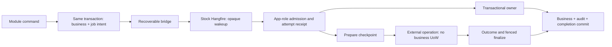

# ADR-0047: Transactional Background Job Runtime

## Status

Accepted — 2026-10-15.

**Date:** 2026-10-15 **Deciders:** @cemil

**Maintainer acceptance — 2026-10-15.** The maintainer approves H1 (stock Hangfire
plus an authoritative LearnStack job record), this detailed contract, its bounded
supersessions/additive seams and the expanded nine-step
[P02b-4 decision package](../roadmap/phase-02b-events-auth.md#p02b-4-decision-package-2026-10-15).
Acceptance and the dated disclosures are committed before runtime code, package
changes, migrations or grants. Implementation and production job proofs remain
pending; acceptance claims neither delivery nor enforcement.

## Decision Drivers

- Phase 04 already requires long ffmpeg work, dedicated worker capacity and tenant
  concurrency limits. A single transactional execution lane cannot supply it.
- Daily media scans and triggered Phase 02c phone-home need durable recurrence,
  tenantless enumeration and isolated per-tenant submission before notifications.
- Business state, submission, MUST audit and transactional completion must preserve
  the current announced UoW contract. A vendor commit is not a business commit.
- The four roles, explicit grants, RLS and bounded diagnostics remain boundaries.
  A vendor's schema/worker defaults do not silently override them.
- [Principles 9, 11 and 16](../standards/00-principles.md) favour mature scheduling,
  adapter isolation and foundational authority now. H1 keeps the provider stock
  while retaining business reliability in LearnStack. No measured total-cost
  comparison is claimed; two operational stores and a bridge are real costs.
- P02b-4 supplies the reusable mechanisms, with zero production business job or
  recurrence definitions. Media, licence and notification features keep their
  domain/provider definitions and acceptance evidence in their owning phases.

## Considered Options

1. **H1: stock Hangfire + authoritative LearnStack job record** (chosen). Mature
   timers and worker pools; transactional business intent,
   execution budgets and terminal audit remain LearnStack-owned. Durable handoff,
   reconciliation and narrow integration guards are necessary.
2. **H2: transaction-aware Hangfire storage** (not selected). Public subclass
   experiments prove native transaction primitives are feasible, not impossible.
   It would also make LearnStack own vendor state/SQL/lease upgrade qualification.
3. **First-party PostgreSQL runner** (not selected). Direct transaction integration
   is feasible, but the original bounded single-lane design misses the now-selected
   external, capacity and recurrence scope. LearnStack would own those schedulers.
4. **Unmodified Hangfire as sole business authority** (rejected). Stock enqueue
   and state changes do not adopt the current explicit application transaction or
   provide its live pair to the MUST audit writer. Filters are not a final fence.
5. **Quartz.NET persistent scheduler** (not selected, not disproved). Its documented
   transaction-joining path deserves independent qualification if revisited; the
   Hangfire experiments establish no incompatibility or cost comparison for it.
6. **In-memory/post-commit callbacks, or integration events used as jobs**
   (rejected). The former can lose intent; the latter confuses a due module command
   with subscriber acceptance of a published fact.

## Decision

LearnStack uses H1: `IBackgroundJobScheduler` writes durable module-owned
intent on the current announced transaction, and stock Hangfire transports only
opaque wakeups. The LearnStack row owns admission, six normal attempts, fenced
business completion and atomic terminal MUST audit. P02b-4 implements transactional
and external prepare/execute/finalize profiles, independent worker capacity,
tenant admission and durable recurrence/fan-out. Modules see typed contracts,
never vendor APIs. The accepted package governs implementation on `development`.

### Workload envelope and first-consumer obligations

[Job terms](../glossary.md#background-jobs) distinguish business identity,
wakeup generation, execution profile, reservations, quiescence and occurrences.
The expanded infrastructure ships in P02b-4; feature definitions remain below.

| Workload | P02b-4 mechanism | Feature owner |
|---|---|---|
| Short tenant mutation | One bounded request-owned transaction; business/outbox/jobs/audit/completion atomic | Owning module |
| Long external work | Durable prepare/execute-intent/outcome checkpoints, no open business UoW during external execution, fenced finalize/reconciliation | Phase 04 ffmpeg adapter, process/artifact supervision and media definitions |
| Dedicated capacity | Disjoint Hangfire queue/server pools with independent slot counts; durable tenant/resource reservations across organizations/instances | Phase 04 production capacity group and coordinated Hard LimitKey |
| Periodic tenant work | UTC interval/daily recurrence, logical-slot deduplication, CoalesceLatest misfires and deterministic recipient jitter | Phase 04 media scans; triggered Phase 02c phone-home; Phase 08a notifications |
| Tenantless trigger/fan-out | Restricted lifecycle inventory read, bounded pages/checkpoints and witness-bound tenant submission | Feature declares one finite recipient policy; no arbitrary tenant selector |
| Installation-level external refresh | Not ordinary tenant fan-out; requires its own tenantless external authority | Phase 11 licence/revocation operational surround |
| Reminder cancellation/replacement | Immutable jobs can no-op on obsolete domain revision; no generic Cancel/Reschedule API | Phase 08b occurrence/revision/dedup and cancel-versus-send semantics; Phase 08a provider dispatch |
| Audit DDL/retention | Privileged PlatformMaintenance remains refused by this ordinary runtime | Phase 11 under ADR-0028 |

Independent dispatch slots are not CPU/memory isolation. Phase 04 owns ffmpeg's
image/process/resource limits; a later separate worker host needs a named extension
of credential confinement. P4 uses the existing API host and adds no service.
Phone-home's initial online refresh remains triggered Phase 02c under ADR-0020;
its 24-hour cadence and integer 0–119-minute jitter remain unchanged.

### Typed definitions, submission and scope

- The SharedKernel port exposes immediate/delayed submission and a typed,
  application-minted UUIDv7 `BackgroundJobId`. A definition key is
  `{module}.{job_name}.v{positive_integer}`, lowercase ASCII, at most 150 characters.
  It binds owner module, identifier-only parameters, profile, queue/capability set,
  exact request types and any capacity group. No persisted CLR type lookup.
  BackgroundJobAttemptId, BackgroundJobOccurrenceId and BackgroundJobRecipientId
  are separate typed UUIDv7 identities, minted by IGuidFactory. Acquisition/bridge
  tokens remain fresh internal control tokens, not domain or vendor IDs.
  Queues match `[a-z][a-z0-9_]{0,49}`; capacity groups are finite module-owned
  `{module}.{resource}` keys, at most 150 characters. Manifest data binds each
  capability queue to exactly one pool, never a tenant-created queue or callback.
- Parameters live in module Application.Contracts; request/definition registration
  in Application; external provider adapters in Infrastructure behind typed ports.
  A module schedules its own definitions. Cross-module work uses the existing
  application-contract/event mechanisms, never a fifth scheduling mechanism.
- Trusted producer enrollment supplies operation/module identity. A module string,
  ambient ModuleName, caller tenant or parameter field grants no authority.
  Submission requires the current writable announced UoW generation and owner.
  Raw, stale, foreign, poisoned and read-only frames refuse.
- Scope is exactly `TenantWide` (organization NULL) or `Organization` (matching
  valid organization). An org-bound request cannot schedule TenantWide work;
  neither scope supplies all-organization access. Nested sends cannot retarget it.
- Stamp tenant/org, traceparent, nullable causal human and incoming event cause from
  trusted origin. Execution uses SystemActor; job identity and optional parent job
  remain distinct from EventId. Never copy a causal human's authority.
- Freeze JSON options; use the declared runtime parameter type and a 262,144-byte
  UTF-8 cap before INSERT. Identifier-only prepared plans/outcomes are bounded to
  65,536 bytes each; provider secrets, URLs, authored content and exceptions stay
  out. Recheck authority/generation after serialization/getters and before SQL.
  Pre-read requires canonical typed round-trip and immutable stored identity;
  unknown/extra authority fields cannot disappear through permissive deserialization.
- INSERT is immediate on that same transaction. Only successful INSERT records
  produced work in every ancestor; SQL faults poison and rethrow. Absorbed failures
  after scheduled work follow ADR-0057's sticky receipt semantics.
- Store immutable original UTC due time and current `available_after` at database
  microsecond precision. Database time governs admission; a vendor timer is a hint.
  A changed logical domain revision creates new work rather than mutating old inputs.

### Ordinary execution authority

`JobExecutor` is the sole job-path writer of `ITenantContextAccessor.Current`,
including its closed recurrence-recipient entry. It installs validated Ambient
context with no HostScope, effective SystemActor and separate causal metadata,
and restores accessor/Activity through actual cleanup. Empty/sentinel IDs,
unresolved contexts, malformed traces and scope mismatch refuse before handlers.

A sticky immutable execution admission, independent of later accessor changes,
positively enumerates framework requests and the definition's ordinary root/nested
requests. Missing metadata, Platform/privileged/provisioning requests and direct
privileged executors refuse before construction. PlatformAdminScope and bypass
credential resolution are separately refused from this admission; test with a
permissive platform gate, not only today's DenyAll gate. Current Authorization is
pass-through, so these guards ship now. Phase 03 intersects permissions with this
ceiling; SystemActor or causal metadata can never widen it.

Exact framework pre-read requests select physical ReadOnly through a closed mode
mapping and Audit Off registration. Framework admission/checkpoint/submission
commands use ordinary writable announced owners and Audit Off. This exposes no
caller-selected mode, public host ceiling or general completion callback. Business
prepare/finalize/root requests retain their own catalogue/audit classification.

### Storage, table classes and grants

The Platform chain owns the following new infrastructure, all in `public`.
Canonical DDL/grants belong only in Standards 05 at implementation; this inventory
fixes authority before that SQL is written.

| Table | Class and contents |
|---|---|
| `background_jobs` | Tenant-owned/org-scoped authoritative intent, immutable envelope/plan, phase/outcome checkpoints, attempts and routing/bridge/finalization state |
| `background_job_attempts` | Tenant-owned/org-scoped counted stage admissions and write-once ExecuteIntent/outcome/quiescence evidence; no overwritten attempt history |
| `background_job_capacity` | Tenant-owned, tenant-wide mutex per finite capacity group; no organization/business content |
| `background_job_reservations` | Tenant-owned, tenant-wide occupancy by job/attempt/group; unresolved external occupancy survives lease expiry |
| `background_job_recurrences` | Platform infrastructure control: finite code key/revision/hash, activation/next-slot and ownership; no parameters or fake tenant |
| `background_job_occurrences` | Platform infrastructure control: unique logical slot, frozen target/policy, upper bounds and page checkpoint |
| `background_job_recipients` | Tenant-owned/org-scoped immutable occurrence route, submission lease and accepted child-job receipt |

Tenant tables use canonical RLS, FORCE, restrictive org guards where applicable,
immutable facts and bounded fields. Capacity tables are deliberately tenant-wide
coordination metadata: they count the same resource across organizations and carry
no org content. Recurrence/occurrence control tables enable/FORCE RLS with no app
policy/privilege; their named confined bypass access is not tenant authority.

`background_jobs.recipient_id` is nullable for ordinary submission. Non-null
identity is unique and binds the same tenant via a composite FK plus exact org
mirror; one recipient cannot point into another tenant or make two child jobs.
Recipient uniqueness uses NULLS NOT DISTINCT on occurrence/tenant/org. Facts stay
immutable even for the owner. All eligibility indexes exclude completed/dead
rows and match actual normal/recovery/terminal/bridge predicates and order;
clock comparisons remain runtime SQL, not nonimmutable partial-index expressions.

| Role | New authoritative/control access | Refused |
|---|---|---|
| `learnstack_app` | RLS-scoped job/attempt/recipient reads and enumerated INSERT; exact admission/phase/evidence/finalize columns, including owner-bound failure-terminal completion; capacity mutex/reservation INSERT and bounded release UPDATE | Immutable fact rewrite, routing/bridge ownership or arbitrary terminal mutation, cross-scope rows or vendor/control tables |
| `learnstack_outbox_admin` | Enumerated routing/status reads; routing/bridge/renewal/recovery/terminal state UPDATE; recurrence/occurrence/recipient routing INSERT/checkpoint; minimal lifecycle inventory SELECT | Job parameters/plans/outcomes/causal reads, job INSERT, business prepare/final completion writes, tenancy writes, DDL |
| `learnstack_platform` | No new job, recurrence, reservation or vendor privileges | General operator bypass or maintenance authority through this packet |
| `learnstack_migration` | Owns schema/grants and pinned vendor bootstrap | API/worker runtime use |

App admission increments normal attempts only together with its durable start
receipt, after capacity succeeds. App INSERT cannot set attempts, leases or terminal
state. Phase/checkpoint grants are a deliberate expansion of the former
processed_at-only candidate, protected by immutable/transition guards and exact
caller censuses. The bypass role cannot create a successful business completion.
Actual denied-column/row tests pin the final enumerated SQL grant lists.

Attempt identities bind tenant/org/job/stage and ordinal 1–6, with unique
`(job_id, stage, ordinal)` and at most twelve counted rows per job. Summary count
and ledger INSERT commit atomically. ExecuteIntent, plan/outcome references and
quiescence evidence are write-once: no clearing/replacement or runtime DELETE.
Mutable lease/phase/probe diagnostics stay on the job row. This is not a claim
that the whole attempt row is insert-only; evidence arrives at later checkpoints.
All tenant/org FKs and mirrors are composite and independently tested.

#### Stock vendor control-plane inventory

Install provider schema version 23 from the pinned scripts as migration owner in
`public`. Preserve its twelve tables and nine sequences; this is an explicit
vendor-control class/convention exception, not a fork or a new database role.
The exception covers vendor SERIAL/BIGSERIAL, generated constraints and column
spellings. Vendor tables contain only opaque references, finite wrapper/recurrence
metadata and sanitized operational state; they are not tenant payload stores.

| Vendor objects | Confined runtime grants |
|---|---|
| `job`, `jobqueue`, `server`, `lock`, `set`, `hash`, `list`, `aggregatedcounter` | SELECT / INSERT / UPDATE / DELETE |
| `jobparameter` | SELECT / INSERT / UPDATE; deletion via job cascade |
| `state` | SELECT / INSERT; deletion via job cascade |
| `counter` | SELECT / INSERT / DELETE |
| `schema` | SELECT for exact-version verification only |
| `counter_id_seq`, `hash_id_seq`, `job_id_seq`, `state_id_seq`, `jobqueue_id_seq`, `list_id_seq`, `set_id_seq`, `jobparameter_id_seq`, `aggregatedcounter_id_seq` | USAGE only |

App, Platform and PUBLIC receive no vendor grants. No schema-wide ALL, membership,
ownership, CREATE or runtime schema preparation. Reuse the API-confined keyed lazy
OutboxDispatcher source through its physical-connection role/attribute/membership
guard and a named provider connection factory; do not pass a raw unguarded string.
Schema sweeps still enumerate every public table: require each exact class, reject
unclassified tables, and prove expected app SELECT denial (42501) for vendor/control
objects instead of silently omitting them. Tenant RLS checks remain unchanged.

Provider options explicitly set `SchemaName=public`, preparation/degraded startup/
ambient transaction enlistment false, native queue transactions true and sliding
invisibility true. Pin `EnableLongPolling=false`: the stock notification reconnect
path opens connections outside the named factory. Every enabled provider path
must keep the guarded physical source. Apply bounded server statement/lock timeouts
as well as connection/command/socket budgets; the pinned counter aggregator uses
an explicit unlimited driver command timeout. Real blocked vendor SQL and reconnect
controls prove these limits rather than relying on driver defaults.
Exact-version/guard/ACL failures refuse real runtime startup.
Vendor invisibility is operational only, never execution or quiescence authority.

### H1 handoff and generation fencing

Text fallback: commit business and intent together; bridge the committed intent to
Hangfire; admit the referenced generation under app-role authority; execute the
registered profile; only LearnStack completion proves business success.

- New intent starts at positive wake generation 1. Bridge token/lease are separate
  from routing/execution ownership. Lease a bounded obligation with SKIP LOCKED,
  commit, then call the vendor outside that transaction. Store its returned ID only
  under the same generation/bridge-token fence; the callback may run before ACK.
  A separate persisted handoff-check time starts immediately, including future-due
  jobs, so the bridge can use stock delayed scheduling. ACK moves that check to at
  least max(database-now, available_after) plus repair grace. New generations arm
  it again; bridge selection does not repeatedly scan every future-due job.
- Vendor wrappers accept only `(BackgroundJobId, wake_generation)` or a finite
  `(recurrence_key, revision)` tick. Close type resolution and exact target,
  MethodInfo/signature, arguments and queue admission before performer/activation.
  Static/inherited methods are not admitted just because the type token resolves.
  A native cancellation argument, if used, has only the pinned empty placeholder;
  the actual token is framework-injected, never a serialized authority object.
- A routing claim requires the referenced generation, due database time, Active
  definition, incomplete/nonterminal state and no live OR expired execution lease.
  It spends no attempt. Read/validate the envelope under app-role RLS; the exact
  admission command then commits a new attempt UUID/count and any reservation.
  Capacity refusal, duplicates, early callbacks, Pending/unknown keys and recovery
  spend no normal attempt or construct a business handler.
- Business retry/recovery atomically advances generation and availability, clearing
  stale bridge/vendor hints. Resends within one eligibility cycle keep the same
  generation: a late duplicate cannot become the next attempt, and reconciliation
  cannot continuously invalidate a congested current callback.
  Outcome → FinalizePending also advances the wake generation. That phase admits
  finalize-only wakeups, never another Execute. TerminalPending alone excludes
  business wakeups while awaiting bypass terminalization.
- Pending unleased work is reissued after bounded grace even if the vendor says
  Scheduled/Enqueued/Processing. Recorded vendor IDs are hints, not delivery proof.
  Unknown enqueue/ACK, missing/deleted/failed/succeeded wakeups and the vendor's
  create-before-initialize crash window all leave a recoverable obligation.
- Disable automatic wrapper retries (`Attempts=0`); crash requeue can still happen.
  Wrappers return only void/bounded transport outcomes. Vendor Succeeded means
  wakeup handled, never business success; vendor replay/delete cannot reset a job.
- Synchronous vendor client calls have bounded wait/SQL/socket budgets and retained
  task/scope ownership. Cancelling a wait does not cancel creation. A late create
  produces a harmless same-generation duplicate, not permission to dispose live work.

Active/Pending/explicit-retired readiness is finite code metadata. Valid unknown
keys defer with fixed deployment-mismatch diagnostics, not dead-letter. Retain
compatible definitions through backlog/rollback; retirement needs tombstones.
New incompatible definition sets use new finite capability queues that old
binaries do not subscribe to. Deferred admission remains a backstop. Liveness
requires a compatible worker, not blind terminalization by an older binary.

### Request owner and transactional profile

Framework admission commits its start receipt in a short separate transport
transaction before business work; a later handler rollback still spends that
normal attempt. Each business attempt uses one fresh registered root through
ISender and the existing TransactionExecutionCoordinator, preserving eight setter
sites and its two entry shapes. PreparedDeliveryOwner remains delivery-specific.

A closed job participant binds root, unit, announcement generation, immutable
facts, attempt/token and phase. Unlocked preflight verifies current facts/lease;
no job-row lock spans the handler. Final completion locks the row, then checks
current token and database time in a separate UPDATE. Expiry during a lock wait
cannot borrow an earlier check. Scheduler selection always uses SKIP LOCKED.

Order remains handler → successful-save promotion → owner domain drain → pending
MUST audit → job fence/checkpoint → commit admission → COMMIT. Transactional work,
produced outbox/jobs, audit and processed state commit together. Nested sends join
the same owner; no ninth setter, third generic owner or callback API is added.
The one-aggregate rule and ADR-0042's existing named exceptions still apply.

Acknowledged COMMIT stays successful through cleanup faults. Uncertain admission,
prepare, outcome, finalize or terminal COMMIT is reconciled by locking the actual
row before interpreting its durable receipt. A plain unlocked NULL is not proof
of rollback; lock/probe timeout preserves uncertainty and spends no new attempt.

### External profile and quiescence

An external definition binds exact prepare/finalize requests and typed prepared
plan/outcome contracts to one Infrastructure adapter's Execute/Reconcile methods.
The adapter receives immutable validated DTOs/identity/cancellation, not a UoW,
DbContext, ISender, service provider or arbitrary callback. Provider implementations
and ffmpeg supervision land in Phase 04; P4 tests use explicit fixture adapters
through the real production engine, without fake production definitions.

1. **Admission:** acquire capacity and commit the normal-attempt receipt before
   module Prepare. A failed prepare spends this already committed attempt.
2. **Prepare:** a fresh audited module request validates domain revision and commits
   business/outbox/jobs/audit plus an immutable plan/fingerprint checkpoint. A
   confirmed existing plan is reused; its inputs cannot change under the same job.
3. **Arm:** a short framework transaction durably records ExecuteIntent for that
   plan/attempt. Do not invoke the adapter until this commit is confirmed.
4. **Execute:** dispose the preparation owner first. Run outside every business UoW,
   renewing the token in separate short infrastructure transactions. Lease loss,
   deadline or shutdown closes the start/commit gates and requests cancellation.
5. **Outcome:** a fenced app-role framework transaction records a bounded typed
   outcome and positive quiescence evidence; only that evidence releases occupancy.
6. **Finalize:** a separate committed finalize-admission receipt counts the stage
   before its fresh audited module request. Known success or final failure applies
   the outcome/revision and commits business/outbox/jobs/audit plus completion
   through the job owner. A stale domain revision takes the definition's explicit
   no-op/cleanup outcome. Successful failure-handling returns Result.Ok: its typed
   outcome says failure; Result.Fail would roll back the intended business state.

The stable operation key derives from JobId and immutable plan identity. An
attempt UUID is a fence, not the sole provider idempotency key. A new external
attempt is allowed only after prior effect/quiescence is known and the adapter's
logical-operation deduplication contract permits it. Unknown acceptance cannot
be resolved by creating a new provider request ID. Provider effects are not
exactly-once because the database has a completion fence.

| Reconciliation result | Allowed action |
|---|---|
| Running | Keep reservation, request cancellation if due, schedule bounded probe |
| Succeeded(outcome, quiescence proof) | Checkpoint and finalize; never Execute again |
| Failed/Cancelled with known effect and quiescence | Release old occupancy; apply bounded retry/terminal policy |
| NeverStarted | Retry only after revoking old authority and proving no durable ExecuteIntent exists |
| Unknown, or provider NotFound after ExecuteIntent | Quarantine; keep occupancy; no Execute or assumed failure |

After ExecuteIntent, a paused old worker can still submit. Proof therefore requires
provider/supervisor fencing against late starts, or observation of actual local
task/callback and entire process-tree termination. Lease/heartbeat expiry, worker
disappearance and a database fence are not such proof. Recovery uses a fresh token
for probe/checkpoint/finalize only, never Execute or an extra normal attempt.

Six unsuccessful bounded recovery probes quarantine the unresolved operation;
Running probes are paced until its immutable deadline, then cancellation/grace
and quarantine apply if quiescence remains unproved. Quarantine is nonterminal,
retains reservations and makes health unhealthy. No automatic seventh start or
operator release is hidden here; Phase 03 owns audited operator reconciliation.
Known success or final failure enters FinalizePending, with at most six separately
committed finalize admissions and the same five backoffs. A permanent finalizer
refusal requests finalize_refused immediately; transient exhaustion requests
finalize_exhausted. Both retain the outcome and report business_finalization_incomplete;
they never rerun external work or claim the module's Failed state was written.

Confirmed permanent failure or normal-budget exhaustion becomes a final failure
only after every possible ExecuteIntent has positive known-effect/no-start/
quiescence evidence. If Prepare committed, FinalizePending must stay wakeup-eligible
until its failure finalizer commits. Its participant performs terminal UPDATE,
job-terminal MUST audit and business changes atomically on the app-role UoW.
If no Prepare checkpoint ever committed, locked uncertainty reconciliation can
route directly to bypass terminalization without constructing a module finalizer.
These are separate closed budgets; exhaustion never converts Unknown into Failed.

### Tenant capacity and independent pools

Definitions bind a finite capacity group, positive operational ceiling and optional
declared Hard LimitKey. External definitions require a group. A tenant-wide mutex
serializes admission across orgs/instances; count every unreleased reservation,
including unresolved old work. Resolve IFeatureFlags under the admitted tenant;
never query the entitlement cache directly.

- With a declared Hard key, effective ceiling is min(positive plan value,
  operational ceiling); -1 uses the operational ceiling and 0 defers admission.
  Undeclared/Soft/less-than-minus-one values or lookup faults refuse/defer safely.
- Without a plan key, the positive operational ceiling is a working default.
  P4 invents no Media key or Hub endpoint. Phase 04 coordinates its real key/default
  before its first production definition; NullEntitlementProvider stays unchanged.
- A downgrade prevents new admission at the source's stated consistency; it does
  not kill current work or promise globally linearizable entitlement generations.
- Reservation release requires confirmed completion/no-start/quiescence, not TTL.
  A lost worker may reduce availability by quarantining capacity; unrelated tenants
  and transactional pools remain serviceable.

Use disjoint transactional/external/control capability queues with separate stock
Hangfire server pools and worker counts. The control pool serves short ticks, not
external operations. Defaults reserve one transactional, two external and one
control slot per API instance. The finite registry supports dedicated feature
pools with disjoint queue sets; Phase 04 binds its media queue to reserved slots,
rather than sharing one occupied external slot with unrelated providers. Pool/queue
count and total worker bounds belong in the package.
This guarantees dispatch slots, not CPU/memory isolation. A separate orchestration
loop fairly rotates bridge/recovery/terminal/occurrence/recipient quanta; no
terminal-audit backlog or blocked vendor call may starve healthy work.

### Durable recurrence and recipient admission

A frozen code manifest binds recurrence key, monotonically activated revision,
target definition, UTC anchor/period, CoalesceLatest misfire policy, jitter and
one finite recipient policy. P4 implements intervals/daily slots, not arbitrary
calendar/cron policy or user-editable schedules. Hangfire recurring ticks are hints.

A recurrence target uses a fixed typed occurrence-ID parameter contract, with no
caller-supplied parameter factory or tenant selector. It is submitted only through
the restricted recipient path; ordinary callers cannot forge an occurrence input.
Registration checks tenant recipient policies against TenantWide targets and the
organization policy against Organization targets. Feature request construction
still occurs under the admitted route through the ordinary request boundary.

- Authoritative uniqueness is `(recurrence_key, scheduled_at)`, independent of
  revision, so a deployment cannot duplicate one logical slot. New revisions
  activate at an explicit nondecreasing boundary; existing occurrences keep their
  frozen target/policy. An older binary cannot overwrite the active revision or
  re-register its obsolete vendor tick over the new one.
- Materialize the latest due slot under a database-time fence. Persist deterministic
  recipient jitter once; retries never redraw it. Coalescing records skipped-slot
  count and avoids unbounded catch-up. No production recurrence is registered yet.
- The closed inventory reader has tenant `id`, `status`, `deleted_at`,
  `default_organization_id` and organization `tenant_id`, `id`, `status`,
  `deleted_at` SELECT grants through the
  confined source. Its projection is declared by Tenancy; it grants no names,
  branding/content, entitlements, credentials or tenancy writes.
- Policies are ProvisionedNonArchivedTenants (Trial/Active/Suspended, completed
  provisioning, not deleted/Archived), ServingTenants (Trial/Active) and
  ServingOrganizations (serving tenant plus Active, nondeleted organization).
  Phone-home may include Suspended; Active-only is not a universal policy.
- Claim an occurrence, freeze upper key bounds, seek at most 100 routes, INSERT
  immutable recipients and advance the checkpoint in that same short transaction.
  Yield after each page. Replays converge on NULLS NOT DISTINCT uniqueness; a crash
  cannot advance past a missing recipient.
- Eligibility is evaluated while sweeping and rechecked before submission. Routes
  added/made eligible during the sweep may wait for the next occurrence; this is
  not a historical MVCC cohort. Continuously eligible routes present at sweep start
  must be visited. Deleted/ineligible recipients finish as a bounded skipped route.

A restricted witness from the actual claimed recipient row binds occurrence,
manifest/target, tenant/org, token and database-time lease. JobExecutor's closed
recipient entry installs that route and sends one framework submission request
through ISender. The announcement must match exactly; registered manifest binding
supplies trusted producer module identity. Child INSERT, produced-work receipt and
recipient completion (accepted JobId) commit together under a single-use gate.
After acknowledgement loss, the stored child receipt wins over creating another ID.

No ScheduleForTenant API, arbitrary selector/delegate, sentinel announcement or
module-service construction exists in tenantless orchestration. Pending/unknown
manifests and recoverable control faults retain checkpoints with bounded backoff;
permanent invalid control facts quarantine with health failure. Do not terminally
abandon an uncreated child under the job terminal witness. Automatic control-plane
abandonment is not delivered; Phase 03 owns any audited operator recovery surface.

### Attempts, terminal audit and diagnostics

Normal execution has six committed admission receipts, including crash after
admission; five retries wait 1 s, 5 s, 30 s, 5 min and 1 h. Recovery, bridge, early/
duplicate wakeups, capacity refusal and deferred definitions spend none. Prepare
failure spends its admitted attempt. External finalization has the separate six
attempts above. No definition overrides these budgets in P4.

| Outcome, in precedence order | Disposition |
|---|---|
| Acknowledged COMMIT / uncertain COMMIT | Success despite cleanup / locked durable reconciliation before any retry |
| Shutdown / execution deadline | Leave/reconcile ownership; close gates and retain actual work, never fabricate permanent refusal |
| concurrency_conflict, rate_limited, dependency_unavailable, audit_unavailable; AggregateConcurrencyException, InfrastructureException, AuditWriteFailedException | Bounded retry; returned/thrown concurrency parity; fresh request/state |
| Validation/authentication/authorization/scope/not-found/business refusal, disabled feature, unsupported locale, unclassified audit; DomainException/TenantContextMissingException | Terminal request without broadening authority |
| Provider rate limiting/dependency fault translated to the standard transient code | Bounded retry before the blanket IsClientError rule |
| Other ProviderException IsClientError true / false | Terminal request / bounded retry |
| Unmapped Result or unexpected exception | Bounded unexpected_fault retry, never supplied text |

Classify the top-level code/type only. Unknown external effect takes the
quiescence/reconciliation path before this failure table. An expired sixth normal
attempt cannot start a seventh. Terminal request immediately excludes admission
and bridge scheduling; only quiescent/known outcomes may release reservations.

Tenancy owns `platform.job.dead_letter`, MUST / SecurityEvent / off-path. Add the
sixth narrow IAuditStore.WriteJobTerminalAsync method with a job witness minted
only from the actual fenced UPDATE RETURNING. Bind stored tenant/org/job/definition/
token/reason and live connection/transaction; substitutions refuse both state and
audit. Terminal UPDATE and MUST INSERT commit together; failed audit retains the
request, and uncertain COMMIT reconciles without another audit. Five existing
writes keep their contracts. This is not a generic control-plane audit writer.

Two exact minting/caller paths are permitted: the app-role failure-finalization
participant on its announced owner, and the bypass terminalizer for uninvokable
work or refused/exhausted finalization. The former additionally binds the stored
final outcome and root/generation; RLS strengthens but does not replace the witness.
Business MUST audit precedes its terminal fence/MUST row and the same commit gate.
If terminal audit fails, business finalization and terminal state both roll back.
Bypass terminalization of prepared work records business_finalization_incomplete,
retaining the plan/outcome for Phase 03 recovery. Terminal audit success means the
transition committed, not that the external effect or business finalizer succeeded.

Routine confined job/recurrence routing/status operations extend ADR-0046's
conditional exemption, with exact grants, caller censuses, bounded outcomes,
metrics/health and terminal MUST audit. Standards 18 Required Behaviours receives
that named extension on acceptance. It exempts no business mutation, platform-admin
entry or privileged maintenance; removing its controls invalidates the exemption.

Stock worker fallback can persist raw exceptions with filters disabled. Select a
migration-owned vendor-state guard below filters: replace all free-form reason/
exception fields with fixed redacted codes and enforce the pinned operational
field/key/size allowlist. Companion invocation/jobparameter/control-metadata guards
admit only the two wrappers and their opaque/finite values. These are narrow H1
integration triggers, not a provider fork; real pinned worker/filter-fallback and
direct-write dirty controls must prove compatibility and containment. Suppress raw
vendor log message factories/exception objects through a bounded ILogProvider
adapter. No tenant/trace/actor/parameter/secret is allowed in vendor storage/logs.

### Lifecycle and observation

Bound every SQL/probe/wait; retain scopes/tasks/cancellation callbacks and renewal
through actual completion. A wait deadline does not kill managed code or synchronous
vendor creation. Four retained overruns per pool are the stop-new-start threshold,
not permission to discard concurrent work already admitted. Atomic pool admission/
retention accounting bounds actual retained executions by configured workers plus
four, at most twenty per pool. Record an overrun before releasing its wrapper slot.
Retain/observe/renew all admitted work through real cleanup; affected job identities
remain blocked while other pools/tenants progress.
Synchronous bridge calls keep their separate hard limit of four. One shared finite
shutdown join budget covers all pools and bridge operations.

Renew using database time, matching token/phase and an unexpired lease; no expired
renewal resurrection or extension beyond the immutable attempt deadline. Ordinary
running work with valid renewal is healthy; stale control heartbeat, failed refresh,
retained cleanup, unknown deployment or quarantine is unhealthy. Snapshots are
immutable memory reads in gauge callbacks; refresh failure retains prior values.
Register `jobs` health without mapping it; Phase 11 owns readyz/production alerts.

Standards 10 owns the exact instrument inventory at implementation. Job/profile/
capacity/recurrence labels come only from finite registries and fixed unknown/
retired/invalid categories. No tenant/org/job/occurrence/trace labels or SQL in
callbacks; confirmed failure and unknown outcome remain distinct signals.

### Dependency and demand-gate position

Use Hangfire Core/NetCore 1.8.25, Hangfire.PostgreSql 1.21.1 and explicit
Newtonsoft.Json 13.0.4 with existing Npgsql 10.0.0 / Hosting 10.0.12 / MediatR 12.4.1.
Use NetCore directly, not the umbrella SQL Server package; no Pro/Ace/dashboard.
The .NET 10 graph and real worker/storage paths must qualify together. Runtime
migrations, missing-store degraded mode and unrestricted serializers are disabled.

The official packages and provider carry their separate LGPL obligations. Use
unmodified shared assemblies, include applicable licence/notice/corresponding-source
material and preserve replacement/relinking rights in distribution packaging;
commercial Hangfire rights do not cover the community provider automatically.
The implementation verifies the concrete graph/notices/packaging, not an imagined
customer or a claim that all application source must be published.

This is a selected working runtime outside ADR-0035's gated set, not a waiting
adapter or a new demand-gated exception. Its tenant/authority contracts ship now;
future replacement needs explicit backlog/identity/audit compatibility and vendor
qualification. Feature-specific provider definitions still arrive with real demand.

### Bounded supersessions and additive seams

This new ADR holds normative bounded changes. Dated Amendments in affected Accepted
records disclose/link them without editing prior Decisions/acceptance metadata.
Disclosure is navigation content, not a new governance instrument; none of these
changes is an ADR-0041 fact correction or whole-record retirement.

| Existing authority | Selected H1 addition/replacement | Preserved |
|---|---|---|
| ADR-0003 four-role/grant confinement; Standards 05 table classes/naming/tenant enumeration | Enumerated vendor-control exception, routing/control grants, app admission/checkpoint/reservation grants and minimal lifecycle inventory reader | Four roles, public schema, canonical tenant/org RLS, no runtime DDL/business bypass |
| Standards 01 Tenant-Scoped Code / 17 payload blocker and self-review | Tenant/org belong in the authoritative LearnStack job envelope; opaque vendor wakeups and tenantless ticks carry no tenant payload | Validated context before business work; no tenant authority from a caller or vendor message |
| ADR-0036 Rules/Amendment 2 job JobActivator | JobExecutor, including restricted recipient submission, is sole job context writer | HTTP factory/host provenance, event writers and context restoration |
| ADR-0032 job restoration/correlation | Trusted job/recipient origins and bounded async diagnostics | Pipeline order and W3C trace contract |
| ADR-0040 request owner; Amendment 8 / ADR-0052 read mode | Closed stage/recipient participants and sticky admission; exact framework read-only requests | Eight setters, two entry shapes, public host ceiling, nesting/aggregate rule |
| ADR-0057 produced-work/enrollment | Job INSERT receipts and restricted recurrence-recipient producer origin | Outbox/save receipts, ordinary work-free refusals and owner domain drain |
| ADR-0033 three writes; ADR-0044 fourth/capture exclusions; ADR-0046 / ADR-0044 Amendment 10 fifth | Job-specific sixth write and named job/control capture exclusions; atomic state/audit witness | Existing five writes, MUST durability and standalone restrictions |
| ADR-0046 routine dispatcher exception / Standards 18 Required Behaviours | Confined job/recurrence control exception with added exact caller condition | No general background/privileged audit exemption |
| ADR-0015 dashboard CI bullet | No P4 route; Phase 03 chooses approved operator recovery permission/surface | Platform protection and Phase 11 edge surround |
| ADR-0020 phone-home/revocation identity and direct activation | Typed recurrence/child identities and trusted recipient activation | Hangfire choice, 24h/jitter and licence phase/trigger owners |
| ADR-0028 future audit Hangfire registration | Route through typed runtime boundary when its privileged executor is accepted | Hangfire choice, algorithm/cadence/retention and Phase 11 ownership |
| ADR-0023 identifier inventory | Typed job/attempt/occurrence/recipient IDs, separate from acquisition/vendor identities | UUIDv7/Vogen/serialization conventions |
| Standards 09/20 job retries, names, schema and context | H1 profiles, budgets, queues and public vendor-control storage | Provider isolation and event delivery policy |
| Standards 05 Data Migrations | Deploy-time backfills remain migration-owned; they cannot run through ordinary API jobs with migration credentials | Existing migration safety and deployment ownership |

ADR-0003's Amendment concerns changed confinement/grants/table class, not merely a
new tenant table. ADR-0036's Amendment discloses an actual writer decision change,
not an erratum. ADR-0010's Architecture Tests Hangfire-payload bullet and ADR-0017's
[Defense-in-depth Jobs row](0017-tenant-organization-hierarchy.md#defense-in-depth-extending-adr-0003)
receive dated navigation; the four cross-module mechanisms do not change.
Hub-owned DNS/TLS jobs in ADR-0022/architecture 27 remain outside this runtime.

## Context

At baseline 71568e78 no job port/runtime/schema exists. Producer enrollment,
request-owned transaction completion, physical read-only public frames and durable
delivery already exist; job stage/recipient participants and ordinary-job ceilings
do not. PreparedDeliveryOwner is a delivery entry token, separate from its
completion participant/gate, and must not become a generalized callback.

The earlier PostgreSQL proposal and H1/H2 comparison exposed real first-consumer
gaps. The maintainer then selected H1 and expanded infrastructure rather than
leaving long operations/recurrence foundations to the first feature. Phase 04 still
owns ffmpeg and its process contract; P4 supplies the durable orchestration that
can enforce it. No total maintenance-cost winner was measured.

### Hangfire alternative assessment (2026-10-15)

Pinned source shows stock enqueue/state writes own their transactions; native queue
transactions and System.Transactions enlistment do not adopt ADR-0040's current
explicit DbTransaction. Core creates the vendor row before its state/queue commit,
so row-created/uninitialized and queued/unacknowledged windows both need repair.
Worker fallback may disable filters, and ordinary automatic retries count failures,
not LearnStack crash/admission attempts. H1 therefore retains business authority,
adds generation-fenced repair and chooses below-filter diagnostics guards.

The prior exact-version invocation probe rejects unknown/spoofed types without
assembly loads, but accepts sampled static/inherited methods under type-only
resolution. Exact method/shape admission remains necessary. Public custom storage
spikes prove H2 primitives feasible, not its complete security/worker integration.
H2 is not selected; no public-seam impossibility claim is used to justify H1.

#### Dependency, licence and compatibility evidence

Inspected source commits are 1d4778c23410b365b5f9ce35458202efe0b0f3ea (Core) and
e0a4001c6627695d61a0eea19d4403882e4cea34 (provider). An isolated net10.0 restore/
build/basic DI load with Npgsql 10.0.0/Hosting 10.0.12 succeeds. Default Newtonsoft
11.0.1 emitted NU1903; explicit 13.0.4 built/loaded without warnings. No package
was added to LearnStack by that experiment. Core tests inspected stop at net8;
provider tests at net9/Npgsql 6.0.11. Computed compatibility is not certification.

The official and community package licences are separate; no Pro/Ace dependency
or commercial redistribution right is inferred. The implementation graph/notice/
shared-assembly distribution checks remain obligations, not completed evidence.

#### Isolated feasibility results and limits

Temporary experiments used exact Core 1.8.25 / PostgreSql 1.21.1 / Npgsql 10.0.0
and a fresh PostgreSQL 18.4 container on a random loopback port. They used no
existing database, service or credential, and changed no repository runtime file.
The database spike used SDK 10.0.302 outside the repository, not its pinned
10.0.112 SDK. Its eighteen focused cases passed and its owned container was
removed. This is isolated feasibility evidence, not the repository test suite.

| Experiment | Observed result | What it does not prove |
|---|---|---|
| Borrow explicit native transaction; native option × enlist option × create/write/real enqueue | All 12 combinations reject nested/concurrent transaction adoption | No claim that public customization is impossible |
| Stock real enqueue owning its transaction | Commits successfully | Coupling to LearnStack's existing UoW |
| Stock outer TransactionScope with no existing local transaction | Enqueue rolls back with that scope | An approved replacement for ADR-0040's explicit transaction model |
| Public custom storage/connection/write subclasses; real client enqueue | External owner rollback/commit governs the inserted job | Full delayed/recurring/worker/state command coverage |
| Custom terminal UPDATE RETURNING plus stand-in audit INSERT | Same txid; audit fault/owner rollback undoes both; commit retains both | Real IAuditStore, row witness, tenant RLS, role grants or stale-epoch protection |
| Closed type resolver and malicious invocation probes with Newtonsoft 13.0.4 | Unknown/spoofed types and sampled hostile JSON refused without assembly loads | Exhaustive hostile-input proof |
| Static string method and inherited wrapper method | Type resolution accepts them | Exact method admission; a resolver/JobActivator-only fence is insufficient |

The database experiment implements a deliberately small immediate-enqueue command
subset. It is not a reusable production provider and must not be copied into the
application as if unimplemented operations were safe. Full Hangfire selection
requires worker-level success/failure/crash/expiry/filter-fallback/uncertain-COMMIT,
two-worker, isolation, cancellation and diagnostic proofs using LearnStack's real
audit store. The expanded H1 implementation plan supplies these obligations before
closeout.

#### Decision comparison

| Route | Outcome of selection | Remaining cost |
|---|---|---|
| H1 | Accepted: mature stock timers/pools, LearnStack business authority | Two operational stores, bridge/repair, integration guards and business lifecycle |
| H2 | Feasible primitives, not selected | Customized vendor storage/state/fences and upgrade qualification |
| First-party PostgreSQL | Initial small runner not selected for expanded scope | Entire scheduling/worker/recurrence runtime plus business lifecycle |
| Quartz.NET | Not independently qualified or selected | Exact-version authority/audit/storage/lifecycle assessment if revisited |

## Consequences

### Positive

- Scheduling intent and business state commit together; vendor loss is repairable.
- Short database work and long external effects have distinct honest guarantees.
- Dedicated slots and tenant reservations prevent one external lane monopolizing
  transactional execution; unresolved effects cannot silently overbook capacity.
- First features inherit recurrence and trusted fan-out instead of inventing them.

### Negative

- H1 retains substantial LearnStack reliability code and two operational stores.
- Fail-closed quiescence can quarantine capacity until positive reconciliation or
  later audited operator action; safety does not imply unconditional availability.
- Vendor DDL/diagnostic guards need pinned upgrade tests despite stock packages.
- A database fence cannot recall external effects or forcibly kill managed work.

### Neutral

- No production business/recurrence definition, dashboard, Hub endpoint or separate
  worker deployment is introduced. No readyz/production p95 claim is made.
- Reminder replacement remains domain-owned; privileged maintenance remains Phase 11.

## Implementation Notes

The [decision package](../roadmap/phase-02b-events-auth.md#p02b-4-decision-package-2026-10-15)
owns nine implementation steps, option bounds, validation and carrier ownership.
Acceptance/dated Amendments are committed before runtime. Canonical SQL/grants,
metrics and catalogue rows land with implementation, not fictional passing status.

Use LearnStack.Infrastructure.Jobs for the adapter/stores/executor and API-only
composition for stock servers/control workers. Modules depend on typed contracts;
no provider package, bypass source or job table mapping enters Application/Domain.
Transport control writes are named infrastructure exceptions, not permission for
multiple business aggregates. No event witness can mint a job/recipient witness.

## Architecture Tests

Register these canonical obligations on acceptance, with named structural and/or
behavioural owners, nonempty runtime subjects and planted dirty/clean controls:

- BackgroundJob_Submission_Is_Transactional_And_Stamped
- BackgroundJob_Definitions_Stay_In_Their_Owning_Module
- BackgroundJob_Execution_Restores_Tenant_And_Trace
- BackgroundJob_Completion_Is_Owner_Atomic_And_Fenced
- BackgroundJob_Terminal_Audit_Is_Row_Bound
- BackgroundJob_Retries_And_Terminal_Faults_Preserve_Progress
- BackgroundJob_Storage_And_Credentials_Are_Confined
- BackgroundJob_Runtime_Has_No_Production_Definitions_Or_Dashboard
- Hangfire_Wakeups_Are_Recoverable_And_Generation_Fenced
- Hangfire_Invocations_And_Diagnostics_Are_Closed
- Hangfire_Bootstrap_Uses_Pinned_Schema_And_Confined_Role
- BackgroundJob_Capacity_Is_Tenant_Wide_And_Quiescence_Bound
- BackgroundJob_External_Work_Has_No_Business_Transaction
- BackgroundJob_External_Recovery_Never_Assumes_Quiescence
- BackgroundJob_Finalization_Retries_Are_Bounded
- BackgroundJob_Recurrence_Is_Durable_And_Deduplicated
- BackgroundJob_Fanout_Uses_Recipient_Bound_Tenant_Admission
- BackgroundJob_Ordinary_Execution_Has_No_Platform_Authority
- BackgroundJob_Worker_Pools_Reserve_Independent_Capacity

The submission rule replaces Hangfire_Job_Payloads_Include_TenantId; restoration/
owner rules replace LearnStackJob_RunAsync_SetsTenantBeforeExecute. Preserve the
canonical LearnStack_OutboxAdmin_Role_OnlyUsedBy_OutboxProcessor key, but explicitly
reframe its assertion/censuses for the enumerated H1 consumers and lifecycle reader.
Organizations_Are_Read_By_Composite_Key receives only that named enumeration
exception; ordinary point lookups remain composite. Whole-schema sweeps classify
every table rather than excluding the vendor names from discovery.

Prove actual pinned workers/PostgreSQL, not only direct wrapper calls: enqueue
failure windows, duplicate/stale generations, queue/pool isolation, mode/role boot,
all checkpoints/unknown COMMIT, stale fences/lock waits, tenant/org limits,
NotFound-after-intent, live-overrun reservations, repeated terminal-audit faults,
logical-slot/mixed-revision/tick dedup and recipient/child atomicity. Production
business manifests remain exactly empty while fixture definitions exercise every
profile through the real runtime. No fake production subject satisfies a census.

Failure-finalize proofs commit domain Failed state plus business/terminal MUST
audit and job terminal state together; audit failure rolls all back. Lost ACK cannot
repeat a committed finalizer. FinalizePending remains eligible without Execute;
refusal/exhaustion reports unapplied business finalization. Old ExecuteIntent/
quiescence evidence survives later attempts; neither stage can take a seventh
admission, and Unknown occupancy stays held despite budget exhaustion.

## Amendments

### Amendment 1 — maintenance replacement and additive ownership seams (2026-10-16)

Accepted [ADR-0058](0058-bounded-stock-hangfire-maintenance.md) replaces only the
H1 maintenance configuration: the exact pinned `CountersAggregator` is suppressed
through the public component hook and only `StatisticsHistoryAttribute` is
removed through its public exact-type filter API before workers start. Stock
expiration, heartbeat, state-counter handlers, admission/retry filters, assemblies
and SQL remain. This is a new configuration decision, not an ADR-0041 correction
of the original record. No enabled command receives an unlimited-driver or socket
exception.

The additive seams are exact fail-closed component/filter inventories and one
API-instance expiration owner shared across pools. The provider's internal
expiration interval is exactly one millisecond; the owner supplies the normal
one-hour cadence after actual completion and cancelable pacing/backoff. One owned
background thread retains actual work, cancellation state and resources through
late completion. Its positive finite wait is at most five minutes (the default),
with at most one second of cleanup waiting. It adds no business worker slot or
reservation and is accounted separately from the existing workers-plus-four and
bridge-four limits. Retained maintenance makes the unmapped `jobs` check unhealthy
with a separate fixed maintenance dimension and bounded progress/outcome code.
Host stop uses the existing one shared shutdown budget without disposing resources
still in use or admitting fresh acquisitions.

The confined shared source adds reset-safe
`idle_in_transaction_session_timeout=5000` alongside the existing finite
statement/lock and driver connect/command/cancellation bounds. Warm reset,
successful outbox/delivery transactions and real aborted-idle cleanup require
proof. No shared `transaction_timeout` is introduced. Per-statement, per-lock and
idle-session deadlines neither bound a whole maintenance pass nor guarantee
client-socket termination. The withdrawn minimum-two/nonpooled proposal supplies
no pool rule: Step 4 enumerates all simultaneous physical-acquisition lanes,
enforces the qualified supported configuration/floor before workers start, and
proves other pools progress there under contention.

Standards 05/20 and the Events and Outbox architecture carry this maintenance
policy. Standards 21 extends the existing
`Hangfire_Bootstrap_Uses_Pinned_Schema_And_Confined_Role` and
`BackgroundJob_Worker_Pools_Reserve_Independent_Capacity` assertions; both remain
Registered. Step 2 owns source/reset and schema qualification, Step 4 owns actual
component/filter/owner/pool-boundary proofs, and Step 9 owns full observation,
enforcement and regression. Acceptance precedes dependent implementation and
claims no completed runtime proof. Business authority, roles, grants, schema,
attempts and existing execution/bridge ownership bounds remain unchanged.

## References

- [ADR-0003 Tenant Isolation](0003-tenant-isolation-defense-in-depth.md)
- [ADR-0010 Cross-Module Communication](0010-cross-module-communication.md)
- [ADR-0015 Gateway Boundary](0015-api-gateway-apisix.md)
- [ADR-0017 Tenant / Organization Hierarchy](0017-tenant-organization-hierarchy.md)
- [ADR-0020 Deployment / Licence Model](0020-triple-deployment-hybrid-license.md)
- [ADR-0022 Hub-Owned Custom Domains](0022-custom-domain-tls.md)
- [ADR-0023 Strongly-Typed Identifiers](0023-strongly-typed-id-source-generator.md)
- [ADR-0028 Audit Partition Management](0028-audit-log-partition-management.md)
- [ADR-0033 Audit Durability](0033-audit-durability-model.md)
- [ADR-0032 Cross-Cutting Foundation](0032-exception-handling-logging-and-observability.md)
- [ADR-0035 Demand-Gated Infrastructure](0035-demand-gated-infrastructure.md)
- [ADR-0036 Tenant Resolution](0036-tenant-resolution-trusted-inputs.md)
- [ADR-0038 Port/Event Contracts](0038-cross-cutting-port-and-event-contracts.md)
- [ADR-0040 Ambient Unit of Work](0040-ambient-unit-of-work.md)
- [ADR-0044 Audit Write Path](0044-audit-write-path.md)
- [ADR-0042 Provisioning Exception](0042-tenant-provisioning-cross-aggregate-transaction.md)
- [ADR-0046 Durable Delivery](0046-durable-event-delivery-and-recovery.md)
- [ADR-0052 Public Read Boundary](0052-anonymous-public-read-boundary.md)
- [ADR-0057 Transactional Production](0057-transactional-event-production-and-completion.md)
- [Hangfire.NetCore 1.8.25 package](https://www.nuget.org/packages/Hangfire.NetCore/1.8.25)
- [Hangfire.PostgreSql 1.21.1 package](https://www.nuget.org/packages/Hangfire.PostgreSql/1.21.1)
- [Pinned provider transaction implementation](https://github.com/hangfire-postgres/Hangfire.PostgreSql/blob/1.21.1/src/Hangfire.PostgreSql/PostgreSqlWriteOnlyTransaction.cs)
- [Hangfire write-transaction interface](https://github.com/HangfireIO/Hangfire/blob/v1.8.25/src/Hangfire.Core/Storage/IWriteOnlyTransaction.cs)
- [Npgsql 10.0.0 licence](https://github.com/npgsql/npgsql/blob/v10.0.0/LICENSE)
- [Hangfire features and storage support](https://www.hangfire.io/overview.html)
- [Hangfire package licence scope](https://www.hangfire.io/licenses.html)
- [Provider licence](https://github.com/hangfire-postgres/Hangfire.PostgreSql/blob/e0a4001c6627695d61a0eea19d4403882e4cea34/LICENSE.md)
- [LGPL combined-work conditions](https://github.com/HangfireIO/Hangfire/blob/1d4778c23410b365b5f9ce35458202efe0b0f3ea/COPYING.LESSER)
- [Pinned provider options](https://github.com/hangfire-postgres/Hangfire.PostgreSql/blob/e0a4001c6627695d61a0eea19d4403882e4cea34/src/Hangfire.PostgreSql/PostgreSqlStorageOptions.cs)
- [Pinned provider queue](https://github.com/hangfire-postgres/Hangfire.PostgreSql/blob/e0a4001c6627695d61a0eea19d4403882e4cea34/src/Hangfire.PostgreSql/PostgreSqlJobQueue.cs)
- [Pinned provider schema scripts](https://github.com/hangfire-postgres/Hangfire.PostgreSql/tree/e0a4001c6627695d61a0eea19d4403882e4cea34/src/Hangfire.PostgreSql/Scripts)
- [Pinned Core job factory](https://github.com/HangfireIO/Hangfire/blob/1d4778c23410b365b5f9ce35458202efe0b0f3ea/src/Hangfire.Core/Client/CoreBackgroundJobFactory.cs)
- [Pinned worker state fallback](https://github.com/HangfireIO/Hangfire/blob/1d4778c23410b365b5f9ce35458202efe0b0f3ea/src/Hangfire.Core/Server/Worker.cs)
- [Pinned state changer](https://github.com/HangfireIO/Hangfire/blob/1d4778c23410b365b5f9ce35458202efe0b0f3ea/src/Hangfire.Core/States/BackgroundJobStateChanger.cs)
- [Pinned configuration hooks](https://github.com/HangfireIO/Hangfire/blob/1d4778c23410b365b5f9ce35458202efe0b0f3ea/src/Hangfire.Core/GlobalConfigurationExtensions.cs)
- [Pinned invocation loader](https://github.com/HangfireIO/Hangfire/blob/1d4778c23410b365b5f9ce35458202efe0b0f3ea/src/Hangfire.Core/Storage/InvocationData.cs)
- [Newtonsoft.Json 13.0.4](https://www.nuget.org/packages/Newtonsoft.Json/13.0.4)
- [Newtonsoft security advisory](https://github.com/advisories/GHSA-5crp-9r3c-p9vr)
- [Database Standards](../standards/05-database.md)
- [Architecture Standards — Tenant-Scoped Code](../standards/01-architecture-standards.md#tenant-scoped-code)
- [Code Review Standards](../standards/17-code-review.md)
- [Error Handling Standards](../standards/09-error-handling.md)
- [Audit Coverage Standards — Required Behaviours](../standards/18-audit-coverage.md#required-behaviours)
- [Infrastructure Standards](../standards/20-infrastructure-stack.md)
- [Architecture Test Catalogue](../standards/21-architecture-tests-catalogue.md)
- [Media Pipeline](../architecture/16-media-pipeline.md)
- [Quartz.NET persistent job stores](https://www.quartz-scheduler.net/documentation/quartz-3.x/tutorial/job-stores.html)
- [Quartz.NET execution/cancellation FAQ](https://www.quartz-scheduler.net/documentation/faq.html)
