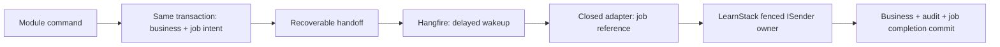

# ADR-0047: Transactional Background Job Runtime

## Status

Proposed — approval pending.

**Draft date:** 2026-10-15

**Review update — 2026-10-15.** The maintainer requested a deeper Hangfire
comparison before choosing a runtime. The [expanded assessment](#hangfire-alternative-assessment-2026-10-15)
includes isolated database experiments. The PostgreSQL design below is the initial
proposal, not an accepted selection; Hangfire remains a viable customized option.

**Workload review — 2026-10-15.** The initial single-lane transactional proposal
does not implement Phase 04's long-running media workers, isolated queue capacity
or tenant concurrency limits. The [workload envelope](#workload-envelope-and-first-consumer-obligations)
now separates those requirements from short transactional jobs. Runtime selection
and the final implementation plan remain open; the earlier comparison reviews did
not establish readiness for these additional requirements.

This record closes no gate until the maintainer accepts it together with the
[P02b-4 decision package](../roadmap/phase-02b-events-auth.md#p02b-4-decision-package-2026-10-15).
No job runtime, migration, grant or passing runtime proof is claimed by this draft.

## Decision Drivers

- The [background-job scope](../roadmap/phase-02b-events-auth.md#background-jobs)
  requires a working runner, safe submission, restored tenant authority and terminal
  audit, while deliberately supplying no business job or dashboard.
- The existing four-role model, single `public` schema and MUST audit durability
  are correctness contracts. A vendor's default schema, unrestricted grants or a
  separately committed audit cannot silently replace them.
- P02b-1 supplies announced producer frames; P02b-3 supplies fenced completion,
  cancellation arbitration and bounded task ownership. Jobs must preserve those
  guarantees without becoming integration events or a fifth cross-module mechanism.
- The current job carriers disagree on the context writer and describe a handler
  directly enqueueing outside its transaction. Both decisions precede any caller.
- [Principles 9, 11 and 16](../standards/00-principles.md) favour mature defaults,
  reversible adapters and explicit first-consumer ownership. Principle 9 names
  Hangfire; a first-party runner would be an exception needing a workload-based
  justification, not a presumption that customization costs more. Principle 12
  separately governs readability for every option. Neither integration cost nor
  total maintenance cost has been measured for these candidates.

## Considered Options

1. **Bounded PostgreSQL default behind a scheduling port** — initial proposal. One
   authoritative job row uses the already pinned database/provider, existing owner
   lifecycle and familiar fenced transitions. LearnStack maintains this mechanism.
2. **Unmodified Hangfire 1.8.25 with Hangfire.PostgreSql 1.21.1 alone** — insufficient
   for the current transaction/audit contract.
   Its provider owns a separate transaction path; its public write interface does
   not expose the live connection/transaction required by `IAuditStore`. A normal
   state filter cannot supply the required same-transaction terminal audit.
   Public storage customization can supply those primitives; a fork is not
   inherently required. The expanded assessment distinguishes the working
   experiment from the production storage/lifecycle work still required.
3. **Stock Hangfire plus an authoritative LearnStack job record** — viable
   alternative. Hangfire owns wakeup scheduling; LearnStack owns business execution,
   attempts, completion and terminal audit. Reliable handoff and reconciliation
   are extra work. There are two operational stores, but only one authoritative
   business job state; describing both as business-authoritative ledgers was too broad.
4. **Hangfire with a transaction-aware storage adapter (H2)** — viable alternative
   requiring further production proof. Public subclass seams allow custom native
   transaction commands without reflection or a Core fork. LearnStack would own
   the customized SQL/state/lease integration and its upgrades. This is materially
   more than adding an audit filter to the unmodified provider.
5. **Quartz.NET with persistent storage** — a scheduling-focused candidate, not
   rejected on capability grounds. Its official documentation covers persistent
   triggers and joining an existing transaction. Exact-version submission,
   completion/audit, privileges and lifecycle integration have not been qualified
   here; those are required before selecting it. No assertion of incompatibility
   or relative cost follows from the Hangfire experiments.
6. **In-memory scheduling or a post-commit callback** — rejected. A process crash
   can lose work; the current UoW deliberately exposes no post-commit hook.
7. **Reuse integration-event deliveries as jobs** — rejected. Scheduled commands
   have one module owner and a due time, rather than a published fact and subscriber
   acceptance. Sharing lifecycle utilities does not make their identities equivalent.

## Decision

No runtime is selected. This Proposed record compares PostgreSQL, Hangfire H1/H2
and an unqualified Quartz.NET candidate. The common proposed boundary is typed,
module-owned submission atomic with the requesting business transaction; restored
tenant authority; fenced transactional completion; and terminal state atomic with
its MUST audit. Modules see contracts, never vendor APIs. Maintainer selection,
route-specific design and explicit acceptance precede implementation.

### Workload envelope and first-consumer obligations

[Background jobs and their identities/scopes](../glossary.md#background-jobs-proposed)
have the following distinct workloads. A queue name is not reserved capacity.
The bounds below apply to the initial **transactional** candidate only; they are
not a claim that ffmpeg or network work fits a five-minute database transaction.

| Workload | Required boundary | Owner before first use |
|---|---|---|
| Short tenant state change | One bounded request-owned transaction; business/outbox/audit/completion atomic; no long external work inside it | P02b-4 |
| Transcode or other long external effect | Short prepare transaction, external execution with no open business UoW, short fenced finalize transaction; stable operation/attempt identity, reconciliation and stale-result rejection | Phase 04, before its first media worker; its scope already requires a dedicated queue and tenant LimitKey concurrency |
| Periodic tenant work | Durable occurrence identity, UTC cadence/jitter/misfire policy and duplicate-tick suppression; each tenant operation gets its own announced producer frame | Earliest of Phase 04, triggered Phase 02c or Phase 08a, before its first periodic definition |
| Tenantless trigger/enumeration/fan-out | Separate bounded authority to enumerate eligible tenants, checkpoint/retry pages and submit isolated tenant intents; no sentinel tenant and no implicit platform business authority | Same first periodic consumer; Phase 04's nightly media scans can arrive before Hub or notifications |
| Installation-level revocation refresh | Tenantless external refresh with bounded network/secret access; no fake tenant announcement | Phase 11's licence operational surround, coordinated with Hub key/revocation publication |
| Reminder cancellation/reschedule | Domain-owned logical occurrence and revision; stale/cancelled intent is a successful no-op before side effects; new revision schedules new work atomically | Phase 08b, using Phase 08a notification infrastructure |
| Audit partition/retention maintenance | Privileged tenantless executor with named DDL/purge authority and MUST audit | Phase 11 under ADR-0028; distinct from ordinary tenant fan-out |

Phase 04's [media pipeline](../roadmap/phase-04-cms-media-pages.md#media-library-and-the-transcoding-pipeline)
and [media lifecycle](../architecture/16-media-pipeline.md) are
concrete consumers. The long-operation contract must define isolated worker
capacity, cross-instance tenant admission, lease renewal/loss, ffmpeg process
ownership/cancellation and external artifact reconciliation. These are unmet by
the single-lane candidate. Hangfire worker pools are relevant here, but they do not
by themselves provide tenant limit enforcement or external-effect idempotency.

P02b-4 currently proposes only short transactional execution and immediate/delayed
submission. Long external execution, recurrence/fan-out and domain schedule
mutation are additive feature contracts owned above, not delivered infrastructure.
No generic `Cancel`/`Reschedule` API or generic natural-key uniqueness is claimed:
`BackgroundJobId` identifies a submission, not a session/reminder occurrence.
Phase 08b must choose the occurrence/revision key, deduplication storage and
cancel-versus-send race policy before its writers. Cancellation of already-started
external effects is cooperative and cannot promise recall of a delivered notice.

The maintainer must choose whether to retain this bounded P02b-4 scope with those
explicit first-consumer gates, or expand P02b-4 to implement the long-operation and
trigger contracts now. An expanded scope needs revised steps and proof bounds
before approval. No runtime option is presented as already satisfying that wider
scope, and a Phase 04 exit cannot treat a queue label as its worker isolation proof.

ADR-0020's Implementation notes already assigns phone-home refresh to triggered
Phase 02c. Its phase document omitted that deliverable; the accompanying plan
correction restores it. This is separate from Phase 11's signed-key hardening and
revocation-list operations, and from Hub-owned publication. Phone-home is not an
existing Phase 02c integration-event consumer.

### Initial PostgreSQL candidate — conditional design

The following detailed design applies only if the maintainer selects the bounded
PostgreSQL route. H1/H2 or Quartz selection replaces its storage/host details and
reconciles the supersession table before acceptance. None of these clauses grants
implementation authority while this record is Proposed.

### Contract, ownership and submission

- The port and typed `BackgroundJobId` live in `LearnStack.SharedKernel`. A job
  definition has a stable versioned key, an owner module, a parameter contract, a
  concrete `IRequest<Result<None>>` execution type and a declared queue. Typed
  registrations bind these without persisted CLR names or dynamic type loading.
- A definition declares `TenantWide` or `Organization` scope. TenantWide requires
  a tenant-wide announcement (organization NULL); Organization requires a valid
  announced organization. Submission never drops/adds organization to fit a
  definition. Activation independently checks the stored scope before construction.
  Consequently an org-bound host/request cannot submit a TenantWide definition;
  it needs a separately admitted tenant-wide operation. TenantWide is not an
  all-organizations bypass, and nested sends cannot widen or retarget its scope.
- Parameter contracts live in their owning module's `Application.Contracts`;
  execution requests/registrations live in its `Application`. A module schedules
  only its own definitions. Another module must use an application contract or
  publish an integration event whose consumer makes its own scheduling decision.
- The pipeline or sanctioned direct consumer entry supplies the trusted current
  operation/module identity to producer bookkeeping. Submission compares it to
  the definition's owner. A caller-supplied
  module string or ambient `ModuleName` alone grants no scheduling authority.
  Domain-event translation remains outbox-only and cannot schedule a job.
- Submission requires the same live unit, writable announcement generation,
  enrolled producer owner and unpoisoned transaction that outbox production requires.
  It refuses raw transactions, read-only owners and stale/cross-unit frames.
- Tenant and organization come exclusively from that announcement. Traceparent,
  causal actor and any incoming event causation come from the producer origin.
  Parameters contain no authority overrides. A human causal actor is optional for
  system work, but an explicit nullable field is retained; effective execution is
  always `UserId.SystemActor`.
- Parameters contain identifiers only, not authored content, credentials, signed
  URLs or exception text. Frozen JSON options and a 262,144-byte UTF-8 maximum
  apply before INSERT. Serialization/getters cannot change authority: recheck the
  unit, generation, identity and mode immediately before the statement.
- INSERT is immediate. The scheduler mints typed `BackgroundJobId` through
  `IGuidFactory.NewUuidV7()` and returns it after INSERT. Only a successful INSERT
  records produced work in the
  invocation and every ancestor. An INSERT fault marks rollback-only and rethrows.
  An absorbed refusal after scheduled work therefore cannot commit it.
- Due time is an explicit UTC instant, stored at PostgreSQL microsecond precision.
  It may be now or later; past times are eligible immediately. Selection uses
  database time. No process-local timer is the durable source of a due job.

### Storage and credentials

- One `public.background_jobs` table belongs to the Platform migration chain.
  It retains immutable definition/routing/parameter/causal facts and mutable
  scheduling/completion state. No `hangfire` schema, fifth database role or
  runtime DDL permission is introduced.
- Jobs are tenant-owned and optionally organization-scoped. The creating migration
  applies the exact canonical policy and restrictive write guards, immutability
  checks, row/byte bounds and matching scheduling indexes. No sentinel or empty
  tenant can be stored. Schema-wide RLS sweeps include this table from first boot.
  Scheduling indexes are partial: completed/dead-letter rows are excluded; normal
  selection also excludes terminal requests, leases and exhausted attempts.
  Recovery and terminal indexes match their actual static predicates and selection
  order, including both expired leases and unleased exhausted rows. Database-time
  comparisons stay in acquisition SQL, not immutable index predicates. Verify
  actual plans against mixed live/delayed/completed/terminal backlogs before exit.
- `learnstack_app` inserts and reads job facts under RLS, and updates only the
  columns needed by fenced business completion. Routing, parameters and original
  causation cannot be rewritten after submission. Infrastructure SQL supplies
  explicit tenant/org predicates as well as RLS; no module maps a job entity.
- The existing API-confined `learnstack_outbox_admin` data source gains only
  enumerated routing/status SELECT and scheduling/status UPDATE grants. It cannot
  read parameters/causal facts, insert jobs, execute business writes or use DDL.
  The scheduler's cross-tenant acquisition is a named extension of that role's
  confinement, not a new general bypass. Seeder and web receive no credential.
- `learnstack_platform` receives no job privileges in P02b-4. Retention, operator
  replay and tenantless maintenance require their later bounded authority decisions.
- Routine confined job polling/claim/recovery/status updates extend ADR-0046's
  bounded dispatcher audit exemption: exact grants, bounded structured attempt
  outcomes, exact caller censuses, metrics/health and atomic MUST-audited terminal
  transitions are required.
  This grants no exemption to job business mutations, other background tasks or
  `EnterPlatformAdminScope`'s pre-entry audit. Standards 18 carries the named
  dispatcher exception today; acceptance would add the named job extension to
  its Required Behaviours. Exact caller censuses are an additional condition here,
  beyond ADR-0046's four conditions. Removing these controls invalidates exemption.
- [Database Standards](../standards/05-database.md) owns canonical DDL and grants.
  Transport rows use the same explicit SQL/capture-exclusion treatment as outbox
  and delivery state; they are not unaudited business aggregates.

The candidate column-authority matrix is explicit before canonical DDL is written:

| Role | Permitted job access | Refused |
|---|---|---|
| `learnstack_app` | INSERT enumerated immutable facts plus initial due state; tenant/org-scoped SELECT; UPDATE only `processed_at` through fenced completion | Setting attempts, leases, terminal state or changing facts; cross-scope reads/writes |
| `learnstack_outbox_admin` | SELECT identity/definition/queue/scope and scheduling/terminal state; UPDATE only `attempts`, `available_after`, `locked_by`, `locked_until`, `last_error`, `terminal_reason`, `dead_lettered_at` | INSERT, completion UPDATE, parameter/causal reads, business writes or DDL |
| `learnstack_platform` | None in P02b-4 | Every job operation |
| `learnstack_migration` | Migration-chain schema/grant changes | Runtime use by the API/runner |

App INSERT cannot set attempts/lease/completion/terminal fields. Immutable guards
and initial-state checks protect defaults; successful completion keeps token/lease
as inert provenance rather than widening app UPDATE grants. Real denied-operation
tests and catalogue ACL inspection pin this matrix. H1/H2 require their own vendor
table matrix; this public-table matrix is not assumed to fit provider storage.

### One context writer and one transaction owner

- `JobExecutor` is the sole job-path writer of `ITenantContextAccessor.Current`.
  There is no `JobActivator` and no context-writing `LearnStackJob` base class.
  It restores the previous accessor and Activity in `finally`, including constructor,
  validation, execution, cancellation and disposal failures.
- A validated job context is `Ambient`, has no `HostScope`, carries the stored
  tenant/org, effective SystemActor, nullable causal actor and full traceparent.
  Default/uninitialized IDs, sentinel tenants and malformed traces are refused
  before business handler construction.
  SystemActor is attribution, not platform authorization. Registry admission
  rejects Platform-scope roots and privileged execution classes; runtime admission
  rejects Platform-scope nested requests and platform-admin entry from this job
  context before handler construction. Current authorization is pass-through, so
  this needs an explicit job-path guard now, not reliance on Phase 03. Phase 03
  must preserve that ceiling; privileged maintenance needs its separate contract.
  Causal-human metadata grants no permissions. Tenant job code cannot resolve the
  bypass data source or call a direct privileged executor; runtime guards and
  whole-production caller censuses pin those paths as well as MediatR sends.
- The bypass claim contains only routing facts. Parameter/envelope loading runs
  as `learnstack_app` through a framework-owned `ISender` read request and the
  existing announcement path. It resolves no business handler. Full validation
  precedes a fresh business scope; a missing/invalid definition cannot activate it.
  The exact framework request receives a closed physical read-only mode mapping
  and Audit Off registration. It is not `[PublicSurface]`, requires no host ceiling
  and exposes no general caller-selected transaction mode.
- The execution scope installs the validated context before resolving application
  services and sends exactly the registered root request through `ISender`.
  This preserves the eight sanctioned SQL setter sites. The runner does not open
  a ninth business transaction or copy `PreparedDeliveryOwner`.
- A restricted job participant is bound to that root request, unit, transaction
  generation, immutable loaded facts, job ID and acquisition token. After normal
  announcement, an unlocked scoped read rechecks the current row, facts, token and
  lease before invoking the handler. It holds no row lock through business work.
  Immediately before completion, the coordinator locks the row, then evaluates
  database time and token in a separate fenced UPDATE; expiry while waiting cannot
  borrow an earlier time check. A pre-existing transaction, read-only root, changed
  envelope or stale token fails preflight. Ownership lost after that read rolls
  back business work at the final fence. Scheduler claim/recovery/terminal selection
  uses `FOR UPDATE SKIP LOCKED`, bounded SQL deadlines and no handler-held lock.
- Only the root consumes/completes the participant. Nested sends join the same
  owner and inherit producer/audit ancestry. The normal order remains handler,
  successful-save promotion, owner-only domain drain, pending MUST audit, then
  fenced job completion and atomic commit admission immediately before COMMIT.
  Business changes, produced outbox/jobs, audit and job completion commit together.
  The execution request retains the existing one-aggregate boundary and only
  ADR-0042's named exceptions; it is not an orchestration wrapper for arbitrary
  commands or provider calls inside one long transaction.
- The participant is a closed capability, not an arbitrary callback registration,
  public pre/post-commit hook or direct handler execution escape. Construction,
  binding, fence and gate callers receive exact production censuses.
- Trusted asynchronous attribution is shared by event and job contexts. Audit
  records a separate job identity; a job ID is never relabelled as an event ID.
  Incoming event causation remains event causation. Descendant jobs may additionally
  retain a parent job ID. Diagnostics apply the existing bounded asynchronous
  policy to job faults instead of exposing provider messages/stacks.

### Attempts, cancellation and terminal state

- Publication is not involved. Execution is at-least-once after a crash/unknown
  outcome, never exactly-once. External effects require the provider's stable
  job-ID idempotency or a durable outbox intent; a database fence cannot undo them.
- Six committed normal claims spend the job's attempt budget, including a claim
  followed by crash. Bounded retries use 1 s, 5 s, 30 s, 5 min and 1 h; no
  per-definition retry override ships in P02b-4. Apply the ordered table below
  before persisting a closed outcome category. Error details/localized text never
  classify a failure. Each retry constructs a fresh request and rereads state.
- A fresh UUID acquisition token and database-time lease fence every transition.
  Expired work is reconciled/recovered before another execution; recovery spends
  no attempt. An expired sixth claim never executes a seventh time. A terminal
  request is permanently excluded from normal execution even if its audit fails.
- Deterministic selection is `(available_after, created_at, id)` within the single
  worker. Rotate normal/recovery/terminal opportunities and declared queues with
  bounded service; terminal-audit backlog cannot starve healthy due work. No FIFO,
  cross-process or unconditional same-key ordering is promised.
- Closing the execution gate prevents late business commit. Cancellation and
  commit admission have one winner. An acknowledged COMMIT stays successful;
  an uncertain COMMIT is reconciled from durable job state before spending another
  attempt or terminalizing it. Reconciliation faults preserve the uncertainty.
- A deadline bounds the wait, not managed-code lifetime. Retain/observe the task,
  scope and cancellation callbacks through actual completion; never dispose a
  scope under live work. A retained overrun blocks reacquisition of its same job
  identity locally; other jobs can progress until four retained executions stop
  acquisition. Health is unhealthy until cleanup completes.
- One shared finite shutdown budget covers execution/callback/cleanup joins.
  Shutdown leaves uncertain live claims for expiry recovery and does not fabricate
  a persisted failure. Work cannot be forcibly killed by the runner.

| Outcome, in precedence order | Disposition |
|---|---|
| Acknowledged COMMIT, including later cleanup fault | Successful; poison/dispose the scope without retrying committed work |
| Uncertain COMMIT | Reconcile durable state first; a probe fault preserves uncertainty, never assumes rollback |
| Host shutdown | Leave the live claim for expiry recovery; no fabricated persisted failure |
| Execution deadline or cancellation that wins commit admission | Close the gate; recover/retry only after actual completion and durable reconciliation |
| Returned top-level `concurrency_conflict`, `rate_limited`, `dependency_unavailable`, `audit_unavailable`; thrown `AggregateConcurrencyException`, `InfrastructureException`, `AuditWriteFailedException` | Bounded retry; identical disposition for returned/thrown concurrency |
| Returned `validation_failed`, `not_found`, `unauthorized`, `forbidden`, `tenant_mismatch`, `business_rule_violation`, `resource_scope_violation`, `recording_consent_required`, `unsupported_locale`, `feature_disabled`, `audit_unclassified_operation`; thrown `DomainException` or `TenantContextMissingException` | Terminal request; authority/configuration refusal never grants a broader scope |
| Provider exception translated to `rate_limited` or `dependency_unavailable` by its adapter | Bounded retry, before the general client-error rule; a provider 429 must not be marked permanent just because it is 4xx |
| Other `ProviderException` with `IsClientError = true` / false | Terminal request / bounded retry respectively |
| Unmapped Result code or unexpected exception | Bounded retry with fixed `unexpected_fault` category; never persist supplied text |

HTTP-only idempotency/routing errors are not job control messages; if returned by
a faulty handler they take the explicit unmapped fallback. A provider adapter
must translate upstream throttling to the standard transient code. This does not
change `IsClientError`'s existing error-capture semantics. Table tests cover Result
and exception parity, fallback, provider-429 precedence and unknown-COMMIT priority.

### Terminal MUST audit

- Tenancy owns `platform.job.dead_letter`, MUST / SecurityEvent / off-path.
  This records a confined bypass-role terminal transition, not every routine poll.
- Add the narrow sixth `IAuditStore.WriteJobTerminalAsync` write. A restricted
  job witness is minted only from the actual fenced `UPDATE ... RETURNING` on
  the terminalizer's live connection/transaction. It binds tenant, organization,
  job identity, definition, token and closed terminal reason to the draft.
- Terminal UPDATE and audit INSERT share one short transaction. Draft/row scope,
  identity, operation/class/type or connection/transaction substitution refuses
  both writes. The bypass grant supplies no RLS tenant binding; this verified
  witness and caller census are the explicit application boundary.
- A failed audit rolls back terminal state, retains the terminal request and
  retries terminalization only. Lost COMMIT acknowledgement reconciles durable
  terminal state without inserting another audit. No standalone writer substitutes.
- Persist only closed stage/reason/category descriptors, at most 256 UTF-8 bytes.
  Do not persist exception text, raw CLR names, trace IDs or parameter fragments.

### Definition identity, queues and platform maintenance

- Definition keys use `{module}.{job_name}.v{positive_integer}`, lowercase ASCII,
  bounded to 150 characters. The suffix versions the parameter/execution contract.
  Execution identity is the separate typed UUID, not a colon/dotted display name.
- Queues are finite code declarations matching `[a-z][a-z0-9_]{0,49}`. `default`
  is the initial queue. Neither a payload nor tenant customization creates a queue.
  Phase 08a chooses definition-to-queue assignments within this policy, not a second
  grammar/retry mechanism. Compatible versions need explicit registration; stored
  text never selects arbitrary CLR code.
- Definition readiness is explicit: Active may execute; Pending or syntactically
  valid unknown keys are deferred before claim/attempt spend and handler
  construction. Older workers never terminalize newer definitions merely because
  they do not recognize them. Deferred unknown work exposes a fixed deployment
  mismatch diagnostic/count and unhealthy status, not unbounded identity labels.
  Explicit retained retirement tombstones terminalize; malformed identities or
  invalid envelopes on an admitted definition are permanent faults. Deploy
  consumers before producers, retain compatible versions through backlog/rollback,
  and retire only after old consumers are drained. Mixed-version proofs pin this;
  ADR-0046's separate event identity policy is unchanged.
- `Tenant` and `PlatformMaintenance` are separate execution classes. The latter
  has no tenant context, cannot use a sentinel as one, and is refused at submission
  and activation in P02b-4. Phase 11 owns its real privileged executor and audit
  partition/retention definitions; enabling it requires the bounded DDL/purge
  authority and caller records that those operations need.
- P02b-4 implements immediate/delayed tenant submission, not cron/calendar
  recurrence, arbitrary continuations, a workflow engine or an operator dashboard.
  Phase 04 owns the first media definitions. Its periodic media lifecycle,
  Phase 02c's triggered phone-home refresh or Phase 08a's recurring definitions,
  whichever arrives first,
  owns a durable recurrence decision before those writers. Adding recurrence to
  the port is additive to immediate/delayed callers; no current payload depends on
  a cron engine or calendar policy.
  That decision also owns the separate tenantless trigger/enumerator/fan-out
  contract in the workload envelope; declaring PlatformMaintenance does not supply
  it. Phase 11 owns audit maintenance cadence and its measured-growth trigger.
  No business or recurring production definition is registered in this packet.

### Dependency and demand-gate position

The tenant/job contract is a one-way door; the runner is replaceable behind its
port. P02b-4 ships a working persistent default rather than a null adapter. There
is no vendor adapter silently waiting for a date. Measured scheduling needs that
the bounded default cannot meet trigger a new runtime decision in Phase 11 (or
the feature phase where that evidence first appears), including compatibility,
transaction/audit and redistribution proofs. This is not an unimplemented
four-part ADR-0035 entry: this is a runtime selection outside that gated set, not
a new gated component or a vendor exception already authorized by ADR-0035.

Only the initial PostgreSQL candidate adds no third-party runtime package. It uses
the repository's central pins: Npgsql 10.0.0, .NET hosting/EF 10.0.12 and
MediatR 12.4.1.
Npgsql's PostgreSQL-style licence permits redistribution with its notices; the
existing dependency graph/notice obligations remain. No Hangfire LGPL binary or
commercial extension enters the graph. A future vendor choice needs its own
exact graph and redistribution review; a package's popularity is not a licence
verdict. This dependency decision is independent of a hypothetical air-gapped sale.

### Bounded supersessions and additive seams

Acceptance preserves prior bodies and acceptance metadata. The new ADR carries
normative bounded supersessions; dated **Amendments** in the old records disclose
and link those changes without editing their Decisions. “Disclosure” describes
that navigation content, not a separate governance instrument. Additive seams
receive dated Amendments as well. These are not ADR-0041 fact corrections or
whole-record retirements. The following inventory is conditional on PostgreSQL
selection and must be reconciled for the selected route before acceptance.

| Existing authority | Change under this ADR | Unchanged |
|---|---|---|
| ADR-0036 Rules / Amendment 2 job writer `JobActivator` | Bounded supersession: `JobExecutor` owns the job path | Factory-only HTTP context; the four logical entry classes; event writers |
| ADR-0032 Hangfire restoration/correlation carrier | Bounded supersession: the same propagation obligations use `JobExecutor` and the transactional scheduler | Pipeline order and W3C correlation contract |
| ADR-0015 Architecture tests / CI gates dashboard bullet | Bounded supersession of the vendor-specific recovery UI/filter choice; P4 maps no dashboard | Platform protection remains required; Phase 03 decides permission/surface and Phase 11 the edge wiring |
| ADR-0020 Decision outcome, Phone-home implementation and Revocation list | Bounded supersession of Hangfire/vendor identity and colon IDs for those future LearnStack jobs | 24-hour cadence, jitter, signed-key/grace/revocation semantics and their existing phase/trigger owners |
| ADR-0028 Decision vendor selection and Hangfire-specific registration | Bounded supersession: future audit jobs use the accepted job-runtime boundary, not a mandatory Hangfire adapter | Partition algorithm, UTC daily cadence, retention horizon, measured-growth trigger and Phase 11 ownership |
| ADR-0023 cross-cutting identifier inventory | Add typed BackgroundJobId in SharedKernel, minted through the existing app-side UUIDv7 factory | Vogen/version/serialization conventions and existing identity minting |
| ADR-0057 successful produced-work definition | Bounded extension: successful job INSERT also produces a sticky ancestral receipt | Existing outbox/save receipts, ordinary event/job-free refusal semantics, owner-only domain completion |
| ADR-0040 shared owner contract | Add closed root-job participant/gate to its existing request entry; no new setter or general callback | One connection, eight setter sites, two entry shapes and nesting/read-only rules |
| ADR-0040 Amendment 8 / ADR-0052 public read-mode selection | Bounded extension: the exact framework job pre-read also selects physical ReadOnly and its mode-setup-before-announcement order | Public requests still require PublicSurface and real matching host provenance; no caller mode override |
| ADR-0033 three audit writes; ADR-0044 § 10 fourth write; ADR-0046 / ADR-0044 Amendment 10 fifth write and dispatcher boundary | Add job-specific sixth write and same-transaction witness-bound terminal audit | Existing five write methods, standalone restrictions and MUST fail-closed durability |
| ADR-0003 four-role confinement, with ADR-0046 routing/status exception | Add the enumerated job status/routing grants on the same confined API data source | Four roles, `public`, app-role RLS, no payload read or runtime DDL |
| ADR-0046 Routine confined dispatcher bypass / Standards 18 Required Behaviours | Bounded extension of the same conditional poll/claim/mark exemption to the confined job scheduler; phase Audit coverage wiring mirrors it | No general background-task exemption; job business MUST audit and platform-admin pre-entry audit |
| Standards 20 Hangfire/schema/names and Standards 09 job retry/dead-letter prose | Replace with this persistent default, identity/queue contract and six-claim terminal policy | Provider isolation and existing event retry budgets |
| Standards 05 Data Migrations: larger migrations as idempotent Hangfire jobs using migration credentials | Separate deploy-time backfill execution from tenant application jobs; final carrier names the selected deploy-time mechanism | No migration credential in API/runner; existing migration safety and deployment ownership |

ADR-0010's Architecture Tests Hangfire-payload bullet and ADR-0017's
[Defense-in-depth (extending ADR-0003)](0017-tenant-organization-hierarchy.md#defense-in-depth-extending-adr-0003)
“Jobs (Hangfire)” row receive dated Amendment navigation;
their cross-module and tenant/organization obligations do not change. Hub-owned
DNS/TLS/renewal jobs in ADR-0022 and architecture 27 are outside LearnStack's
runtime decision and remain untouched. No Hub contract or runtime is selected here.

The existing five audit methods are `WritePendingAsync`, `WriteStandaloneAsync`,
`WriteBestEffortAsync`, `WritePlatformScopeAsync` and `WriteEventTerminalAsync`.
The job write is a separate sixth method, not a sixth existing writer.

ADR-0003's Amendment covers the expanded bypass grants/confinement (as Amendment 7
did for dispatch), not the mere addition of a tenant-owned table under its existing
policy. ADR-0036's Amendment points to the context-writer supersession. G9's vehicle
is aligned with that distinction; an erratum is not used to change a decision.

## Context

At baseline `71568e78`, there is no scheduling port, job package, runtime or
storage. The phase correctly reserves ADR-0047. Its literal writer-count premise
is stale: the live accessor allow-list has HTTP, `InProcessEventBus` and
`DeliveryExecutor` files, representing HTTP and event logical entry classes.

`TransactionExecutionCoordinator` already owns successful-save/domain drain,
pending MUST audit and COMMIT. Its request entry has no job completion capability;
delivery uses `PreparedDeliveryOwner` as a single-use entry token and separately
uses `DeliveryCompletionParticipant` / `DeliveryCommitGate`. Claiming atomic job
completion by merely calling `ISender` would be false without the additive seam above.

The evaluated Hangfire PostgreSQL provider queues writes and commits through
its own `UseTransaction`/`TransactionScope` path. Its public state filter interface
does not supply the `DbConnection`/`DbTransaction` pair the current audit store
requires. This is a bounded integration assessment of the pinned versions, not
a claim that Hangfire cannot be customized. Building such a customization while
also preserving RLS, grants and reliable submission is additional work. No
comparative cost result against a complete first-party runner has been measured.

Superseded ADR-0016's Hangfire references remain historical. ADR-0033 already
replaced that record; current future maintenance authority is ADR-0028, whose
vendor selection is expressly addressed here rather than rewriting ADR-0016.

### Hangfire alternative assessment (2026-10-15)

This assessment compares complete reliability boundaries, not enqueue API length.
It updates the initial rejection rationale: stock integration is not sufficient,
but customized Hangfire integration is possible. Runtime selection remains open
for maintainer review. The Decision's PostgreSQL sections remain an initial
candidate; selecting either Hangfire route requires revising those sections and
the implementation plan before acceptance.

#### Benefits and the boundary Hangfire does not supply

Hangfire provides established immediate, delayed and cron-based recurring
scheduling, worker lifecycle, retry/history and a monitoring UI. These are real
advantages over maintaining those capabilities in LearnStack. P4 does not map
the dashboard or define recurring business jobs. Its first media consumer already
requires separate worker capacity; recurrence and worker controls are therefore
selection drivers now, even where their business definitions land in Phase 04.
PostgreSQL storage is a community adapter, not an officially supported Hangfire
storage backend. The Core feature set needed by P4 does not require Pro/Ace.
See the [official overview](https://www.hangfire.io/overview.html).

LearnStack still owns tenant/org admission, module authority, effective/causal actor,
business transaction completion, external-effect idempotency and MUST audit. A
Hangfire queue lease or Succeeded state alone does not prove those properties.

Pinned source distinguishes four mechanisms:

- `UseNativeDatabaseTransactions` affects queue/lock handling, not ordinary
  job creation/state-transaction adoption. `EnableTransactionScopeEnlistment`
  concerns `System.Transactions`, not adoption of the current explicit UoW
  `DbTransaction`. An existing-connection factory alone changes neither fact.
- A state filter is insufficient as the final durability boundary. The worker
  can retry a failed transition and fall back to Failed with filters disabled.
  If vendor terminal state is authoritative, its audit guard belongs below that
  fallback in the storage transaction path.
- Queue invisibility/fetched-time fencing is not the job business acquisition
  fence. Worker state completion checks Processing state; the ordinary vendor
  path does not bind that write to LearnStack's attempt epoch/commit gate.
- Automatic retry elections count thrown failures. Setting five retry delays
  does not bound crash/requeue executions to six committed business claims.

These observations come from the pinned storage/options/queue and Core worker/
state-changer sources linked below. They are specific to the inspected versions,
not a claim that the library cannot be extended.

#### Route H1 — stock provider, authoritative LearnStack job record

Use Hangfire for durable wakeup scheduling. `public.background_jobs` remains the
single business authority for parameters, attempts, admission, completion and
terminal audit; vendor rows hold only opaque job references and operational data.

Text fallback: a command commits its durable job intent with business state; a
recoverable bridge schedules a Hangfire wakeup; a fixed adapter invokes the
LearnStack owner, which remains the authority on business completion.

Required handoff contract:

1. Read only committed intents. Do not call Hangfire directly inside the business
   handler or use a post-commit in-memory callback as the durable bridge.
2. Claim a handoff with a fresh token. Create/schedule the vendor wakeup, then
   persist the observed vendor reference. The two commits are not atomic.
3. Crash after vendor enqueue but before recording it may create another wakeup.
   Duplicate wakeups must acquire the same logical job/fence; a losing duplicate
   neither constructs a business handler nor spends another business attempt.
4. A reconciler detects never-recorded, lost, terminal or exhausted vendor wakeups
   for a still-pending logical job and schedules another bounded wakeup. A recorded
   vendor reference cannot be treated as permanent evidence of future execution.
5. Business transient failures update the logical availability/attempts. Wakeup
   rescheduling respects that durable time. Vendor retry defaults cannot become a
   second independent business retry budget.

The wrapper returns bounded transport outcomes and keeps provider/business
exceptions out of vendor failure payloads. Hangfire Succeeded means the wakeup
was handled, not that business work succeeded. Its dashboard would need a clear
link to authoritative LearnStack status; vendor requeue/delete does not reset a
business terminal row. Operator permission/replay remain Phase 03 work.

This route avoids maintaining a vendor SQL fork and retains its timer/recurrence
machinery. It still needs LearnStack's job row, fence/gate, attempt policy,
terminalizer, bridge and reconciler. It therefore does not remove most of the
reliability code in the initial PostgreSQL proposal. That cost should be compared
with the actual recurrence/operational benefits, not hidden as a simple adapter.

#### Route H2 — transaction-aware provider customization

Public overrides on storage, connection and write transaction allow LearnStack
commands to use a caller-owned native connection/transaction. A production
adapter could keep vendor job state authoritative instead of adding a second
business-status ledger:

- Initial job/parameter/state/queue commands borrow the admitted UoW pair and
  flush without physically committing it. The producer owner remains the only
  business commit point and records the successful scheduling receipt.
- Add immutable logical UUID/tenant/org identity and a fresh execution epoch.
  The request owner rechecks that epoch before business work and writes completion
  through the customized storage on the same physical transaction.
  The original acquisition cookie must reach the performer from that fetch;
  rereading the latest token cannot authorize an older callback as a new owner.
  Prove this propagation through the actual worker/connection/performer seams.
- The worker's later acknowledgement observes the durable completed state. It
  cannot repeat business work or rewrite a newer epoch. Unknown COMMIT, duplicate
  queue entries and queue removal need real worker proofs, not just a SQL example.
- Terminal storage commands perform fenced `UPDATE ... RETURNING`, mint the
  actual-row witness and call the sixth audit writer before the same transaction
  commits. No bypass of filters or alternate terminal state path may skip this.
- All commands used by the enabled feature subset must be implemented or refuse
  loudly. Inheriting a private command queue while overriding Commit to ignore it
  is unsafe. Scheduled sets, hashes, counters, parameters, expiry and queue removal
  cannot silently drop writes just because immediate enqueue worked.

A public adapter does not necessarily require a Core or provider fork. It does
own provider SQL/schema assumptions and needs upgrade qualification like a fork.
If the public seams cannot cover a required path cleanly, a small audited provider
fork is an explicit next choice, not an unreviewed reflection workaround.

The larger unresolved integration is authority: stock workers load vendor
invocations before tenant restoration, and global vendor tables contain no tenant
key. A full design must specify exactly which tables/columns are protected tenant
facts, which are control-plane metadata and how app-role parameter loading works.
It cannot grant the bypass credential arbitrary business-parameter reads and call
that the existing confined dispatcher contract. H2 remains a feasible candidate,
not a production-ready security design established by the experiment below.

#### Common Hangfire integration work

- Keep a typed LearnStack scheduling port; modules never use Hangfire expressions,
  clients, filters or runtime job types directly. Business execution still goes
  through the existing audited `ISender` owner, not a directly activated handler.
- Declare vendor control-plane storage explicitly. The pinned installer creates
  twelve tables, including its schema-version table. `SchemaName=public` is
  configurable; a separate `hangfire` schema is also an explicit schema/bootstrap
  decision. Neither choice inherently requires a fifth role or runtime DDL.
- Install the pinned schema through the migration/bootstrap path, disable runtime
  preparation and define exact table/sequence grants. The four-role policy,
  schema-wide sweeps and the vendor-control-plane exception need approval. There
  is no blanket exemption for arbitrary payload tables or migration credentials
  in the API. H1's opaque references make the exception narrower than full payloads.
- Use one closed wrapper target with a precompiled type-token map. A custom
  `UseTypeResolver` can avoid arbitrary `Type.GetType`/assembly lookup, but does
  not restrict methods. Validate exact target/method/argument shape and declared
  queue before performer/activator resolution, including static/inherited methods.
- The wrapper/activator cannot resolve module services before tenant admission;
  one boundary owns accessor/Activity restoration through actual cleanup. Vendor
  cooperative cancellation does not replace the sticky business commit gate.
- Sanitize vendor logs and persisted failure state below relevant fallback paths.
  Only opaque references and closed outcomes enter control-plane data. Turning off
  a dashboard does not prevent failure state/logging from retaining private values.
- Review stock expiry/heartbeat/visibility/queue-order behavior against bounded
  waits, fair service, reconciliation and shutdown. Vendor defaults are not the
  accepted job policy merely because the package exposes them.

For H1, the inspected version-23 vendor inventory is `schema`, `job`,
`jobparameter`, `state`, `jobqueue`, `server`, `lock`, `set`, `hash`, `list`,
`counter` and `aggregatedcounter`. The following is an observed candidate runtime
grant boundary, not canonical SQL or permission to grant schema-wide ALL:

| Vendor objects | Candidate confined-runtime operations |
|---|---|
| job, jobqueue, server, lock, set, hash, list, aggregatedcounter | SELECT / INSERT / UPDATE / DELETE |
| jobparameter | SELECT / INSERT / UPDATE; job deletion cascades |
| state | SELECT / INSERT; job deletion cascades |
| counter | SELECT / INSERT / DELETE |
| schema | SELECT for an adapter-owned exact-version check; no runtime mutation |
| Nine insert sequences | USAGE, not ownership or DDL |

`learnstack_app` and `learnstack_platform` need no vendor-object privileges in H1;
the authoritative LearnStack row remains app-role RLS protected. Its control-plane
tables need a named table-class/ACL/schema-sweep exception, not a claim that their
opaque invocation JSON independently enforces tenant isolation. H2 needs its own
more detailed app-submission/tenant-fact grant design and cannot inherit this H1
matrix unchanged. Migration tests must verify actual ACLs and the pinned schema
version rather than only asserting runtime preparation is disabled.

#### Dependency, licence and compatibility evidence

At review, the candidate stable pins are Hangfire Core/NetCore 1.8.25 and
Hangfire.PostgreSql 1.21.1. P4 needs no dashboard, so NetCore can be the direct
hosting integration; avoid the umbrella Hangfire package's SQL Server dependency.
The inspected package metadata names source commits
`1d4778c23410b365b5f9ce35458202efe0b0f3ea` and
`e0a4001c6627695d61a0eea19d4403882e4cea34` respectively.

An isolated net10.0 restore/build/basic DI-load probe with repository-equivalent
Npgsql 10.0.0 / Hosting 10.0.12 succeeds. The unqualified graph selected
Newtonsoft.Json 11.0.1 and emitted NU1903; a second probe explicitly pinned
13.0.4 and built with zero warnings/errors. A selected Hangfire plan must carry
that safe direct pin and review its complete lock graph, including Dapper and
Dapper.AOT. No package was added to LearnStack by these experiments.

NuGet's computed net10 compatibility is not an upstream certification. The
inspected Core test targets stop at net8; the provider tests target net9 and its
source dependency is Npgsql 6.0.11. Local compilation/loading is positive evidence
for the candidate graph, not proof of real worker, RLS, crash or audit correctness.

The official Hangfire packages offer LGPL-3.0-or-later/commercial choices; the
community PostgreSQL provider has its own LGPLv3 licence. An official Hangfire
purchase does not establish commercial rights to that provider. Distribution
needs the relevant notices/licences and the chosen LGPL shared-library/relinking
arrangement; a modified library additionally needs its corresponding source and
change notices. These are licence-source facts, not a conclusion that LearnStack
must publish all application source or that a particular container/EULA is compliant.
Final distribution packaging remains a concrete qualification item if selected.

#### Isolated feasibility results and limits

Temporary experiments used exact Core 1.8.25 / PostgreSql 1.21.1 / Npgsql 10.0.0
and a fresh PostgreSQL 18.4 container on a random loopback port. They used no
existing database, service or credential, and changed no repository runtime file.
The database spike used SDK 10.0.302 outside the repository, not its pinned
10.0.112 SDK. Its eighteen focused cases passed and its owned container was
removed. This is isolated feasibility evidence, not the repository test suite.

| Experiment | Observed result | What it does not prove |
|---|---|---|
| Borrow explicit native transaction; native option × enlist option × create/write/real enqueue | All 12 combinations reject nested/concurrent transaction adoption | No claim that public customization is impossible |
| Stock real enqueue owning its transaction | Commits successfully | Coupling to LearnStack's existing UoW |
| Stock outer TransactionScope with no existing local transaction | Enqueue rolls back with that scope | An approved replacement for ADR-0040's explicit transaction model |
| Public custom storage/connection/write subclasses; real client enqueue | External owner rollback/commit governs the inserted job | Full delayed/recurring/worker/state command coverage |
| Custom terminal UPDATE RETURNING plus stand-in audit INSERT | Same txid; audit fault/owner rollback undoes both; commit retains both | Real IAuditStore, row witness, tenant RLS, role grants or stale-epoch protection |
| Closed type resolver and malicious invocation probes with Newtonsoft 13.0.4 | Unknown/spoofed types and sampled hostile JSON refused without assembly loads | Exhaustive hostile-input proof |
| Static string method and inherited wrapper method | Type resolution accepts them | Exact method admission; a resolver/JobActivator-only fence is insufficient |

The database experiment implements a deliberately small immediate-enqueue command
subset. It is not a reusable production provider and must not be copied into the
application as if unimplemented operations were safe. Full Hangfire selection
requires worker-level success/failure/crash/expiry/filter-fallback/uncertain-COMMIT,
two-worker, isolation, cancellation and diagnostic proofs using LearnStack's real
audit store. The initial six-step plan is reworked for H1 or H2 before acceptance.

#### Decision comparison

| Choice | Benefit | LearnStack maintenance | Present evidence |
|---|---|---|---|
| Bounded PostgreSQL default | One authoritative table and direct owner/audit integration | Entire bounded runner; later recurrence/operations capabilities | Existing reusable lifecycle plus source design; no job runtime yet |
| H1 stock provider + authoritative job record | Mature timers/recurrence/worker tooling; stock vendor upgrade path | Business reliability plus durable handoff/reconciliation and status interpretation | Coherent architecture; full bridge/worker proof still required |
| H2 transaction-aware Hangfire adapter | Mature Core scheduler with one authoritative job state | Customized storage/state/lease SQL, security boundary and every package upgrade | Native transaction primitives reproduced; production lifecycle/authority not proved |
| Quartz.NET persistent scheduler | Timers/triggers; official documented transaction-joining route | Still needs exact-version audit/authority integration and lifecycle qualification | Documentation review only; no package pin, dependency/licence decision or experiment here |

If the maintainer prefers Hangfire, H1 is the lower vendor-coupling route; H2 is
the route for avoiding a second operational handoff, with a substantially larger
storage-qualification obligation. Neither is a drop-in replacement for the
Accepted event durability and proposed job guarantees. The initial PostgreSQL
preference is not justified by an impossibility or measured cost claim.

Against the actual first consumers, the single-lane PostgreSQL candidate needs
an additional external-worker/isolated-capacity contract. H1 can use independent
vendor worker pools, but still needs LearnStack's tenant admission, operation
generation and reconciliation. H2 must prove those plus customized state authority.
No route has yet proved the complete Phase 04 workload. Quartz.NET is a genuine
candidate for a scheduling-first comparison: the official
[persistent-store documentation](https://www.quartz-scheduler.net/documentation/quartz-3.x/tutorial/job-stores.html)
documents Npgsql storage and an existing-transaction integration route. Its
[job execution guidance](https://www.quartz-scheduler.net/documentation/faq.html)
describes cooperative cancellation and per-job nonconcurrency, not LearnStack's
tenant-cap or terminal-audit proof. A source/pin/transaction assessment is needed
if the maintainer requests that route; the Hangfire spike cannot answer it.

Selection must consider the already documented recurrence, external work and tenant
capacity requirements, together with audit/identity integration. Further throughput
or operating-cost measurements may distinguish candidates, but are not required
to recognize Phase 04's existing needs. The workload table names the excluded
capabilities and their blocking first-consumer owners. Submission/terminal
atomicity, authority and the mixed-version policy belong in P02b-4 itself.

## Consequences

### Positive

- Scheduling commits or rolls back with the act that requested it.
- Existing database isolation and owner completion remain the authority.
- PostgreSQL and a qualified H2 design each have one authoritative job state.
  H1 deliberately adds a second operational store with a recoverable handoff,
  while retaining one business authority.
- Future module definitions inherit a tested boundary and stable identity contract.

### Negative

- PostgreSQL makes LearnStack own the entire bounded runner; H1 adds a bridge and
  business ledger; H2 adds storage/state customization. No cost winner is measured.
  Sharing lifecycle primitives must avoid a configurable universal framework.
- The PostgreSQL candidate supplies no cron engine or isolated media capacity.
  Vendor alternatives supply scheduling/worker primitives, but still require the
  workload-specific authority and audit contracts before their first definitions.
- Lease/fence correctness does not make external effects exactly-once or forcibly
  terminate uncooperative work. Long provider work needs bounded stages/provider
  idempotency rather than an unbounded database transaction.

### Neutral

- No product route, Hub crossing, new deployment mode or production job is added.
- P02b-5–8 authentication/session/phase-exit work remains separate.

## Implementation Notes

The [decision package](../roadmap/phase-02b-events-auth.md#p02b-4-decision-package-2026-10-15)
owns implementation steps, runtime option bounds, validation and carrier inventory.
Acceptance and its dated Amendments precede runtime code. Canonical SQL, metrics and
catalogue rows land with their first implementation; none is marked Implemented
merely by accepting this record.

The adapter lives in `LearnStack.Infrastructure.Jobs`; API composition owns hosted
execution and observation. Reuse proven cancellation/gate/transition code only where
its authority and audit identity remain explicit. No event witness can mint a job
witness, and no job can borrow an event ID.

Selection readiness also requires resolving the P02b-4 workload scope in the
envelope above. The initial six-step PostgreSQL plan is conditional, not the
approved implementation plan for H1/H2, Quartz or an expanded execution scope.

## Architecture Tests

Register these canonical obligations on acceptance, with behavioural/structural
owners and planted dirty/clean controls; implementation lands in P02b-4:

- `BackgroundJob_Submission_Is_Transactional_And_Stamped`
- `BackgroundJob_Definitions_Stay_In_Their_Owning_Module`
- `BackgroundJob_Execution_Restores_Tenant_And_Trace`
- `BackgroundJob_Completion_Is_Owner_Atomic_And_Fenced`
- `BackgroundJob_Terminal_Audit_Is_Row_Bound`
- `BackgroundJob_Retries_And_Terminal_Faults_Preserve_Progress`
- `BackgroundJob_Storage_And_Credentials_Are_Confined`
- `BackgroundJob_Runtime_Has_No_Production_Definitions_Or_Dashboard`

The first replaces `Hangfire_Job_Payloads_Include_TenantId`; the restoration and
owner rules replace `LearnStackJob_RunAsync_SetsTenantBeforeExecute`. The catalogue
records these as named replacements, not unexplained deletion. Widen the existing
context-construction, setter, connection, producer-receipt and audit-writer censuses.
Specifically retain the canonical key
`LearnStack_OutboxAdmin_Role_OnlyUsedBy_OutboxProcessor` and explicitly reframe its
assertion to the enumerated dispatcher **and job scheduler** consumers if the
selected route shares that source. Its historical name does not authorize broader
use: add exact caller/grant subjects and planted unauthorized resolution controls
with implementation. A different credential design must name its replacement rule
before acceptance; the currently Implemented assertion remains unchanged today.
Real runtime subjects must be nonempty; business definitions remain deliberately
empty with a separate assertion and isolated test-only definitions.

The proof plan includes expiry during handler execution and row-lock waits;
concurrent recovery and unrelated-job progress; root/nested/direct platform
refusal before construction; exact organization/no-widening cases; Result/exception
retry parity; and mixed-version Active/Pending/unknown/retired admission without
spending attempts on deferred work. Consumer extensions require separate external
effect, tenant-cap, duplicate-tick and cancel-versus-send proofs before use.

## References

- [ADR-0003 Tenant Isolation](0003-tenant-isolation-defense-in-depth.md)
- [ADR-0010 Cross-Module Communication](0010-cross-module-communication.md)
- [ADR-0015 Gateway Boundary](0015-api-gateway-apisix.md)
- [ADR-0017 Tenant / Organization Hierarchy](0017-tenant-organization-hierarchy.md)
- [ADR-0020 Deployment / Licence Model](0020-triple-deployment-hybrid-license.md)
- [ADR-0022 Hub-Owned Custom Domains](0022-custom-domain-tls.md)
- [ADR-0023 Strongly-Typed Identifiers](0023-strongly-typed-id-source-generator.md)
- [ADR-0028 Audit Partition Management](0028-audit-log-partition-management.md)
- [ADR-0033 Audit Durability](0033-audit-durability-model.md)
- [ADR-0032 Cross-Cutting Foundation](0032-exception-handling-logging-and-observability.md)
- [ADR-0035 Demand-Gated Infrastructure](0035-demand-gated-infrastructure.md)
- [ADR-0036 Tenant Resolution](0036-tenant-resolution-trusted-inputs.md)
- [ADR-0038 Port/Event Contracts](0038-cross-cutting-port-and-event-contracts.md)
- [ADR-0040 Ambient Unit of Work](0040-ambient-unit-of-work.md)
- [ADR-0044 Audit Write Path](0044-audit-write-path.md)
- [ADR-0042 Provisioning Exception](0042-tenant-provisioning-cross-aggregate-transaction.md)
- [ADR-0046 Durable Delivery](0046-durable-event-delivery-and-recovery.md)
- [ADR-0052 Public Read Boundary](0052-anonymous-public-read-boundary.md)
- [ADR-0057 Transactional Production](0057-transactional-event-production-and-completion.md)
- [Hangfire.NetCore 1.8.25 package](https://www.nuget.org/packages/Hangfire.NetCore/1.8.25)
- [Hangfire.PostgreSql 1.21.1 package](https://www.nuget.org/packages/Hangfire.PostgreSql/1.21.1)
- [Pinned provider transaction implementation](https://github.com/hangfire-postgres/Hangfire.PostgreSql/blob/1.21.1/src/Hangfire.PostgreSql/PostgreSqlWriteOnlyTransaction.cs)
- [Hangfire write-transaction interface](https://github.com/HangfireIO/Hangfire/blob/v1.8.25/src/Hangfire.Core/Storage/IWriteOnlyTransaction.cs)
- [Npgsql 10.0.0 licence](https://github.com/npgsql/npgsql/blob/v10.0.0/LICENSE)
- [Hangfire features and storage support](https://www.hangfire.io/overview.html)
- [Hangfire package licence scope](https://www.hangfire.io/licenses.html)
- [Provider licence](https://github.com/hangfire-postgres/Hangfire.PostgreSql/blob/e0a4001c6627695d61a0eea19d4403882e4cea34/LICENSE.md)
- [LGPL combined-work conditions](https://github.com/HangfireIO/Hangfire/blob/1d4778c23410b365b5f9ce35458202efe0b0f3ea/COPYING.LESSER)
- [Pinned provider options](https://github.com/hangfire-postgres/Hangfire.PostgreSql/blob/e0a4001c6627695d61a0eea19d4403882e4cea34/src/Hangfire.PostgreSql/PostgreSqlStorageOptions.cs)
- [Pinned provider queue](https://github.com/hangfire-postgres/Hangfire.PostgreSql/blob/e0a4001c6627695d61a0eea19d4403882e4cea34/src/Hangfire.PostgreSql/PostgreSqlJobQueue.cs)
- [Pinned provider schema scripts](https://github.com/hangfire-postgres/Hangfire.PostgreSql/tree/e0a4001c6627695d61a0eea19d4403882e4cea34/src/Hangfire.PostgreSql/Scripts)
- [Pinned Core job factory](https://github.com/HangfireIO/Hangfire/blob/1d4778c23410b365b5f9ce35458202efe0b0f3ea/src/Hangfire.Core/Client/CoreBackgroundJobFactory.cs)
- [Pinned worker state fallback](https://github.com/HangfireIO/Hangfire/blob/1d4778c23410b365b5f9ce35458202efe0b0f3ea/src/Hangfire.Core/Server/Worker.cs)
- [Pinned state changer](https://github.com/HangfireIO/Hangfire/blob/1d4778c23410b365b5f9ce35458202efe0b0f3ea/src/Hangfire.Core/States/BackgroundJobStateChanger.cs)
- [Pinned configuration hooks](https://github.com/HangfireIO/Hangfire/blob/1d4778c23410b365b5f9ce35458202efe0b0f3ea/src/Hangfire.Core/GlobalConfigurationExtensions.cs)
- [Pinned invocation loader](https://github.com/HangfireIO/Hangfire/blob/1d4778c23410b365b5f9ce35458202efe0b0f3ea/src/Hangfire.Core/Storage/InvocationData.cs)
- [Newtonsoft.Json 13.0.4](https://www.nuget.org/packages/Newtonsoft.Json/13.0.4)
- [Newtonsoft security advisory](https://github.com/advisories/GHSA-5crp-9r3c-p9vr)
- [Database Standards](../standards/05-database.md)
- [Error Handling Standards](../standards/09-error-handling.md)
- [Audit Coverage Standards — Required Behaviours](../standards/18-audit-coverage.md#required-behaviours)
- [Infrastructure Standards](../standards/20-infrastructure-stack.md)
- [Architecture Test Catalogue](../standards/21-architecture-tests-catalogue.md)
- [Media Pipeline](../architecture/16-media-pipeline.md)
- [Quartz.NET persistent job stores](https://www.quartz-scheduler.net/documentation/quartz-3.x/tutorial/job-stores.html)
- [Quartz.NET execution/cancellation FAQ](https://www.quartz-scheduler.net/documentation/faq.html)
