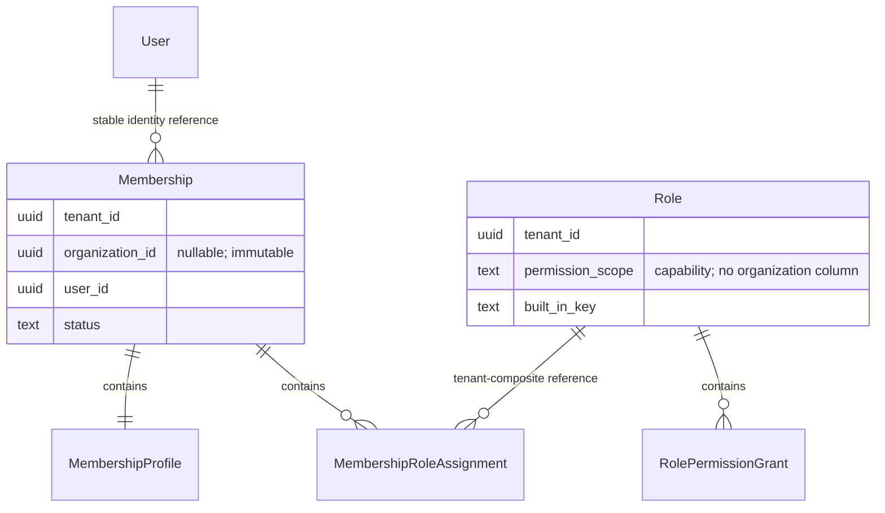
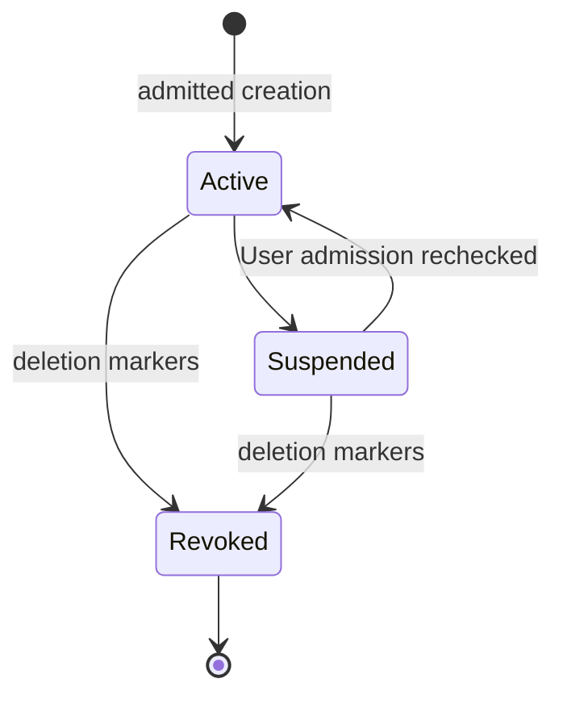
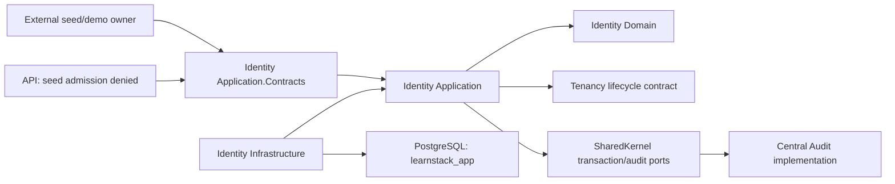

# Identity — Module Specification

**Global/contextual storage, common audit, seed handoff and existing-binding API
admission are implemented.** Derived from
jointly Accepted [ADR-0072](../../decisions/0072-application-owned-identity-bootstrap.md)
and [ADR-0073](../../decisions/0073-scoped-membership-and-identity-data-foundation.md),
2026-10-25. The global User/authority model, internal binding/adoption consumers
and central creation owner exist. Contextual tables/commands/manifests below
are implemented; the [Phase 03 Status block](../../roadmap/phase-03-identity-admin.md)
owns current qualification and review state. Jointly Accepted
[ADR-0076](../../decisions/0076-live-scoped-authorization.md) /
[ADR-0077](../../decisions/0077-trusted-authorization-evidence.md) define P03-2 live
authorization and one administrative directory GET. Its confined reader,
canonical policy/evaluator, central denial evidence and HTTP directory are wired
in the API composition. New-user/native editing
activation remains P03-3.
The ordered admission timing/observation contract additionally derives from
[ADR-0074](../../decisions/0074-membership-admission-under-ordered-locks.md),
Accepted 2026-10-26. The phase Status block owns qualification and review state.

## Overview

Identity owns global application bindings, contextual Membership/Profile/
assignments and tenant-wide Role templates. Keycloak owns credentials/provider
authentication; Tenancy owns Tenant/Organization lifecycle; Audit owns audit rows.
Cross-module facts use application contracts, without an Organization FK,
navigation or database join. Branch-specific Role configuration is not selected.

### Global implementation and deployment

P03-1 Step 3 implements one global User/authority model and migration chain,
the common prepared creation owner and eight central audit seams. API composition
denies seed adoption; the ordinary seed/demo handoff is implemented in Step 4.
Existing-binding API admission uses the same read-only contract. No creation
route is exposed here.

Set both `Identity__AuthorityId` and `Authentication__Tenant__Issuer` in the
selected private deployment environment before `make migrate` installs/verifies
the authority. Supply the migration connection and complete pair together, either
as all three process variables or in the selected private environment file.
The migration owner refuses partial input and never combines the two sources;
a complete process selection takes precedence over file defaults. Schema-only
process input also refuses a file that supplies an authority pair. The ID is
deployment-pinned and never derived from an issuer URL.
The dedicated deployment child receives the migration credential only in its
environment; restore/build and API processes receive no migration credential.
An exact existing registration is a no-write verification. A conflicting pair
refuses without repair/rebind. With both keys absent, migrations create the
schema only; missing authority cannot admit a binding. A partially configured
pair refuses before migration writes. See [the environment example](../../../.env.example)
and the [canonical authority contract](../../standards/05-database.md#global-class-and-authority-anchor).

Schema-only migration does not satisfy API startup. Every API host, including one
serving only anonymous reads, requires both runtime configuration keys and the
matching installed authority. Startup qualification rejects missing, unavailable
or mismatched registration before accepting HTTP requests. Direct `dotnet run`
reads process/.NET configuration, not the root `.env`. Restore the intended
configuration when it differs from the selected database; an issuer rebind remains
P03-9/G13 and is not an automatic repair.

The internal binding service uses explicit startup qualification and fresh,
physically read-only existing-binding transactions; it never creates a missing
binding. Fixed seed adoption separately requires its confined admission port.
Real provider/app-role, schema/body/ACL/caller and physical outcome controls are
implemented. The directory contract appears below; closure,
production first-admin and issuer rebind retain their named later owners.

### Aggregate and storage contract

User's authority is [ADR-0072](../../decisions/0072-application-owned-identity-bootstrap.md);
the [canonical accepted database annex](../../standards/05-database.md#proposed-p03-1-identity-storage-annex)
owns its exact global SQL, grants and guards.

| Table | Class / owner | Keys, scope and lifecycle |
|---|---|---|
| `memberships` | Tenant-owned, org-scoped; Membership root | UUIDv7 `MembershipId`; referenceable `(tenant_id,id)`; current unique `(tenant_id,user_id,organization_id) NULLS NOT DISTINCT WHERE deleted_at IS NULL` |
| `membership_profiles` | Tenant-owned, org-scoped; contained Membership child | PK `(tenant_id,membership_id)`; one profile created with Membership; exact parent organization mirror/lifecycle |
| `membership_role_assignments` | Tenant-owned, org-scoped; contained Membership child | PK `(tenant_id,membership_id,role_id)`; exact Membership organization mirror; Role capability compatibility guard |
| `roles` | Tenant-owned, tenant-wide; Role root | UUIDv7 `RoleId`; referenceable `(tenant_id,id)`; current unique `(tenant_id,permission_scope,built_in_key) WHERE deleted_at IS NULL`; no `organization_id` |
| `role_permission_grants` | Tenant-owned, tenant-wide; contained Role child | PK `(tenant_id,role_id,permission_scope,permission_key)`; exact Role capability-scope mirror; no `organization_id` |

Use each [Standard 05 table class](../../standards/05-database.md#table-classes),
its EF filter and ENABLE/FORCE RLS. Org-scoped tables receive canonical
restrictive write guards and immutable organization triggers. Parent references
use `(tenant_id,parent_id)` with ON DELETE RESTRICT; index every FK. Independent
INSERT/UPDATE mirror triggers compare nullable organizations with
`IS DISTINCT FROM`. Never rely on a nullable organization column in a FK to
check tenant integrity under MATCH SIMPLE.

Assignments reference Membership and Role through two tenant-composite FKs.
Membership's `user_id` references same-module `users.id` with ON DELETE RESTRICT
and its own supporting UserId index. The permanent User tombstone retains the
key; audit actor columns still have no User FK. The BEFORE admission guard maps
unknown and nonadmitting targets to the same refusal before FK diagnostics can
be exposed, and its fixed diagnostic translation discloses no constraint values.
Their trigger checks the exact Membership organization mirror, then requires
Tenant capability iff that organization is NULL and Organization capability iff
it is non-NULL. Role has no organization to match. Grant children reference Role
through its tenant-composite FK and mirror capability scope. Tenant, User/parent
references, Role built-in key and capability scope are immutable.
Role built-in/scope CHECKs admit only the finite manifest pairs; no free-form Role
key or Platform variant enters these tables. Soft-deleted Roles/Revoked or
Suspended Memberships do not contribute live grants. Tenant natural-key indexes
remain partial while referenceable primary-key-containing indexes remain full.

`learnstack_app` receives SELECT/INSERT/UPDATE on Membership/Role/Profile and
SELECT/INSERT/DELETE on assignment/grant children, subject to all guards. Root
revocation is soft; no app root/Profile DELETE exists. Child changes go through
the owning root and tracked audit capture. No PUBLIC/Platform/dispatcher Identity
privileges or new login are introduced. Global grants/functions follow ADR-0072.
Each migration declares exact grants: a privilege never identifies a code path.

Permission definitions remain compiled code, without a new global Permission
table. Persisted grants select `(scope,key)` from the registry; unknown/inactive
entries never authorize. [Standard 19's accepted foundation contract](../../standards/19-permissions.md#proposed-identity-foundation-contract)
owns the exact registry, version-1 grants and generated kernel artifact.

### Lifecycle, profile and admission

The database requires Active/Suspended Memberships to have NULL deletion fields
and Revoked to carry both deletion timestamp/actor. Its INSERT/UPDATE lifecycle
guard rejects direct resurrection, inconsistent status/deletion markers and
transitions outside the diagram. Active/Suspended share current uniqueness;
Revoked is terminal. Rejoin creates a new ID and fresh assignments after retiring
the predecessor. Profile has no independent delete/status lifecycle; historical
child facts cannot restore a revoked Membership's authority.

Profile carries optional contextual `DisplayName` (128 characters) and
`PreferredLocale` (35-character well-formed locale tag), both marked sensitive.
No unused contact field is collected. Missing values use explicit safe UI fallback, without copying
global fields on reads. NULL-org profiles contain no branch-private notes;
organization profiles are independent. Self/admin changes allow those fields
only, never canonical email/verification, global identity, Role bindings,
arbitrary settings or consent evidence. P03-3/G6 chooses exact DTOs; P03-5/G9 owns
dynamic fields/revisions. No dormant custom-fields column lands in the foundation.

Creation, Suspended→Active and **all** assignment additions recheck the target
User fence, including additions of currently empty/inactive templates.
[Standard 05's accepted lock contract](../../standards/05-database.md#proposed-lock-snapshot-and-adoption-conditions)
alone owns the algorithm, ordering, fresh reads, deadlines and database guards.
Profile/nonadmin/organization mutations use its shared tenant invariant mode;
first-admin and tenant-admin eligibility/assignment/kernel transitions use its
exclusive mode. Actual affected rows bind the mode before acquisition; no
shared-to-exclusive upgrade or caller-declared nonadmin exemption is admitted.
Only the admission operations above automatically require the User fence;
profile-only changes and assignment removals retain their existing tenant-lock
requirements. Standard 05 also owns backend-heldness limits, fixed internal plan
fault versus target refusal, and the identical outward refusal. No algorithm or
new User reader is defined here.

Every Membership mutation, in either lock mode, leaves an Active, globally
eligible, tenant-wide Tenant Admin with both kernel pairs. The first mutation
therefore establishes that administrator. Role roots may exist first; completed
foundation is actual eligible administration plus semantically valid required
templates, without a
bootstrap Boolean, receipt or table. Trial, Active and Suspended retain their
admin. No Archived/termination exemption exists until separately admitted by
G13/G16. Final-admin removal/suspension/revocation or kernel stripping refuses.
Future global closure cannot make the final admin ineligible before its separate
recovery/termination authority and guards are Accepted and implemented.

P03-1 supplies the bounded Tenancy Application.Contracts port
`IIdentityScopeLifecycleReader.ReadAsync(TenantId, OrganizationId?, CancellationToken)`.
Its immutable `IdentityScopeLifecycle` result has four Booleans:
`TenantExistsAndNotDeleted`, `TenantAllowsOrdinaryWork`,
`OrganizationBelongsToTenant` and `OrganizationAllowsOrdinaryWork`. Organization
facts are false when no organization is requested; it returns no row or list.
Trial/Active admit ordinary work; Suspended retains an
admin without ordinary-work eligibility. Organization work requires Active and
nondeleted, not just belonging. Missing targets return closed false facts.

The target must match an already trusted, announced owner scope. The Tenancy
implementation reads its own tables in one fresh READ COMMITTED statement on
that app-role transaction; no cached lifecycle result, additional setter,
cross-module SQL join or Organization FK is admitted. P03-1 Step 4 supplies the
port/implementation and seed controls; P03-2 executes it for live admission at
the declared per-act snapshot. P03-3 owns lifecycle-transition/last/default-org
concurrency before Tenancy endpoints. G3's foundation contract does not qualify
those later live checks or archive races.

### First-admin and seed sequence

P03-1 admits only the fixed development-seed capability.
`ISeedIdentityFoundationAdmission` is `DenyAllSeedIdentityFoundationAdmission`
in API composition. The external seed/demo owner supplies bounded canonical
manifest facts and actual provider-adoption witnesses to the confined Seeder
implementation. Email, a realm role or SystemActor alone supplies no admission.
There is no HTTP entry, operator population or general bootstrap bypass.

Production first-admin/provisioning admission is **P03-9/G13**, before a
production provisioner uses it. Its authority/recovery cannot inherit the seed
capability. Tenancy's current ProvisionTenant remains the ADR-0042 Tenant/default
Organization pair; no cross-module transaction or further exception is admitted.

1. The external seed owner completes Tenancy acts and ADR-0072 trusted binding
   adoption, preserving all four actor/provider IDs, credentials and MFA.
2. `InitializeSeedRole` writes one Role and grants per transaction from version 1.
   Eight templates per tenant include three Organization-capability variants;
   there are no per-organization Role rows or organization-initialization step.
3. `CreateFirstSeedAdminMembership` atomically writes the declared admin,
   contained Profile/Assignment and central MUST audit, referencing an existing
   Tenant Admin template. Its complete root/child plan precedes mutation;
   User/tenant/last-admin guards apply.
4. `CreateSeedMembership` writes each learner and contained state separately.
   `SetSeedMembershipProfile` changes bounded fields through Membership. No
   command writes another root merely because its transaction is available.
5. Each act uses a deterministic version-1 expected manifest fingerprint and
   exact postcondition. Matching completed acts skip before dispatch. Interrupted
   reruns verify committed acts and create only missing uncompleted declarations.
   Revocation, suspension, ID conflict or edited grants refuse with a fixed
   diagnostic, stop remaining acts and leave prior committed facts intact.
   They never reset, repair or silently create successors.

The expected fingerprint is not a new receipt table. Existing Role/Membership
facts establish completion; keep historical manifest versions to verify earlier
completed acts. Registry additions do not change adopted grants. P03-2 owns
separately admitted/audited grant adoption, including removal of the initial
profile grant outside the two-pair kernel. A legitimate later upgrade that no
longer matches this fixed v1 seed also makes that seed refuse; it never overwrites,
repairs or resets upgraded authority. Seed is not an upgrade reconciler.

| Existing actor | Membership scope | Assignment |
|---|---|---|
| English admin (`a001` suffix) | English / NULL organization | Tenant Admin, Tenant capability |
| English learner (`a002`) | English / NULL organization | Learner, Tenant capability |
| Yoga admin (`b001`) | Yoga / NULL organization | Tenant Admin, Tenant capability |
| Yoga learner (`b002`) | Yoga / default studio | Learner, Organization capability |

[SeedData](../../../backend/src/LearnStack.Tools.Seeder/SeedData.cs) owns the full
legacy actor/tenant/organization IDs. Exact assignment declarations extend that
manifest; suffixes above identify existing actors, not newly allocated IDs.
The four authentication personas remain fixed. Additional cross-tenant/two-branch
and same-tenant-second-person proof populations are fixture-local, outside
`IdentityUsers` and its exact four-user realm manifest. Email never merges them.

Yoga admin `b001` keeps its existing provider claim for default studio `b1`.
Its seed Membership declaration independently selects NULL organization, and
the seed transaction derives NULL SQL organization scope from that trusted
target; the authentication manifest does not choose the Membership write scope.
A branch session may consume eligible Tenant grants for branch operations and
explicitly declared tenant-wide reads. Tenant-wide Membership/Profile/template
writes require an explicitly selected orgless context through P03-3's validated
reissue transition. Neither the existing branch claim nor `app.scope` promotes
writes; no extra branch-admin Membership or provider-claim rewrite is required.

### Accepted live authorization and directory contract

**Live policy, central evidence and the administrative directory are implemented.**
The policy/evaluator consumes the confined reader/source through the shared
decision port; common Application gains no Identity module dependency. The
directory uses the real EF read adapter and common MUST write path. API and
application checks each read fresh committed authority before dispatch.
`CommittedIdentityAuthorizationReader` coordinates the module statements from
Application; its Infrastructure session factory retains the exact Identity SQL
and physical child owner. The reader consumes an
exact verified actor/tenant/optional-organization candidate in an isolated child
owner. It returns bounded current Membership/Role/grant facts and consumes
Tenancy's lifecycle contract, without a profile/global directory, synthetic
TenantContext or parent transaction reuse. The grant and lifecycle statements
have separate committed snapshots; revocation committed before the grant query
affects that admission, while already-admitted work can finish. Binding remains
the earlier global User eligibility check.

HTTP and direct application dispatch independently classify and authorize each
protected act. Explicit public, AccountSite, protected and finite seed/system
policies default deny unknown/missing declarations. Resolver membership confirms
scope but does not authorize a later protected act. Public requests remain free
of identity/grant lookups; AccountSite keeps its separate real HostScope ceiling
and Off/physical ReadOnly mode while gaining live membership/lifecycle admission.

The accepted administrative directory uses existing Tenant
`identity.membership.admin`, with no new grant or v2 seed bundle. It admits
HostAndClaim or confirmed ClaimAndMembership, never HostOnly. Its declared
tenant-wide read can use an eligible NULL-org Tenant Admin Membership from a
branch session. It returns current undeleted Active/Suspended Memberships and
only MembershipId, UserId, OrganizationId, status, contextual DisplayName and
PreferredLocale. Provider subject, email, global profile and grant graph are
excluded. The [API contract](../../standards/04-api-design.md) owns exact route,
DTO/cursor/no-store rules; the native BFF operation allowlist remains P03-3 work.

Its MUST `identity.membership.list` row commits on the ordinary ReadWrite owner
before disclosure; it is not a physical ReadOnly-catalogue query. Planned
`ChangeRoleGrantsCommand` and `AdoptRoleGrantManifestCommand` each mutate one Role
with contained grants, expected version, current post-lock authority and same-
transaction MUST audit. [Permissions](permissions.md) owns their exact bindings
and delegation ceiling; unknown manifest, self-escalation or kernel removal
refuses. Fixed v1 seed reruns still refuse legitimate differing adopted state.

[Standard 05](../../standards/05-database.md#authorization-and-evidence-source-ledger)
owns the dedicated four/two authorization/evidence lanes, tracked job ownership,
retained cleanup and required direct/PgBouncer progress proofs. Its
[read authority contract](../../standards/05-database.md#operation-bound-read-authority)
owns invocation/transaction lifetime and EF/RLS agreement. [Standard 18](../../standards/18-audit-coverage.md#trusted-authorization-evidence)
owns denial occurrences, immutable provenance and all pre-success barriers.
No pool, crash, permission or disclosure proof is claimed by acceptance alone.

## Entity-relationship diagram



Text fallback: User has contextual Memberships; each contains Profile and
assignments to tenant-wide Roles. Roles contain grants. OrganizationId is a
Membership value, without a cross-module FK/navigation.

## State diagrams



Text fallback: Active and Suspended exchange; either revokes. Revoked is terminal,
with a distinct successor on rejoin. Global Active/Closing/Closed admission and
permanent binding follow ADR-0072, not a Membership state transition.

## Sequence diagrams

```mermaid
sequenceDiagram
    participant Seed as External seed owner
    participant Role as InitializeSeedRole
    participant Member as CreateFirstSeedAdminMembership
    participant DB as App-role PostgreSQL
    participant Audit as Central audit path
    Seed->>Role: Exact v1 template and closed seed witness
    Role->>DB: One Role plus grants; commit
    Seed->>Member: Declared admin and existing Role
    Member->>DB: Standard 05 admission/invariant guards
    Member->>DB: Membership, Profile and Assignment
    Member->>Audit: MUST intent with captured children
    Audit->>DB: Same-transaction audit
    DB->>DB: Deferred invariant guards
    DB-->>Seed: Commit and fresh semantic verification
```

Text fallback: Roles commit separately; first admin/children commit with audit.
Failure leaves no partial Membership; earlier Role acts are verified on resume.
There is no published primary integration-event flow in this foundation; see
the empty [catalogue](#integration-event-catalogue).

## Component diagram



Text fallback: Application uses domain, Tenancy application contracts and shared
ports. Infrastructure persists through the app role. API seed admission is denied;
global/provider adoption remains ADR-0072's confined owner.

## Integration-event catalogue

P03-1 publishes no Identity integration event and activates no provider ingress,
Invitation or closure consumer. P03-4/6/10 decide their first writers separately;
framework domain-event dispatch does not imply a published contract.

## Permission matrix

[Identity permissions](permissions.md) binds production seed commands to
the exact [accepted Standard 19 manifest](../../standards/19-permissions.md#proposed-identity-foundation-contract).
The seed commands are implemented in P03-1 Step 4; the separately marked P03-2
bindings are implemented. Capability metadata alone grants neither permission
nor a route; canonical admission and exact endpoint declarations enforce both.

## Audit coverage matrix

[Identity audit](audit.md) declares implemented root/child classifications and
personal/reference paths and the implemented authorization event/read/grant rows.
The central writer owns durability; Identity has no
audit table/direct audit SQL. Global mutation audit follows ADR-0072 alone.

## Performance budget

The canonical [initial performance budgets](../../standards/15-performance.md#initial-budgets)
apply: API p95 below 200 ms reads / 500 ms writes, excluding separately reported
provider calls. The [Step 4 record](../../roadmap/phase-03-delivery-log.md#p03-1-step-4--contextual-foundation-and-owned-seed-2026-10-26)
owns the small local command-path measurement and its limits; it establishes
no production capacity. The distinct
[Step 5 binding-load observation](../../roadmap/phase-03-delivery-log.md#p03-1-step-5--existing-binding-api-admission-2026-10-26)
retains its own control and scope.
Standard 05 owns bounded lock waits,
cancellation and metrics. Timeout yields a fixed retryable failure without
partial grants. P03-2 measures candidate-reader/authorization costs before
activation; a global permission cache/session grant cannot replace a fresh check.

## Risks and open questions

Branch-specific Role configuration reopens ADR-0073. Accepted ADR-0076/0077 own
live delegation, default deny/revocation, reader handoff and trusted evidence;
P03-2 implements/proves them; P03-3 scope transitions/DTOs; P03-4
invitations; P03-5 dynamic values; P03-9 production first-admin/recovery; P03-10
closure/locators. These are named later writers, not implicit foundation authority.

| Subject/control | Current state | Owner / scope |
|---|---|---|
| Models, commands and registry | Global and contextual foundation implemented | P03-1 Steps 3/4; live authorization P03-2 |
| Canonical marker/filter/RLS/FK/unique/aggregate/audit controls | Identity extensions implemented with populated positive/dirty controls | P03-1 Step 4; [catalogue](../../standards/21-architecture-tests-catalogue.md#pending-identity-extensions-to-implemented-rules) owns the individual obligations |
| `Permission_Definitions_DeclareScope` | Implemented for the finite foundation | `IdentityFoundationConventionTests` and actual command metadata; broader enforcement P03-2 |
| `Mapped_Properties_Have_Explicit_Personal_Data_Classification` | Implemented for all current models, including contextual Identity | `DataProtectionConventionTests`; complete census and neutral-name omission controls |
| `Identity_Seed_Uses_Finite_Adopted_Manifests` | Implemented; no-write/interrupted/conflict actual seed controls | `IdentityFoundationConventionTests` / `IdentitySeederTests`; combined final provider/browser qualification Step 6 |
| `Identity_Membership_Invariants_Use_Fresh_Ordered_Locks` | Implemented actual app-role races and closed helper/caller controls | `IdentityMembershipTests`, `IdentityMutationLockTests`, `IdentityFoundationConventionTests`; live transition/archive ownership remains P03-3/10 |
| Per-sink PII canaries/child audit/MUST rollback | Implemented actual child snapshots/redacted diffs, MUST rollback and value-bearing diagnostic controls | `IdentitySeederTests`, `IdentityDiagnosticSinkTests`, `TenantExistingBindingAdmissionTests` and canonical [data-protection proof ownership](../../architecture/23-data-protection.md#identity-foundation-and-classification-ownership); classification alone does not establish sink safety |
| `Global_Identity_Storage_Is_Subject_Confined` / `Global_Identity_Creation_Uses_The_Common_Audit_Owner` | Implemented global proofs; Step 3 completed both review rounds | `GlobalIdentitySchemaTests`, `IdentityAuditConventionTests` / `GlobalIdentityBootstrapTests`; P03-3 owns HTTP/new-user BFF activation |

Registered means an actual catalogue entry exists. Until then a new control is
planned/unregistered; later Registered is not Implemented. No empty census,
skipped suite, type declaration or diagram supplies implementation evidence.
