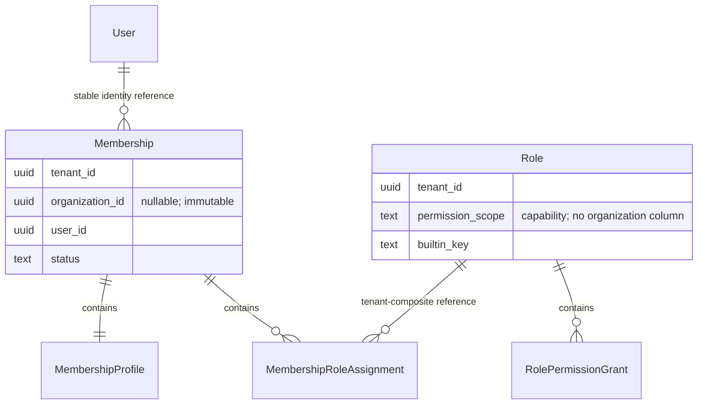
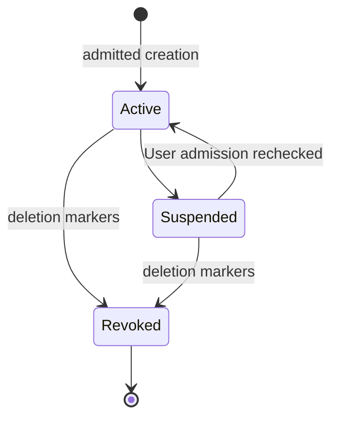
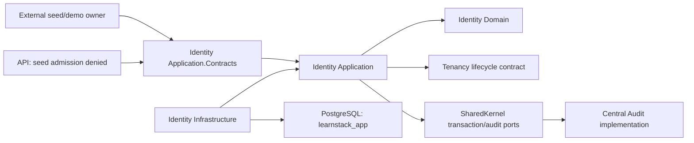

# Identity — Module Specification

**Status: Proposed.** Derived from Proposed [ADR-0072](../../decisions/0072-application-owned-identity-bootstrap.md)
and [ADR-0073](../../decisions/0073-scoped-membership-and-identity-data-foundation.md),
which require joint acceptance. At `92117893`, Identity has assembly-marker
packages only. Every new type, table, command, manifest and proof below is
planned; none is a current runtime implementation or granted capability.

## Overview

Identity owns global application bindings, contextual Membership/Profile/
assignments and tenant-wide Role templates. Keycloak owns credentials/provider
authentication; Tenancy owns Tenant/Organization lifecycle; Audit owns audit rows.
Cross-module facts use application contracts, without an Organization FK,
navigation or database join. Branch-specific Role configuration is not selected.

### Aggregate and storage contract

User's authority is [ADR-0072](../../decisions/0072-application-owned-identity-bootstrap.md);
the [canonical Proposed database annex](../../standards/05-database.md#proposed-p03-1-identity-storage-annex)
owns its exact global SQL, grants and guards.

| Planned table | Class / owner | Keys, scope and lifecycle |
|---|---|---|
| `memberships` | Tenant-owned, org-scoped; Membership root | UUIDv7 `MembershipId`; referenceable `(tenant_id,id)`; current unique `(tenant_id,user_id,organization_id) NULLS NOT DISTINCT WHERE deleted_at IS NULL` |
| `membership_profiles` | Tenant-owned, org-scoped; contained Membership child | PK `(tenant_id,membership_id)`; one profile created with Membership; exact parent organization mirror/lifecycle |
| `membership_role_assignments` | Tenant-owned, org-scoped; contained Membership child | PK `(tenant_id,membership_id,role_id)`; exact Membership organization mirror; Role capability compatibility guard |
| `roles` | Tenant-owned, tenant-wide; Role root | UUIDv7 `RoleId`; referenceable `(tenant_id,id)`; current unique `(tenant_id,permission_scope,builtin_key) WHERE deleted_at IS NULL`; no `organization_id` |
| `role_permission_grants` | Tenant-owned, tenant-wide; contained Role child | PK `(tenant_id,role_id,permission_scope,permission_key)`; exact Role capability-scope mirror; no `organization_id` |

Use each [Standard 05 table class](../../standards/05-database.md#table-classes),
its EF filter and ENABLE/FORCE RLS. Org-scoped tables receive canonical
restrictive write guards and immutable organization triggers. Parent references
use `(tenant_id,parent_id)` with ON DELETE RESTRICT; index every FK. Independent
INSERT/UPDATE mirror triggers compare nullable organizations with
`IS DISTINCT FROM`. Never rely on a nullable organization column in a FK to
check tenant integrity under MATCH SIMPLE.

Assignments reference Membership and Role through two tenant-composite FKs.
Membership's `user_id` references same-module `users.id` with ON DELETE RESTRICT
and its own supporting UserId index. The permanent User tombstone retains the
key; audit actor columns still have no User FK. The BEFORE admission guard maps
unknown and nonadmitting targets to the same refusal before FK diagnostics can
be exposed, and its fixed diagnostic translation discloses no constraint values.
Their trigger checks the exact Membership organization mirror, then requires
Tenant capability iff that organization is NULL and Organization capability iff
it is non-NULL. Role has no organization to match. Grant children reference Role
through its tenant-composite FK and mirror capability scope. Tenant, User/parent
references, Role built-in key and capability scope are immutable.
Role built-in/scope CHECKs admit only the finite manifest pairs; no free-form Role
key or Platform variant enters these tables. Soft-deleted Roles/Revoked or
Suspended Memberships do not contribute live grants. Tenant natural-key indexes
remain partial while referenceable primary-key-containing indexes remain full.

`learnstack_app` receives SELECT/INSERT/UPDATE on Membership/Role/Profile and
SELECT/INSERT/DELETE on assignment/grant children, subject to all guards. Root
revocation is soft; no app root/Profile DELETE exists. Child changes go through
the owning root and tracked audit capture. No PUBLIC/Platform/dispatcher Identity
privileges or new login are introduced. Global grants/functions follow ADR-0072.
Each migration declares exact grants: a privilege never identifies a code path.

Permission definitions remain compiled code, without a new global Permission
table. Persisted grants select `(scope,key)` from the registry; unknown/inactive
entries never authorize. [Standard 19's Proposed annex](../../standards/19-permissions.md#proposed-identity-foundation-contract)
owns the exact registry, version-1 grants and generated kernel artifact.

### Lifecycle, profile and admission

The database requires Active/Suspended Memberships to have NULL deletion fields
and Revoked to carry both deletion timestamp/actor. Its INSERT/UPDATE lifecycle
guard rejects direct resurrection, inconsistent status/deletion markers and
transitions outside the diagram. Active/Suspended share current uniqueness;
Revoked is terminal. Rejoin creates a new ID and fresh assignments after retiring
the predecessor. Profile has no independent delete/status lifecycle; historical
child facts cannot restore a revoked Membership's authority.

Profile initially carries optional bounded contextual display/contact fields and
locale preference. Missing values use explicit safe UI fallback, without copying
global fields on reads. NULL-org profiles contain no branch-private notes;
organization profiles are independent. Self/admin changes allow those fields
only, never canonical email/verification, global identity, Role bindings,
arbitrary settings or consent evidence. P03-3/G6 chooses exact DTOs; P03-5/G9 owns
dynamic fields/revisions. No dormant custom-fields column lands in the foundation.

Creation, Suspended→Active and assignment additions acquire the target User
admission lock and recheck ADR-0072's canonical fence before the tenant lock.
All Membership mutations and protected Role changes take the same tenant
invariant lock before a separate fresh check; deferred database guards cover
direct writes. Writers/guards require READ COMMITTED, refuse incompatible
isolation and use VOLATILE fresh post-wait reads. Locks last through commit.
Never acquire another User lock under tenant; final-admin checks use ADR-0072's
confined Boolean state read. Future closure takes User then affected tenant
locks in stable order. [Standard 05](../../standards/05-database.md) owns the
proposed lock/timeout/telemetry contract, not a second module algorithm.

Every Membership mutation leaves an Active, globally eligible, tenant-wide
Tenant Admin with both kernel pairs. The first mutation therefore establishes
that administrator. Role roots may exist first; completed foundation is actual
eligible administration plus semantically valid required templates, without a
bootstrap Boolean, receipt or table. Trial, Active and Suspended retain their
admin. No Archived/termination exemption exists until separately admitted by
G13/G16. Final-admin removal/suspension/revocation or kernel stripping refuses.

Live coverage also requires Tenancy's current lifecycle facts through its
application contract. Trial/Active admit ordinary work; Suspended retains an
admin without ordinary-work eligibility. Organization work requires Active and
nondeleted, not just belonging. P03-2 owns live checks; P03-3 owns target-scope
transitions and last/default-organization concurrency before Tenancy endpoints.

### First-admin and seed sequence

P03-1 admits only the fixed development-seed capability. Planned
`ISeedIdentityFoundationAdmission` is `DenyAllSeedIdentityFoundationAdmission`
in API composition. The external seed/demo owner supplies bounded canonical
manifest facts and actual provider-adoption witnesses to the confined Seeder
implementation. Email, a realm role or SystemActor alone supplies no admission.
There is no HTTP entry, operator population or general bootstrap bypass.

Production first-admin/provisioning admission is **P03-9/G13**, before a
production provisioner uses it. Its authority/recovery cannot inherit the seed
capability. Tenancy's current ProvisionTenant remains the ADR-0042 Tenant/default
Organization pair; no cross-module transaction or further exception is admitted.

1. The external seed owner completes Tenancy acts and ADR-0072 trusted binding
   adoption, preserving all four actor/provider IDs, credentials and MFA.
2. `InitializeSeedRole` writes one Role and grants per transaction from version 1.
   Eight templates per tenant include three Organization-capability variants;
   there are no per-organization Role rows or organization-initialization step.
3. `CreateFirstSeedAdminMembership` atomically writes the declared admin,
   contained Profile/Assignment and central MUST audit, referencing an existing
   Tenant Admin template. User/tenant/last-admin guards apply.
4. `CreateSeedMembership` writes each learner and contained state separately.
   `SetSeedMembershipProfile` changes bounded fields through Membership. No
   command writes another root merely because its transaction is available.
5. Each act uses a deterministic version-1 expected manifest fingerprint and
   exact postcondition. Matching completed acts skip before dispatch. Interrupted
   reruns verify committed acts and create only missing uncompleted declarations.
   Revocation, suspension, ID conflict or edited grants refuse with a fixed
   diagnostic, stop remaining acts and leave prior committed facts intact.
   They never reset, repair or silently create successors.

The expected fingerprint is not a new receipt table. Existing Role/Membership
facts establish completion; keep historical manifest versions to verify earlier
completed acts. Registry additions do not change adopted grants. Explicit later
grant adoption is separately admitted/audited. Ordinary seed refuses operator
drift rather than interpreting it as permission to overwrite authority.

| Existing actor | Membership scope | Assignment |
|---|---|---|
| English admin (`a001` suffix) | English / NULL organization | Tenant Admin, Tenant capability |
| English learner (`a002`) | English / NULL organization | Learner, Tenant capability |
| Yoga admin (`b001`) | Yoga / NULL organization | Tenant Admin, Tenant capability |
| Yoga learner (`b002`) | Yoga / default studio | Learner, Organization capability |

[SeedData](../../../backend/src/LearnStack.Tools.Seeder/SeedData.cs) owns the full
legacy actor/tenant/organization IDs. Exact assignment declarations extend that
manifest; suffixes above identify existing actors, not newly allocated IDs.
Separate explicit proof subjects cover one person in both tenants/two branches
and a second same-tenant person. Email never merges them.

## Entity-relationship diagram



Text fallback: User has contextual Memberships; each contains Profile and
assignments to tenant-wide Roles. Roles contain grants. OrganizationId is a
Membership value, without a cross-module FK/navigation.

## State diagrams



Text fallback: Active and Suspended exchange; either revokes. Revoked is terminal,
with a distinct successor on rejoin. Global Active/Closing/Closed admission and
permanent binding follow ADR-0072, not a Membership state transition.

## Sequence diagrams

```mermaid
sequenceDiagram
    participant Seed as External seed owner
    participant Role as InitializeSeedRole
    participant Member as CreateFirstSeedAdminMembership
    participant DB as App-role PostgreSQL
    participant Audit as Central audit path
    Seed->>Role: Exact v1 template and closed seed witness
    Role->>DB: One Role plus grants; commit
    Seed->>Member: Declared admin and existing Role
    Member->>DB: User lock/recheck, then tenant lock/recheck
    Member->>DB: Membership, Profile and Assignment
    Member->>Audit: MUST intent with captured children
    Audit->>DB: Same-transaction audit
    DB->>DB: Deferred invariant guards
    DB-->>Seed: Commit and fresh semantic verification
```

Text fallback: Roles commit separately; first admin/children commit with audit.
Failure leaves no partial Membership; earlier Role acts are verified on resume.
There is no published primary integration-event flow in this foundation; see
the empty [catalogue](#integration-event-catalogue).

## Component diagram



Text fallback: Application uses domain, Tenancy application contracts and shared
ports. Infrastructure persists through the app role. API seed admission is denied;
global/provider adoption remains ADR-0072's confined owner.

## Integration-event catalogue

P03-1 publishes no Identity integration event and activates no provider ingress,
Invitation or closure consumer. P03-4/6/10 decide their first writers separately;
framework domain-event dispatch does not imply a published contract.

## Permission matrix

[Identity permissions](permissions.md) binds planned production seed commands to
the exact [Proposed Standard 19 manifest](../../standards/19-permissions.md#proposed-identity-foundation-contract).
They compile in Step 4; current source has none. Capability metadata activates
neither live permission behavior nor HTTP routes.

## Audit coverage matrix

[Identity audit](audit.md) declares planned root/child classifications and
personal/reference paths. The central writer owns durability; Identity has no
audit table/direct audit SQL. Global mutation audit follows ADR-0072 alone.

## Performance budget

The canonical [initial performance budgets](../../standards/15-performance.md#initial-budgets)
apply: API p95 below 200 ms reads / 500 ms writes, excluding separately reported
provider calls; no Identity measurement is claimed. Standard 05 owns bounded lock waits,
cancellation and metrics. Timeout yields a fixed retryable failure without
partial grants. P03-2 measures candidate-reader/authorization costs before
activation; a global permission cache/session grant cannot replace a fresh check.

## Risks and open questions

Branch-specific Role configuration reopens ADR-0073. P03-2 owns live delegation,
default deny/revocation and reader handoff; P03-3 scope transitions/DTOs; P03-4
invitations; P03-5 dynamic values; P03-9 production first-admin/recovery; P03-10
closure/locators. These are named later writers, not implicit foundation authority.

| Subject/control | Current state | Planned owner / timing |
|---|---|---|
| Models, commands and registry | Assembly markers; no subjects | P03-1 Steps 3/4, actual models/production commands and five-pair registry |
| Canonical marker/filter/RLS/FK/unique/aggregate/audit controls | Existing implemented controls unchanged; Identity extensions Awaiting backfill | P03-1 Step 4, real app-role positive/dirty controls |
| `Permission_Definitions_DeclareScope` | Existing control; Identity Awaiting backfill | P03-1 Step 4 nonempty actual commands; broader enforcement P03-2 |
| Semantic mapped-property classification census | Planned, not yet in catalogue | P03-1 Step 2; planned `DataProtectionConventionTests.cs`, actual complete census and planted neutral-name omission |
| Kernel manifest/SQL equivalence | Planned, unregistered; no artifact | P03-1 Steps 1/4, register and qualify equality before grants |
| Lifecycle/null uniqueness/admin/closure-reactivation races | Planned behavioral proof | P03-1 Step 4, separate real app-role connections and independent guard removals |
| Per-sink PII canaries/child audit/MUST rollback | Planned behavioral proof | P03-1 Steps 2/4, positive sink events and actual snapshots |
| Nonseed/native/global identity | Proposed ADR-0072 obligations | P03-1 Steps 3/5/6 under its canonical contract |

Registered means an actual catalogue entry exists. Until then a new control is
planned/unregistered; later Registered is not Implemented. No empty census,
skipped suite, type declaration or diagram supplies implementation evidence.
