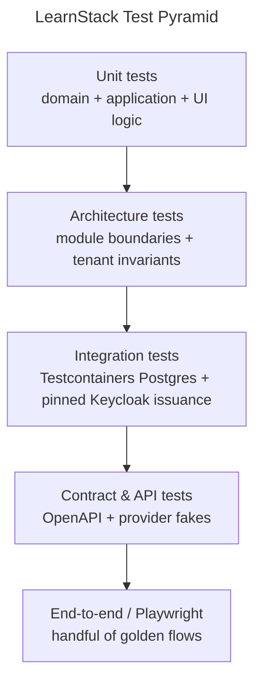

# 06 — Testing Standards

**Status:** Active
Tenant BFF additions derive from
[ADR-0070](../decisions/0070-owned-tenant-bff-sessions.md).
**Derives from:** [ADR 0003 — Tenant Isolation Defense in Depth](../decisions/0003-tenant-isolation-defense-in-depth.md), [ADR 0010 — Cross-Module Communication](../decisions/0010-cross-module-communication.md).
Public-read additions derive from
[ADR-0052](../decisions/0052-anonymous-public-read-boundary.md). Public-renderer
controls derive from [ADR-0053](../decisions/0053-trusted-public-server-rendering.md)
and [ADR-0054](../decisions/0054-bounded-public-renderer-admission.md).
The seeded browser/audit proof derives from
[ADR-0056](../decisions/0056-public-demo-browser-and-lighthouse-enforcement.md).
Native admission, stock-browser fallback and HMR proof controls derive from
[ADR-0055](../decisions/0055-public-renderer-bootstrap-failures.md).
UI localization controls derive from [ADR-0027](../decisions/0027-frontend-i18n.md)
and the [Accepted P02d-6 package](../roadmap/phase-02d-delivery-log.md#p02d-6-decision-package-2026-10-09).

Test pyramid, conventions, and what every change must cover.

Tenant BFF proofs follow [ADR-0070](../decisions/0070-owned-tenant-bff-sessions.md):
unit/actual-native route ownership and planted negatives, real warm Keycloak →
BFF → app-role AccountSite lifecycle/event evidence, and a separate native HTTPS
browser proof of both hosts' cookie storage/send/logout/history. Realm issuance
alone proves no BFF session; Phase 06 retains the full browser OIDC journey.
`TenancyIdentity/TenantBffSessionTests.cs` owns the real chain and invokes
`verify-bff-session.mjs` through a bounded private pipe. Its separate stock-browser
case invokes `verify-bff-browser.mjs` against native HTTPS with fake grants/API;
natural BFCache observations and the explicit persisted-event counter remain
distinct. Every fixture compiles the copied current native/Next sources, joins
owned processes/listeners and exports no raw tokens, cookies, callback/logout
URLs, provider text or HTML. Ordinary CI compiles native web/authenticated SDK
entries before test discovery/execution within its existing whole-job budget.
BFF success also requires unforced group settlement and native exit 0 without a
terminating signal. Parent failure closes the private lifetime pipe first and
verifies its own temporary directory is empty; forced/incomplete cleanup fails.

## Test Pyramid



Text fallback (for renderers without Mermaid support — pyramid base → top):

- **Unit tests** (base layer, widest) — domain + application + UI logic.
- **Architecture tests** — module boundaries + tenant invariants.
- **Integration tests** — Testcontainers **Postgres** and pinned Keycloak issuance.
  Other providers arrive with their actual consumers
  ([ADR-0035](../decisions/0035-demand-gated-infrastructure.md)).
- **Contract & API tests** — OpenAPI + provider fakes.
- **End-to-end / Playwright** (top, narrowest) — handful of golden flows.

We invest most at **unit + integration**. Architecture tests are zero-flake. E2E covers only what cannot be proven below.

## Backend Test Types

| Type | Project | Tool |
|------|---------|------|
| Unit | `LearnStack.Tests.Unit` | xUnit, FluentAssertions |
| Integration | `LearnStack.Tests.Integration` | xUnit + `WebApplicationFactory` (Docker-free host tests) and, from Packet 6, Testcontainers marked `[Trait("Requires","Docker")]` — CI runs the two halves in separate jobs by that trait |
| Architecture | `LearnStack.Tests.Architecture` | xUnit with NetArchTest (Mono.Cecil), reflection and source scans |
| API contract | `LearnStack.Tests.Contract` | The published OpenAPI document; the snapshot-diff gate activates in Phase 02d, per § API Contract Tests |
| End-to-end | Shared demo lifecycle (P02d-7) | Playwright library + Lighthouse; Phase 06 owns the broader golden-flow suite, per § End-to-End Tests |

### Unit Tests

- Cover domain aggregates, use cases (with mocked repos), value objects, pure helpers.
- No I/O. No `HttpClient`. No database.
- One scenario per test. Arrange / Act / Assert.
- Naming: `MethodName_Scenario_ExpectedOutcome`.

### Integration Tests

`LearnStack.Tests.Integration` holds **four populations**, and which one a test
belongs to is decided by what it needs, not by what it is about:

- **Host tests** — a real HTTP pipeline through `WebApplicationFactory`, no
  Docker. Everything that is a property of the API surface lives here: routing,
  the error shape, idempotency, limits, the tenancy edge. These run in the
  required `backend` CI job alongside the unit suite.
- **Data tests** — real **Postgres** via Testcontainers, connected as
  `learnstack_app`, one database per test collection — cases that write either roll
  back or clean up after themselves, because the fixture's seeded row counts are
  what the isolation assertions compare against. Not
  Valkey and not SeaweedFS: nothing the backend runs calls either, and both sit
  behind the gated compose profile ([ADR-0035](../decisions/0035-demand-gated-infrastructure.md)). Everything that is a
  property of the schema lives here, and **every schema-level tenant-isolation
  invariant** does. **Packet 6** shipped the fixtures, the four-role provisioning suite, both
  migration chains, the policies, a two-tenant seed and the schema-level isolation
  suite; **Packet 7** re-runs those cases one layer up — the third population below.
  All of them connect as `learnstack_app`, because a test run as the owner or as a
  `BYPASSRLS` role passes against inert policies. They run in the ordinary/native
  Docker execution jobs behind the required `backend integration (Testcontainers)`
  aggregate, split from Docker-free tests by `[Trait("Requires","Docker")]`.
- **Request-level isolation tests** — a `WebApplicationFactory<Program>` pointed at
  a Testcontainers PostgreSQL. **Packet 7** introduces the population, because it is
  the only shape in which the real middleware chain, the real EF query filters and
  the real RLS policies run against one another in one request, connected as
  `learnstack_app`. Packet 7 originally drives test-only controllers because it
  ships no production endpoint. P02d-4 adds actual public Education GET/HEAD cases
  in `PublicEducationHttpTests`, including mapped-host scope and uniform hidden
  resources. Test-only probes remain separate from the production endpoint set.
  These live under `Database/` with the rest of the Docker-bound suite and carry
  the same trait.
- **Identity-provider tests** — P02b-6's `TenancyIdentity/KeycloakFixture` imports
  the committed realms into Keycloak 26.6.2 with its own PostgreSQL database.
  `SharedKeycloakRealm` shares a baseline provider, not an immutable or read-only
  store: real login changes provider sessions, and the actual reconciler runs
  against it with independently checked zero-write expectations. Cases in that
  collection serialize. Warm/mutated realm variants own private providers;
  tests changing shared owner state restore it before returning. The provider
  uses owned HTTPS with a generated
  fixture CA, explicit custom-root trust and normal hostname verification; no
  host trust-store mutation or certificate-validation bypass is allowed.
  Code/S256 login and signed tokens are real;
  capturing the registered HTTPS callback without following it does not prove a
  browser/BFF session. Application isolation still requires the separate
  `learnstack_app` fixture. Provider/admin credentials and tokens never enter
  failure output. These cases carry the Docker trait and enter ordinary shards.
  `TenantRealmApiTestGroup` separately combines the provider with the actual
  `PublicReadFixture` and preserves its physical read-only/application-role
  observations. It is nonparallel within its process; do not add that database
  fixture to the provider-only collection. `TenantRealmProfileProtectionTests`
  owns a class fixture rather than changing the shared baseline's profile.
  Offline realm tooling controls run in meta with
  fresh named-case reports and zero skips/todos.

**Where a Docker-bound test lives, and what it takes, is what routes it.**
`Every_Database_Test_Carries_The_Docker_Trait` scans the whole of
`LearnStack.Tests.Integration` and requires the trait on every test class under
`Database/` and on every one elsewhere that takes a container fixture —
`SchemaFixture`, `PostgresFixture`, `PublicReadFixture`, `KeycloakFixture`, or the
`SharedSchema` / `SharedKeycloakRealm` / `TenantRealmApiTestGroup` collections, as
`ApiHandlerCompositionTests` does. It scanned `Database/` alone until Packet 9's fifth
review, which left a class beside the HTTP suites unchecked. A missing trait does not fail
the class, it runs it in the `backend` job: the hosted runners also
carry a Docker socket, so the container starts and the test passes — nothing goes red,
and the Docker suite stops being where the Docker tests live. Its companion,
`The_Docker_Trait_Sweep_Can_Actually_Fail`, feeds the predicate the shapes it must and must
not flag. Both backend aggregates reject an empty or incomplete assigned population.
All Docker executions and their aggregate additionally require their exact
discovered case identities, complete results and zero skips: a filter matching
nothing exits `0` without those guards.

Host tests use real application module configuration. Data and request-level
isolation tests use real PostgreSQL plus application module configuration.
Identity-provider tests use real Keycloak with the committed realm configuration;
combined provider/API cases also use real application module configuration.
All four use no mocked repositories and cover happy paths and edge cases.

Under [ADR-0062](../decisions/0062-native-crash-proof-ci-provisioning.md),
`scripts/ci-native-tests.py` owns the complementary Docker populations:
`Requires=Docker&NativeCrashProof=true` and
`Requires=Docker&NativeCrashProof!=true`. The existing source-trait rule also
restricts the shared native trait to the two complete native proof classes and
rejects an unclassified proof caller. Actual VSTest discovery and final TRX IDs
prove the disjoint complete population; display names alone can collide across
theory rows. Private discovery diagnostics are not exported.
Incremental execution events retain actual assembly/case IDs, outcome and
duration even when interruption prevents final TRX. Each selected project uses
its own private diagnostic stream with the pinned VSTest `BatchSize=1` setting;
empty project populations remain covered by discovery. Final results reconcile
those records with TRX, including all summary counters. A display-name-only
progress record cannot distinguish colliding theory rows.

For the five enumerated live Keycloak test classes, failed execution measurements
retain only the fixture's existing closed startup stage, reason and cleanup
result. Unknown, ambiguous or oversized messages supply no diagnostic fields;
raw messages, exception types and provider output remain private. These fields
neither establish quiescence nor replace Docker absence, complete results or a
successful execution receipt. Completed-case streams and retained TRX contain
no raw startup failure text.

Native alone uses the exclusive disposable Ubuntu 24.04 VM and closed
`scripts/ci-native-provisioning.py` owner. Setup verifies a supported collector or
writes only literal `core`; it never restores a pipe. The unchanged child fixture
still qualifies its own preconditions and actual native exits. The required
aggregate checks every producer outcome and matching complete artifacts. Offline
provisioning/launcher controls run in `meta`. The
[CI acceptance and implementation record](../roadmap/phase-02b-delivery-log.md#adr-0062-acceptance-and-ci-implementation-2026-10-18)
owns actual review and hosted qualification; local controls do not establish VM
ownership, no-dump proof or either execution's whole-job budget fit.

### Complete bounded CI assignments

[ADR-0063](../decisions/0063-complete-bounded-ci-test-shards.md) extends that
execution owner to base, Architecture and ordinary selector-group shards. The
tracked [plan](../../scripts/ci-test-shards-plan.json) is the count/weight
source of truth; the finite workflow matrix must agree before launch. Actual
Release discovery supplies assembly, case ID and FullyQualifiedName. Selected
filters are independently rediscovered before execution; all theory rows stay
with their selector. Advisory weights never define membership or a wall bound.

`scripts/ci-test-shards.py` and `scripts/ci-test-shard-results.py` implement the
two always-running aggregates under the unchanged backend/integration required
names. Each verifies current-attempt job outcomes through the read-only Actions
API, downloads immutable artifact IDs, verifies archive hashes and recomputes
assignment and complete exact case/TRX unions. Both scopes compare their full
manifest/toolchain to the same uniquely named, immutable current-attempt base
artifact. Integration additionally requires base as this common witness; it
does not count base's non-Docker cases in its Docker union. Base also requires
the actual Release build, format and Hangfire distribution/source/replacement gates.
Matching worker digests alone cannot replace API or result evidence.

Base/Architecture use only the approved non-root child and owned systemd/cgroup
boundary on exclusive Ubuntu 24.04 VMs: no Docker census/disposal, collector
access or crash inventory. Ordinary retains Docker ownership; native alone
retains collector provisioning and independent crash assertions. Every execution
keeps twenty minutes, both aggregates five minutes, and meta five minutes. The
new offline plan/result controls share one thirty-second allocation in meta.
Actual SDK/console/loaded-adapter hashes, disjoint phase intervals, first-result
gaps and scoped resource observations accompany every successful execution.
Uninstrumented fixture/container measurements remain unknown.

Use **Re-run all jobs**, not failed-job or single-job reruns. All producer
siblings must belong to the current run attempt. Before rerunning, retain the
completed attempt's original producer packages, aggregate receipts and workflow
metadata: a rerun can replace its Actions artifacts. Recovered job-log rows are
labelled recovery evidence, never original artifact packages.
Odd/even attempts select the two deterministic layouts; final qualification
requires genuinely distinct co-membership, including SharedSchema methods, on
the same source, plan, toolchain and complete case population. Plan, algorithm
or fixture-lifetime changes require both layouts. Complete this qualification
before merging.
GitHub can omit a merged same-repository PR from a run's REST projection; the
aggregate refuses that missing identity even after a complete rerun. Further
PR qualification uses an open follow-up PR, without weakening identity checks
or combining receipts from different attempts. Normal future pushes execute
one complete assignment. The
[CI follow-up record](../roadmap/phase-02b-delivery-log.md#adr-0063-step-3--workflow-and-aggregate-enforcement-2026-10-19)
owns actual hosted fit and the two complete attempts; local controls do not
establish either.

**An isolation test connects as `learnstack_app`.** One that runs as
`learnstack_migration`, `learnstack_platform` or `learnstack_outbox_admin`
passes even when every policy is inert, and therefore proves nothing.

### Architecture Tests

Non-skippable: no architecture test carries `Skip`, and the suite runs in the required
`backend` job on every PR. The rules — canonical names, what each asserts, and whether it
runs yet — are [the architecture-test catalogue](21-architecture-tests-catalogue.md). This
section keeps no second list: the table that stood here named checks, such as a Hangfire
payload scan and a provider-SDK reflection rule, that are registered for later phases
and were read as running.

### API Contract Tests

- Validate every endpoint against the published OpenAPI.
- Breaking changes require a version bump.
- **P02d-4 Step 4 delivered:** the contract suite compares the production
  composition's served document with `backend/openapi/v1.json`, preserving array
  order. Eight GET/HEAD operations, exact parameters/statuses and recursive DTO
  allowlists have clean and planted offending controls. The required frontend job
  regenerates the locked SDK and refuses drift; fake transports exercise all four
  generated GET wrappers. Pinned CLI fixtures cover ADR-0024 compatibility, with
  explicit companions for the tool's open-enum gaps. Snapshot admission controls
  fail closed on missing/deleted snapshots and failed base verification.
  [The packet record](../roadmap/phase-02d-delivery-log.md#p02d-4-step-4-contract-sdk-and-ci)
  records executed counts, reviews and the live required-check rollout.

### End-to-End Tests

P02d-7 Step 3 implements the narrow seeded catalog → course → lesson browser
proof over the running production API/native renderer. Its
[delivery record](../roadmap/phase-02d-delivery-log.md#p02d-7-step-3--browser-and-audit-proof-2026-10-11)
records the passing local nine-page walkthrough and 27 Lighthouse audits;
both independent Step 3 reviews are complete. The packet's Step 4 record owns
real CI receipts and required-check activation; local proof alone does not establish
activation. The proof uses Playwright's library and managed Chromium, without a
separate Playwright Test project.
It supplements G33's human walkthrough and preserves P6's recorded manual smoke;
it does not replace either with automated accessibility scores.

Phase 06 owns the broader MVP vertical slice (tenant → page → course → enrollment
→ live session), approximately ten high-signal golden flows and the full
Playwright/axe harness. P02d-5/6's real-API HTML/RSC integration cases remain
separate from browser evidence. P02d-7's proof adds actual linked navigation,
computed themes, ordered fields, TLS refusal controls and bounded audits over
unchanged seeded product routes.

Run the shared proof from a fresh checkout without root `.env`, web `.env.local`
or `artifacts/public-demo`, with Docker and the documented toolchain available:

```bash
(cd frontend && pnpm install --frozen-lockfile)
(cd frontend && pnpm exec playwright install --with-deps chromium)
make demo DEMO_MODE=ci
```

The lifecycle provisions a unique tmpfs-backed Compose project, generates private
disposable TLS/configuration, seeds through normal commands and stops its Keycloak
before browser navigation. Fixed application/Compose ports must be free. Review
the sanitized `artifacts/public-demo/receipt.json`, all 27 JSON/HTML report pairs
and browser screenshots; proof and owned cleanup must both pass. Existing artifacts
must be moved aside before a repeat run. Private environments, certificates, keys,
browser profiles and raw process logs are excluded from artifacts. Human foreground
`make demo` retains manual hosts/CA/leaf setup and persistent local data. The
[local test workflow](../../.claude/skills/run-tests-locally/SKILL.md#public-demo-managed-browser-and-lighthouse)
owns the complete setup and artifact instructions.

The shared CI launcher observes a clean Git commit and tree before its own
dependency restoration or builds, verifies the owned repository root, and rechecks
that identity on entry to the browser proof and before success. Workflow browser
tool bootstrap precedes that launcher checkpoint. Inherited Git overrides do
not select another repository. Tracked, staged or nonignored untracked changes
refuse qualification; ignored runtime/build outputs remain permitted. These clean
checkpoints are source observations, not hermetic build attestation: ignored
configuration/dependencies and an edit restored between observations are not
certified. Foreground local development retains its existing dirty-tree workflow.

Each report receipt binds the JSON and HTML byte digests to the same invocation,
commit/tree, build, URL/run, configuration and browser identity. A missing,
corrupt or substituted member refuses the pair. Closed operation diagnostics
distinguish actual child exit, spawn, deadline, cancellation and daemon failure;
cleanup never borrows a signal sent intentionally during teardown. Raw provider
messages and private configuration do not enter these receipt diagnostics.

The frontend workspace pins Playwright and Lighthouse as development tools.
Lighthouse's transitive development `axe-core@4.14.0` does not supply a standalone
application axe dependency or the full Phase 06 axe suite. There is no
`pnpm test:e2e`, `pnpm test:a11y` or `@playwright/test` project.

### Public renderer fixture ownership

P02d-5 remediation Step 3 implements test-owned process/tree cleanup, positive
child environments, explicit TLS verification and sticky bounded private-output
scanning. Setup and termination share one owner; SIGINT/SIGTERM, explicit control
closure and EPIPE must stop owned children before removing private files. Fixed
port collisions fail; a healthy response alone cannot establish owned readiness.
Cleanup joins final child output before its containment verdict. An unresolved
process/listener cleanup retains the private tree and fails; it cannot claim
confirmed teardown. Envelope boundaries at chunk ends require a delimiter or EOF.

Controls must fail for omitted cleanup, early split leaks followed by large output,
disabled trust verification, stale listeners and unclosed upgrades. Healthy builds
receive nonempty private configuration; a real public-only Client Component and a
successfully built leaking mutant make emitted-asset containment falsifiable.
The [remediation record](../roadmap/phase-02d-delivery-log.md#remediation-step-3--fixture-reliability-and-containment)
owns execution/review evidence. These are socket/build controls, not P7 browser
or Lighthouse delivery.

## Frontend Test Types

| Type | Tool |
|------|------|
| Unit (logic) | Vitest |
| Component | Testing Library + Vitest |
| Server actions | Vitest + Next.js test helpers |
| E2E | P02d-7: Playwright library; Phase 06: broader Playwright Test harness |
| Visual regression | Chromatic / Playwright snapshot |
| Accessibility | P02d-7: Lighthouse automated score; Phase 06: full axe-core via Playwright suite |

Rules:
- Components with non-trivial state have unit tests.
- Snapshot tests only for stable visual primitives.
- Playwright covers the same golden flows the backend E2E covers, from the user's perspective.
- Visual regression covers the public renderer and page-builder block output.

**P02d-6 G38(b,c)/G43 — Steps 1–4 implemented, 2026-10-10.** Vitest
covers synchronous views and pure mappings; all 31 active recommended JSX
accessibility rules have blocking actual-config dirty/clean controls. Async pages
have production
HTML/RSC proofs against unchanged product routes in the existing required real
API/Next Docker fixture; keep P5's synthetic transport probe in a separate mode
so its catch-all cannot shadow product routes. Preserve `learnstack_app`, RLS,
read-only transactions, native HTTPS, closed hop headers and fixture containment.
Step 4 adds deterministic overlapping host/locale lanes, authored RTL content,
whole-theme fallback, next-document freshness and one-shot content-failure modes.
The [delivery record](../roadmap/phase-02d-delivery-log.md#p02d-6-step-4-product-proof-and-accessibility-closeout)
owns execution, review evidence and the completed manual accessibility smoke.

Assert visible HTML/DOM separately from Flight: status, `lang`/`dir`, headings,
theme, attribution, both hosts/locales, cross-tenant absence, overlapping concurrent
host/locale requests, freshness in one process, controlled failures, both opaque
pagination surfaces, exact schema swaps and inert authored values. Test-owned
inventory exceeds the page bound; test-owned enabled RTL content proves direction
and labelled UI fallback without rewriting historical seed inventory. Verify the
approved local 307→404 chain, changed status URL, no direct internal bypass and
HTTP 200 noindex known content-failure states. Under ADR-0055, completed product
documents cost two API calls, fixed status/scaffold documents one and followed
missing documents three. Metadata/layout/page/UI reuse adds no bootstrap; the next
document re-reads. HEAD/RSC/prefetch and Flight fallback need separately proven
counts. The
[Step 3 record](../roadmap/phase-02d-delivery-log.md#adr-0055-step-3--production-admission-proof-and-closeout)
records passing production replacement proofs; both independent Step 3 review
rounds are complete. These HTTP/HTML/RSC proofs are not browser E2E evidence.

ADR-0055's separate test-only stock-Next navigation probe observes a failed Flight
followed by a fresh document request and counts that chain separately. It requires
an installed stock Chromium browser, uses an isolated disposable profile with
certificate-specific public-key trust, and fails if the browser is absent. The
required CI integration job checks `/usr/bin/google-chrome` and its version.
Development HMR controls separately check recompilation and fresh admission in
one native process. The Step 3 record owns their actual execution and review status;
P7's browser demo and Lighthouse, and Phase 06's full Playwright/axe, remain separate.

Applicable jsx-a11y rules run at error severity with actual-config planted
controls. Catalogue checks cover nonempty/equal key sets, valid ICU and argument
agreement, checked callsite coverage and bounded formatter failure, with planted
offenders. Canonical names/statuses live in the
[architecture-test catalogue](21-architecture-tests-catalogue.md); acceptance does
not mark them Implemented. Manual keyboard, focus, 320 CSS px reflow/zoom, long
strings, contrast and real screen-reader smoke evidence must name commit,
environment, both hosts/locales and assistive technology. If pending, P6 completion
is not claimed. Full Playwright Test/axe remains Phase 06; the narrow seeded
demo/browser/Lighthouse proof is delivered by P02d-7. G38(a)'s transport proofs and
G38(d)'s guarded runner are already delivered.

## Tenant Isolation Tests

**Mandatory** for every PR touching tenant-owned data:

Use the shipped examples:

- [PublicEducationHttpTests](../../backend/tests/LearnStack.Tests.Integration/Database/PublicEducationHttpTests.cs)
  resolves actual mapped hosts and asserts exact-locale public catalog/detail
  behavior, foreign/draft/restricted hiding and sibling-organization refusal.
  `Course_draft_branch_foreign_and_unknown_are_uniformly_hidden` and
  `Organization_host_never_serves_a_sibling_organization` exercise the production
  public GET/HEAD contract.
- [EducationIsolationTests](../../backend/tests/LearnStack.Tests.Integration/Database/EducationIsolationTests.cs)
  independently tests raw app-role RLS and EF-filter behavior on all four Education
  tables, including unresolved scope, insert scope, reporting reads versus writes,
  immutable organizations and parent constraints.

Fixtures apply every chain through
[MigrationChains](../../backend/tests/LearnStack.Tests.Integration/Database/MigrationChains.cs),
which owns current chain/history discovery. The current schema has five chains,
21 data tables and five history tables; tests must not copy a fixed partial chain
list. Follow [add-integration-test](../../.claude/skills/add-integration-test/SKILL.md)
for fixture selection and transaction-scoped context.

Rules:
- Every module owning tenant-scoped data has at least one such test.
- Failures block PRs.
- Regression tests are kept indefinitely.

## Test Data

- Builders / factories for entity construction.
- No global mutable fixtures.
- Seed only what a test needs.
- Factories live beside the suite that uses them — `SchemaFixture` and the seeder's
  composition for the integration suite. There is no shared test-kit project; one earns
  its place when two suites need the same builder.

## Coverage Targets

- **Domain code:** ≥ 90% line, ≥ 80% branch.
- **Application code:** ≥ 80% line.
- **Infrastructure adapters:** ≥ 70% line.
- **UI components:** behavior coverage, not lines.

**No CI job collects coverage today**, so these numbers are a local target and gate
nothing. The architecture, isolation and contract suites are the hard gates. Collection
lands with the release pipeline in
[Phase 11](../roadmap/phase-11-production-hardening.md); until it does, a statement that
coverage "blocks" anything is false.

## Test Speed

- Unit suite < 30 s locally.
- Single-module integration suite < 2 min locally.
- Full CI < 15 min.

If a test gets slow, fix the test before the suite.

## Flaky Tests

- A flaky test is a bug. Triage immediately.
- Quarantined tests re-enabled within one sprint or deleted.
- A `Skip` fails CI: the `ci-test-shards.py` / `ci-native-tests.py` execution
  owners and `ci-test-shard-results.py` aggregates require complete discovered
  case-ID unions with every outcome Passed
  ([`No_Architecture_Test_Is_Skippable`](21-architecture-tests-catalogue.md#no_architecture_test_is_skippable)).
  P02d-5 G38(d) extends the runner to frontend workspaces: `pnpm test` from
  `frontend/` discovers test packages and checks actual nonempty Vitest JSON
  outcomes, rejecting failures, skipped/todo cases, missing scripts/reports and
  omitted discovered files. Symlinked workspace packages and test sources fail
explicitly rather than disappearing from discovery. Real clean/planted runner
controls prove refusal.

## Live Classroom Testing

- **Token issuance** — correct identity, role, TTL, grants.
- **Authorization** — only authorized users can join.
- **Provider abstraction contract** — fake provider validates the interface.
- **Webhook handling** — signature verification, idempotency, tenant scope.
- **Attendance computation** — synthetic event streams.
- **Recording policy** — consent flow asserted; recording does not start without consent.

Real LiveKit is **not** required in CI; a fake provider satisfies the contract.

## Background Jobs

- Hangfire jobs are unit-tested by invoking the job class directly.
- Tenant context propagation asserted in integration test for every job.
- Idempotency: same job invoked twice produces the same effect.

## CI Pipeline

1. Restore + build, warnings as errors.
2. Static analysis — the Roslyn analyzers run in the build; ESLint and TypeScript in the
   `frontend` job.
3. Unit, architecture and contract tests, and the Docker-free integration tests — the
   base/Architecture executions behind the required `backend` aggregate.
4. Complete ordinary and native Docker executions — required together by the
   `backend-integration` aggregate, with its existing check name unchanged.
5. Frontend unit and component tests — the `frontend` job.
6. Narrow seeded browser/Lighthouse proof — the `public demo + lighthouse` job
   invokes the shared `make demo DEMO_MODE=ci` lifecycle, per § End-to-End Tests.
   It retains real admission budgets and never retries a 429 or audits a refusal
   page. The packet's Step 4 record owns the real PR receipt and seventh required
   check activation. Phase 06 owns the broader Playwright Test/axe golden flows;
   any infrastructure-flake retry there requires logged justification.
7. Coverage report — none yet, per § Coverage Targets.

A failure in any step that runs fails the pull request. Which checks block a merge is a
repository setting, and [CONTRIBUTING § Branch protection](../../.github/CONTRIBUTING.md)
lists them.

## Forbidden

- Tests depending on real external services (Stripe, LiveKit Cloud, Postmark) without sandbox + recorded interactions.
- Tests sharing mutable state.
- Tests depending on execution order.
- Tests sleeping > 1 s without a polling assertion.
- Tests asserting on log output strings.
- Tests catching and ignoring exceptions.

## Test Names Read Like Specs

Good:
- `PublishCourse_WhenDraftHasNoLessons_ReturnsValidationError`
- `JoinSession_WhenLearnerNotEnrolled_Returns403`

Bad:
- `Test1`, `ShouldWork`, `CourseTests_Publish`
