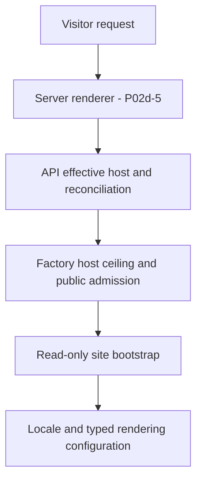

# 07 — Frontend Architecture Standards

**Status:** Active
**Derives from:** [ADR-0070 Owned Tenant BFF Sessions](../decisions/0070-owned-tenant-bff-sessions.md),
[ADR-0009 Frontend Single App First](../decisions/0009-frontend-single-app-first.md),
[ADR-0004 Authentication Strategy](../decisions/0004-authentication-strategy.md)
(Amendment 1: `learnstack-hub` realm for the separate operator portal),
[ADR-0019 LearnStack Hub](../decisions/0019-learnstack-hub.md) (the operator portal
`operator-portal` lives in the separate `learnstack-hub` repository).
Public-read additions derive from
[ADR-0052](../decisions/0052-anonymous-public-read-boundary.md); private ingress,
configured caller and dynamic rendering derive from
[ADR-0053](../decisions/0053-trusted-public-server-rendering.md); native admission and
redirect/query rules derive from [ADR-0054](../decisions/0054-bounded-public-renderer-admission.md).
Public UI localization derives from [ADR-0027](../decisions/0027-frontend-i18n.md);
single-bootstrap ownership derives from
[ADR-0055](../decisions/0055-public-renderer-bootstrap-failures.md);
page composition follows the
[Accepted P02d-6 package](../roadmap/phase-02d-delivery-log.md#p02d-6-decision-package-2026-10-09).
The existing-session Identity foundation boundary derives from Accepted
[ADR-0072](../decisions/0072-application-owned-identity-bootstrap.md).
Native entry, scoped publication and bounded administration derive from
[ADR-0078](../decisions/0078-native-session-scope-and-self-entry.md) and
[ADR-0079](../decisions/0079-bounded-identity-administration.md). The mechanisms
and boundaries below implement those contracts; the
[Phase 03 Status block](../roadmap/phase-03-identity-admin.md) owns progress.

Next.js App Router layout, tenant resolution, SDK shape, and runtime concerns for the
tenant-facing `apps/web` application in *this* repository. See
[03-frontend-coding.md](03-frontend-coding.md) for code-level style. The operator
portal (`operator-portal`) lives in the separate `learnstack-hub` repo and follows
its own standards.

## Apps and Packages

LearnStack's tenant-facing surface ships as a **single** Next.js app under
`frontend/apps/web` using route groups (`(public)`, `(studio)`, `(portal)`). Splitting
into separate apps within this repo is deferred until coordination cost demands it.

```
frontend/
  apps/
    web/                       # the only tenant-facing Next.js app
      src/
        app/
          (public)/            # tenant public site
            [locale]/courses/[slug]/lessons/[lessonSlug]/
            [locale]/status/not-found/
            layout.tsx
          (studio)/            # admin studio
            studio/            # account scaffold only
            layout.tsx
          (portal)/            # learner + instructor
            portal/            # account scaffold only
            layout.tsx
          api/healthz/         # infrastructure GET; auth is native-owned
          layout.tsx           # root layout
        middleware.ts          # ingress verification and live locale/path admission
        components/
          public/              # P6 chrome/states and catalog/course/lesson views
        i18n/                  # ADR-0027 foundation implemented in P6 Step 1
          request.ts
          messages/
            en/public.json
            en/auth.json
            tr/public.json
            tr/auth.json
        server/auth/           # native BFF owner and fixed RP protocol
        client/bff-session.ts  # closed safe session projection/extension

  packages/
    ui/                        # design system primitives (extracted only when duplication is real)
    sdk/                       # generated API client + types
    config/                    # eslint, tsconfig, tailwind shared configs
```

The operator portal `operator-portal` is a **separate Next.js application in the
separate `learnstack-hub` repository** — not under this `frontend/` directory. The two
apps do not share runtime code; if `packages/ui` is later extracted as a build-time
dependency, it can be referenced by both repos. See
[14-frontend-architecture.md § Apps and Packages](../architecture/14-frontend-architecture.md)
for the architecture-side view.

Migration to multiple apps within this repo (e.g. extracting `(studio)` into
`apps/studio`) is feasible because route groups isolate concerns at the layout level.

## Server Components by Default

- **Server Components (RSC)** are the default for every page and component.
- Add `"use client"` only for interactivity, hooks, browser APIs, third-party client-only libraries.
- RSCs use the admitted request-local loaders and passive safe session lookup.
  Private transport configuration, credential cookies and bearer attachment
  remain in the native response owner and configured callers.
- Pass typed primitives across the RSC → Client boundary; never pass class instances or closures.

## Tenant Resolution

**P02d-4 Accepted design — 2026-10-03.** Step 2 delivers site bootstrap;
Steps 3–4 deliver Education reads and the typed SDK; P02d-5 owns the trusted server
transport.
[ADR-0052](../decisions/0052-anonymous-public-read-boundary.md) replaces public edge
ID lookup with host-resolved `/api/v1/public/site` bootstrap. The API owns effective
host resolution under ADR-0036; bootstrap exposes rendering configuration without
tenant/organization IDs or route/query/body tenancy selectors.



- The server states the visitor host over ADR-0036's authenticated trusted hop;
  origin, headers and transport configuration are P02d-5/G35, not client authority.
- Public URLs carry locale and content slugs, never tenant identifiers.
- The approved bootstrap creates no edge tenant registry or resolver endpoint.
- ADR-0053 accepts native ingress provenance, Node middleware bootstrap and the
  server-only configured caller in P02d-5. The
  [accepted entry matrix](../roadmap/phase-02d-delivery-log.md#public-entry-matrix)
  owns membership-first redirects. Anonymous entry neither sets nor uses cookies.
  P02d-5 Steps 1–3 deliver native ingress, visitor budgets, Node bootstrap/entry
  and the configured caller; Step 4 implements frontend fences and real-API
  production HTML/RSC proofs. Public page composition remains P02d-6.
- Studio/Portal tenant switching is separate authenticated functionality; its
  admitted native candidate and live API confirmation do not select institution
  public content. Native scope is separate from provider identity, under
  [Native entry and administration](#native-entry-and-administration).

## Native Admission and URL Identity

**ADR-0054 native/URL controls complete — 2026-10-09; both reviews passed.**
Remediation Step 2 implements these controls. Concrete execution and review
evidence belongs to the [delivery record](../roadmap/phase-02d-delivery-log.md#remediation-step-2--native-ingress-and-url-boundary).

- Admit GET/HEAD on HTTP paths reaching the native listener callback before
  Next dispatch, including matcher-exempt health/assets and exact scaffolds.
  The existing ADR-0070 sign-in/sign-out/extend POSTs and the exact ADR-0078/0079
  [entry/administration form set](#native-entry-and-administration) are the only
  additional admitted methods, with their closed proof/body rules. All other
  methods receive masked no-store 404 without bootstrap or Next method
  conversion. HEAD is bodyless; Node owns malformed protocol input. Adding the
  new form set requires atomic ingress/route/CSRF/owner qualification; acceptance
  alone is no runtime allowlist change.
- Close every production WebSocket upgrade. Development admits only the validated
  GET HMR upgrade path and closes failed/unhandled delegation. Health/asset
  exemptions grant no method, provenance or tenant authority.
- Future Server Actions/write routes and WebSocket consumers require an explicit
  admission decision in their owning Phase 02b BFF/auth or Phase 06 admin work.
  Disable `poweredByHeader` independently, including framework fallback responses.
- Signed raw targets select route/locale identity. Match observed middleware URLs
  only against pinned Next 15.5.28's explicit full-URL RSC/`_rsc` projection; do
  not introduce suffix aliases or select another lesson after normalization.
- Redirects retain inert query values, duplicates and ordering; equivalent percent
  encoding is allowed. Only the verified live host, accepted HTTPS port and local
  path select the destination. Membership-first precedence and redirect statuses
  remain those of the [entry matrix](../roadmap/phase-02d-delivery-log.md#public-entry-matrix).

## Request-Local Bootstrap Admission

**ADR-0055 implementation delivered — 2026-10-10; production replacement proofs
pass.** All three steps completed both independent review rounds and focused fix
verification.
Middleware owns one live site bootstrap and its exact neutral 404/429/503 before
rendering. A native-created context binds the captured host/peer/method/signed
target and request lifetime. Successful entry publishes one bounded, deeply
immutable validated Site DTO; RSC re-verifies provenance and consumes that exact
request's snapshot without another site call. No header DTO, context lookup,
alternate holder or cross-request representation is permitted.

Native finish/close/shutdown disposes the store once and cancels transport. Late
work cannot publish or begin downstream reads; response finish does not prove all
React work ended. Active-request context defects fail closed as internal lifecycle
failures, not API 404. Actual pinned-Next security/lifecycle proofs are mandatory.
Content eligibility remains a live API decision; changes after the sole bootstrap
appear in the next request's site snapshot.

The accepted replacement costs two API calls for a completed product document,
one for a completed fixed status/scaffold document and three for a followed
missing-detail chain. HEAD/RSC/prefetch and Flight fallback require separately
proven counts. Metadata/layout/page/UI reuse adds no bootstrap. Visitor/peer limits
remain API-call budgets. The
[Step 3 record](../roadmap/phase-02d-delivery-log.md#adr-0055-step-3--production-admission-proof-and-closeout)
owns passing production replacement proof, completed reviews and verified fixes;
the five new catalogue rules are Implemented.
[Standards 09](09-error-handling.md#public-page-status-and-recovery) owns refusal
and bounded renderer Retry-After rules.

## Locale Resolution

P02d-4 accepts one required query `locale` for Education reads. Canonicalize the
bounded LocaleTag grammar without trimming before enabled membership, lookup or
cursor binding. `X-Locale` and `Accept-Language` never select public content.
[Localization Standards](08-localization.md#locale-codes) owns admission/errors;
public-site URL canonicalization and header transport remain P02d-5.

- Public-site URL: `/{locale}/...`.
- A successful site bootstrap supplies the configured default and enabled locales.
  An unavailable/no-locale site supplies no synthesized `en` default.
- Client-side locale switching navigates to the new locale path.

**P02d-6 Step 1 foundation implemented — 2026-10-10.** `next-intl`
request configuration uses the same server-only request-local admission loader
as document/layout/page consumers. That loader re-verifies the ingress envelope,
takes the canonical locale from its signed target and checks live enabled
membership before selecting messages. It imports neither next-intl nor messages;
configuration adds no bootstrap call or cycle. No i18n routing middleware,
`requestLocale`, callsite locale override, cookie or `Accept-Language` replaces
this authority. The private identity memo keys admission/content work only by
Next's exact request-store headers object, retaining same-request work across
framework error rendering. It never keys a cache by header values, host or
envelope. `getPublicUi` uses React cache for selected messages/translators inside
an RSC render; it does not deduplicate admission/content reads.
[Standards 08](08-localization.md#strings-in-code) owns catalogue fallback and
language attributes.

## SDK

The SDK is the frontend API boundary. **P02d-4 Step 4 delivers** generated
types and an injected public GET transport. P02d-5 Step 3 delivers the configured
server caller in `apps/web/src/server/configured-public-client.ts`.

- Generate from committed `backend/openapi/v1.json` through `LEARNSTACK_OPENAPI`
  using locked `openapi-typescript` 7.13.0 into checked-in `schema.d.ts`.
  Production served/snapshot equality and required frontend regeneration/drift
  checks are part of P02d-4; generator output remains outside formatter rewriting.
- The root exports generated types and the exact authenticated path/operation
  contract. `/authenticated-server` supplies the injected AccountSite method;
  `/administration-server` supplies the closed ADR-0078/0079 administration
  operations, with no-store requests and bounded response parsing. Aggregate
  versions remain canonical decimal strings through JSON, ETag and If-Match;
  creation preserves 201/Location and replay preserves its explicit header.
  The native configured caller owns credentials and the
  independently verified host/current visitor. It exposes no credential/header/
  host/scope selector to UI consumers. `/server` supplies four thin public GET
  wrappers using generated operation types and an injected Fetch-compatible
  transport that resolves relative URLs; no global-fetch default.
- The unused client factory/export is removed. No tenant-ID option, authority-header
  option, hop secret or request-header lookup enters this package contract.
- Parse Problem Details as unknown, validate it and map to the existing closed
  AppError union, including unknown codes. Localization parameter values are
  strings, matching Standards 09's carrier. Transport failure, malformed JSON,
  invalid local path input and caller cancellation remain distinct from a valid
  API error; cancellation precedes URL construction.
- The server-only `PublicRequestRefusalError` port marks a transport's local
  operation-construction or validation refusal before network I/O. The SDK maps
  this exact type to `invalid-request`; it does not infer refusal from provider
  error text or names. Cancellation takes precedence. Other transport failures
  remain `transport-error`, and body-consumption failures are not reclassified.
  This local result is neither an HTTP 400 nor an automatic retry instruction.
- P02d-5/G35 delivers the configured trusted server caller. P02d-6 supplies all
  public page consumers. HEAD is the HTTP companion, not a browser JSON wrapper.

The `server-only` marker is pinned to **0.0.1**, MIT (compatible with the project's
permissive dependency policy); the installed package metadata and lockfile are
the version/license evidence. [Next's server/client guidance](https://nextjs.org/docs/app/getting-started/server-and-client-components#preventing-environment-poisoning)
explains the import guard. Vitest aliases the marker only in server tests. The
P5 production fixture proves a real client import fails with the marker diagnostic
before rebuilding a clean server route against the real API.

The [accepted contract/CI plan](../roadmap/phase-02d-delivery-log.md#openapi-sdk-and-required-check-plan)
owns the source, pin, diff policy, bootstrap exception and required-check rollout.

## Auth

- Tenant BFF session ownership derives from
  [ADR-0070](../decisions/0070-owned-tenant-bff-sessions.md); implementation is
  delivered by P02b-7. Use the pinned openid-client RP and native session owner.
- OIDC provider: Keycloak.
- Credentials stay in the server owner; the browser carries only host-bound
  opaque cookies. [Security 11](11-security.md#tenant-bff-sessions) owns the rules.
- Server Components use the app-local read-only `auth()` projection. Response
  owners perform refresh/idle/cookie updates before streaming. Never expose
  credentials to Client Components; no Server Action is admitted by P02b-7.
- Accepted ADR-0072 preserves complete native actor/tenant identity, independent
  ID-token verification and matching positive AccountSite for the original
  existing-session boundary. ADR-0078 replaces provider tenant/actor completeness
  as native session scope authority: verified provider identity, optional
  compatibility claims, API-associated actor and published context are separate
  types. Typed entry/no-session completion grants no Membership or tenant cookie.
  The [Security activation gate](11-security.md#p03-3-new-user-http-and-native-activation-gate)
  still requires actual API/provider/native/browser proof before activation.

## Native Entry and Administration

**Derives from:** ADR-0078/0079. Qualification and packet status remain in
[Phase 03](../roadmap/phase-03-identity-admin.md).
Native Studio/Portal uses admitted tenant/organization origins. Fixed management
origins map to tenants with NULL organization; PlatformHost does not acquire
native AccountSite/session entry. The source credential, subject association,
live candidate and exact host ceiling follow Security 11. Public wrappers remain
anonymous; no browser-controlled header, cookie or hidden field selects authority.

Only these additional native POST paths are admitted:

| Path | Fixed operation |
|---|---|
| `/api/auth/entry/create` | Deliberate own bootstrap from the current bounded entry |
| `/api/auth/entry/select` | Fresh own context choice and audited initial admission |
| `/api/auth/switch` | Same-subject fresh audited context transition |
| `/api/studio/membership-profile` | Exact contextual profile replacement |
| `/api/studio/membership-roles` | Whole compatible Role assignment replacement |
| `/api/studio/membership-status` | Named Active/Suspended/Revoked transition |
| `/api/studio/role-grants` | Whole registered scoped grant replacement |
| `/api/studio/role-manifest-adoption` | Exact explicit release adoption |
| `/api/account/profile` | Exact current own Membership preferences |

Existing `/api/auth/signin/keycloak`, `/api/auth/signout` and `/api/auth/extend`
remain in the closed POST set. Sign-out also accepts the current entry proof for the bounded
[entry logout](11-security.md#native-entry-and-publication). New forms require
verified exact same Origin and current entry/session CSRF before work.
Strict UTF-8 form input is at most 16 KiB before
Next, with single-valued named fields and duplicate/unknown fields refused. Only
the declared Role/grant field contains strict finite JSON arrays, at most eight
items. Form decoding, extra fields, canonical identifiers and bounds get real
transport controls. Ordinary admin forms accept no tenant/org, absolute return
URL, path/method/header or bearer; only context-selection forms propose a
non-authorizing candidate. Versions are canonical Int64 decimal strings converted
to exact strong If-Match, never JavaScript numbers. Idempotency nonces survive
deliberate same-request unknown-outcome retry; edited requests need new keys.

GET `/api/auth/entry` serves own-entry confirmation/recovery, or fresh context
choices for the current session when no entry owner is present. The current
context is identified without another selection form; other choices use the
closed switch operation. The
protected document set is exactly `/studio`, `/studio/members`,
`/studio/members/{MembershipId}`, `/studio/roles`, `/studio/roles/{RoleId}`,
`/portal` and `/portal/profile`, with canonical resource IDs. Only member-list
GET accepts cursor/limit; exact route/query/history censuses reject alternatives.
An actual native-captured `RSC: 1` request may additionally carry one nonblank
safe-ASCII `_rsc` transport value of at most 128 characters. Remove only that
field for route-query validation; keep the signed raw target and the native
request's captured activity classification. It provides no credential or operation authority.
The API directory is selected by current admitted capability; a URL never widens
scope. Organization CRUD is API/SDK-only in this packet; full editors are Phase 06.

Use plain anchors and native forms with fixed same-host 303 destinations and
pessimistic fresh reads. No protected SPA/TanStack cache, automatic prefetch
navigation or Server Action is admitted. The response owner holds one credential
revision and performs only the exact generated operations, with one ten-second refresh/API/body deadline and
256-KiB decoded response ceiling. RSC `auth()` remains passive and exposes no API
operation closure; response owners perform refresh, idle/epoch/cookie decisions
and prepare immutable page data before protected output can stream.
No raw identity, credentials or grant graph enters SessionProjection/client props.

Native preparation chooses the finite read set for each selected page. Common
reads obtain current advisory capabilities and the actor's own contextual profile;
exact profile 404 means absence, not permission to create a profile or use the
viewed member's preferences. Member detail derives edit controls from both current
capabilities and exact target scope. Role choices require Role-read admission;
readable Roles need not be editable. No additional label or authority lookup is
performed by the RSC. Browser continuation cursors remain opaque and are bound to
their owner and purpose before the raw API cursor is used.

An admitted current session's non-prefetch protected GET prepares its page,
including a GET classified as passive activity. Passive activity does not refresh
or extend idle life; it is not a shortcut to unchecked page data. HEAD stays bodyless and captured prefetch uses
passive admission without page-data preparation. Selected page and metadata
consumers use `optionalPreparedPage()`: an absent prepared value renders no private
content or title and retains noindex/nofollow metadata. This is not an API fallback
or a successful full-document rendering claim. Positive document proofs must still
assert the expected nonempty page. The facade re-verifies the signed request,
reads the existing native frame and checks snapshot identity/liveness; it does not
create an owner, reserve credit or expose an operation closure. After this passive
await, selected view composition is synchronous.

The pre-entry owner retains its original five-minute deadline and existing
pending/global/per-subject capacity. Callback returns an entry handle before
self-discovery; it creates no User or tenant session. Entry GET resolves current
self/context choices, and explicit creation or selection uses the current entry
proof. Zero Membership gives localized recovery; a destination with a live
session accepts replacement only for the exact verified issuer/sub. A different
subject needs explicit sign-out/fresh sign-in; advisory display names cannot
authorize account replacement. Cross-host entry is independent destination OIDC,
not source-person continuity or token transfer. Refresh uses Off self/AccountSite
checks under the new held token and unchanged scope, not another admission POST.

Reserve a distinct protected-page snapshot before API page reads: 128 global,
eight per current entry/session owner, at most 256 KiB serialized each. Global
exhaustion returns no-store 503; per-owner exhaustion 429; no queue/live eviction.
The 32-MiB serialized bound excludes runtime/rendering/protocol overhead. Freeze
the exact page DTO/capability snapshot to the actual request, host, epoch and
credential revision; RSC only reads it. Actual API/render/body settlement releases
credit, including cancelled/closing work and joined shutdown. The native frame
joins the handler, actual response finish/close, pending write/end callbacks and
work registered through its pinned Next request-context `waitUntil` adapter. The
snapshot lease separately joins tracked provider/API work, including work that
settles after cancellation. Nested registered cleanup must reach settlement before
credit is released. Logical timeout or response finish alone is no proof that
retained work ended.

This guarantee covers those owned and registered lifetimes. It does not discover
arbitrary detached promises, timers or unregistered framework work. The selected
RSC dependency census therefore rejects additional application async work, API
calls, schedulers and framework background hooks, including planted alias and
transitive cases. Its bounded analysis is not a JavaScript interpreter or a proof
about arbitrary third-party internals. The passive provenance dependency remains
an exact checked edge, not a general exception for I/O in rendering.

The same response lifetime covers native entry, context and action-recovery
documents. Mutation-error and account-change pages reserve and pin a current
session lease before private recovery content is published. They recheck current
CSRF and exact action binding; they do not repeat the mutation or acquire new
authority. Checks precede native header flush, write and end. Invalidated output
becomes an empty no-store 503 before headers; after headers, the connection is
destroyed. A response/socket already destroyed before its close event admits no
new write credit: Node can discard such callbacks. Previously issued writes still
retain their credit until their actual callbacks settle. Original native
backpressure and write callbacks remain intact.

The own-capability read is Off/no-store/no-ETag and returns exactly nine advisory
flags: canReadTenantMembers, canReadOrganizationMembers, canWriteMemberProfiles,
canManageMemberships, canReadRoles, canChangeRoleGrants, canAdoptRoleRelease,
canWriteOwnProfile and canManageOrganizations. The canonical predicates are in
[ADR-0079](../decisions/0079-bounded-identity-administration.md#nativeui-execution-and-failure)
and Standard 19. Distinct Role read/change/adopt flags preserve readable but
noneditable pages; target/release state further restricts adoption controls. False
previews mint no denial event or reusable permission. Per-pair canGrant describes
additions and does not prevent removing an existing nonkernel grant. Every
operation independently reauthorizes; target ETags do not validate capability
metadata. Hide unavailable controls and render read-only preferences when needed.

Ordinary admin refusals retain a live broader session while withholding that
result; AccountSite/publication/refresh retain their separate Security 11 policy.
Recoverable localized states include 403/404, 409 conflict/key cases, 429, 503,
unknown commit, expiry and no Membership. Do not assert rollback or automatically
retry mutations. PreferredLocale uses only the exact current Membership's enabled
UI preference, else site default; it never changes content locale or scope.
An unavailable stored preference is shown explicitly in an editable profile.
Saving requires a deliberate enabled-language or site-default choice, with no
preselection that silently removes the stored value. The required native radio
group uses the existing locale/empty-default wire and needs no JavaScript. Read
fallback alone does not change the saved preference.
Unknown outcomes keep the original body/version/key only for a deliberate same-
request retry. Stale-version and key-reuse recovery has no resubmission form: it
shows escaped, localized submitted edits for review, with bounded original intent
outside any form. Role names require authorized metadata; absent labels produce a
truthful unavailable message, not visible resource UUIDs. Current CSRF, internal
versions, target IDs and idempotency nonces are not displayed as edit copy. A fresh
GET supplies a new form/version/key; there is no automatic rebase or retry.

Role and grant Add/Remove buttons submit the complete desired finite array in a
native form. Existing assignments/grants are preserved when adding another item;
`canGrant` controls additions, while existing nonkernel grants can be removed.
TenantAdmin kernel removals remain unavailable. Separate forms carry independent
unused keys, and release adoption remains a distinct deliberate action.

Session controls track only the DOM identities of edited enabled forms. A localized
unsaved-edit notice and native `beforeunload` warning remain until that edited
form submits, or private content expires, is replaced or unmounts. Sign-out and
unrelated form submission do not clear another form's warning. This guard never
copies field values into client state, storage, logs or history. Browser-controlled
prompt wording is not application copy. Without JavaScript, forms still work and the
document explicitly states that unsaved-edit warnings and session extension need
JavaScript.

The fixed protected history guard veils a leaving/restored document. Next GET
documents obtain fresh admission by reload; native POST-result documents use a
checked fixed GET recovery destination with `location.replace`, never a reload
that could resubmit a mutation. Ordinary anchors and native forms preserve full
navigation. Natural history navigation and a synthetic persisted-page event are
separate evidence, and neither supplies a no-script expiry guarantee.
Equal en/tr namespaces and actual keyboard/focus/error/reflow/contrast/assistive-
technology evidence are required. Veiled restoration and no-script recovery need
real browser proof; a script-disabled browser has no script-based expiry promise.

## Version-Qualified Next Response Cleanup

**Derives from:** [ADR-0083](../decisions/0083-owned-next-response-compression-cleanup.md) and
[ADR-0084](../decisions/0084-owned-frontend-runtime-process-families.md).
The [Phase 03 Status](../roadmap/phase-03-identity-admin.md) owns delivery state;
acceptance does not establish an installed patch or implemented verifier.

### Qualified inputs and installation

- Admit only the exact current Node/pnpm/Next tuple in the reviewed
  `frontend/framework/next-response-cleanup/census.json`. The initial tuple is
  recorded by ADR-0083; no supported range follows from one qualified version.
- `frontend/scripts/framework-installation.mjs` uses Node builtins before any
  framework/application import. It checks actual Node, actual app-relative Next
  resolution/version, patch and lockfile identity, census/generator identity and
  every original/patched subject required by its mode. Runtime verifies patched
  subjects; original subjects are generation/qualification inputs, not fallbacks.
- The initial bounded installed set is 30 JS files and 29 maps: 27 compiled pipe
  copies, common compression and two routers. Compression has no map; record
  that explicit exception. Verify complete distribution membership at install/
  qualification and exact qualified file bytes at supported build/start. Do not
  hash the entire framework tree or persistent caches per request.
- `frontend/scripts/generate-next-response-cleanup.mjs` parses qualified installed
  JavaScript, applies the reviewed semantic edits and composes actual mapping
  edits with each original map. Preserve unchanged mapping segments, source
  indices, metadata/ignore lists and license provenance; update transformed
  source content. Stale mappings or source-content-only changes refuse.
- Step 2 supplies the versioned readable owner input, patch and census, recording
  generator version/hash and SHA-256 for every input/output JS/map. Normal pnpm
  patch installation applies the exact reference in `frontend/package.json` and
  `frontend/pnpm-lock.yaml`; unused/non-applying patches are errors. No shared
  store mutation, startup loader transform or permissive fallback is allowed.
- Supported restore/build paths independently verify the actual selected pnpm
  executable before mutation or Next execution. `packageManager`, engine text,
  Corepack, PATH choice and user-agent text alone supply no admission. The
  verifier resolves/probes the executable actually invoked; it does not probe
  one binary and subsequently invoke another through a fresh PATH lookup.
- Exact Node/pnpm engines and strict engine/manager configuration are additional
  controls. Make/demo/CI and direct supported package install paths use the same
  actual-executable admission, including lifecycle checks where applicable.
  A runtime starting a prebuilt verified artifact need not invoke pnpm; it
  verifies the guarded producer's manager provenance and actual Node instead.
- A tuple or correction change receives equivalent owner/install/map controls
  and complete reviewed qualification before admission. Security 11's seven-day
  Critical/high fix SLA remains unchanged; prioritize the work and escalate a
  likely miss immediately. This pin grants neither extra time nor an automatic
  pre-proof emergency release. A different emergency policy needs an explicitly
  bounded accepted decision. Do not rewrite the historical initial tuple.

### Generated runtime provenance

- Supported production build is an owned clean producer, exposed through
  `frontend/apps/web/scripts/framework-build.mjs`; raw positive `next build`
  invocations migrate to it. Verify qualified package/toolchain before generation,
  begin with no reusable executable output/cache from an earlier build, and
  verify package and source/config identity again after the real build exits.
- The producer writes `.next/framework-build.json` last, outside its own digest
  subject set. It binds the guard/
  generator/census and patch identity, actual producer tuple, complete relevant
  source/config graph and actual generated executable output. It cannot bless an
  arbitrary pre-existing directory. Interrupted/failed builds have no valid
  completed identity and cannot replace an admitted output.
- Inventory generated framework copies from the actual Next runtime output and
  file traces. Include every loadable server JS/JSON/map and required root
  manifest, native `.server` output and emitted SDK graph resolved by the native
  launcher. Compare exact relative membership, size and SHA-256; additions and
  deletions fail as well as changed listed bytes. No fixed development file
  count stands in for the production graph. Static delivery bytes and mutable
  request traces/caches are separate from executable server provenance.
- The source/config input set covers the app, SDK/UI source and their workspace
  configuration, actual Next/TypeScript/build entry configuration, manifests,
  lockfile, patch/census/generator and emitted native/SDK resolution. Exact input
  membership is validated, not just a caller-supplied subset. Actual build args
  and non-secret code-generation options belong to the producer identity;
  unqualified loaders/options or outside-root runtime resolution refuse.
- Native production launch verifies installed bytes, current relevant inputs and
  generated output before application/SDK/Next imports or listener creation.
  `public-server.mjs` is a builtins-only owner: it acquires the existing lease,
  verifies output and prepares the native cache before starting the private child.
  `public-runtime-child.mjs` independently verifies the current parent records,
  cache metadata and generated identity before importing runtime code. It never
  acquires/releases the parent's lease or prepares/claims cache metadata. The
  runtime does not recompile `.server` independently after verification.
- Correct installed bytes beside an old `.next`, or an old build plus its own
  old manifest, refuse. A changed source/config/lock/patch or changed/extra/
  deleted loadable output refuses. Production output is immutable for its
  admitted lifetime; supported build/install/run operations serialize access.
- Development's `public-server.mjs --dev` owner invokes the existing clean
  `buildFramework` producer before starting its private runtime child and retains
  the returned development lease. The owner alone prepares the native cache.
  The child's verified compiler owns incremental framework output under that
  reservation; child verification does not transfer lease authority. Gate each
  applicable compiler path before its code is admitted; ordinary source HMR stays
  supported. Dependency/compiler/configuration or runtime-boundary input changes
  close admission and require a clean managed restart. Failed validation cannot
  serve old output as newly qualified compilation. Prove server, middleware,
  client and HMR coverage. The separate framework-build CLI remains the
  production/native producer; it exposes no public development mode.
- Do not recursively remove an unowned or symlink-escaped output. Define output
  ownership/serialization before cleanup and reject ambiguous ownership. These
  are trusted source/install/build drift controls, not signatures against an
  actor who can replace the verifier, source, manifest and outputs together.
  Arbitrary external co-writers violate the immutable/owned-output premise.
- Copied public/admission/ingress/BFF fixtures carry the same verifier and clean
  producer. Their manifests bind their actual post-instrumentation inputs and
  resolved dependencies, not another checkout's identity. Rebuild config/source
  mutants before behavioral assertions; do not sign or re-label stale output.
  A raw stock server used only for a negative isolation test is explicitly
  scoped and cannot become a supported launch path.
- Build input/environment binding has a closed non-secret code-generation
  scope. Never serialize secrets or low-entropy secret hashes into manifests.
  Account for the real loader and compiler graph before declaring closure.
- Current native/production and copied fixtures are supported subjects. No
  Dockerfile, standalone or source-less deployment is delivered by this rule.
  When introduced, packaging must bind and verify an immutable accepted artifact
  before import/listen; unsupported modes have no implied qualification.
- Measure installed and generated verification bytes/time separately on local
  and hosted platforms, including cold/warm cases. No per-request whole-package,
  generated-tree or persistent-cache hash scan is introduced.

### Actual response and compressor ownership

- Compression middleware reserves one immutable response-local owner before
  wrapping methods or constructing a stream. Duplicate ownership refuses before
  another allocation. Record actual selection/allocation, transport finish/close,
  resource closure and operation/cleanup faults separately.
- A no-resource disposition requires actual no-compression selection or a sealed
  allocation path with no object created. Method/status, empty producer, zero
  wire bytes and handler return alone prove none. Preserve stock selection,
  threshold, negotiation and healthy headers/body. Early-flushed unknown-length
  204/304 or empty responses can allocate gzip/deflate; join every actual encoder.
- The terminal observation resolves for actual finish or close, matching existing
  expected-abort behavior. Close before finish means incomplete delivery; it
  supplies no synthetic finish, end, callback or unrelated work completion.
- On either actual response finish or close, account for every actual encoder
  and cancel any still-unretired encoder before joining its actual close. An
  earlier finish cannot skip cleanup at close. A native pre-header refusal can
  finish through the captured writer after allocation, leaving an encoder never
  ended and removing its encoding header; the allocation fact remains. Let a
  naturally closing encoder reach actual close without changing healthy wire.
  Destroy requested, writable flags, timeout or successful wire delivery is no
  resource-close witness. This retires no independent work or callback.
- Each real pipe/router rejection or abort reports to the same owner before its
  own cleanup await. This idempotent transition preserves the first primary
  error and separate cleanup faults. An inner pipe cannot wait for its outer
  router to observe a still-blocked rejection.
- With no stream created, seal all later allocation and retire only the empty
  compression obligation, allowing the existing captured/fenced native error
  writer to respond without a circular terminal wait. Normal early return cannot
  discard response-producing work that is still registered and owned.
- With a stream created, that failure transition requests actual response and
  owned-stream cancellation before joining actual close, including real rejected
  end work before the compression wrapper's end call. Observe construction/
  stream faults immediately; account for every actual partial allocation and
  prevent unhandled rejection. No timeout invents a failure acknowledgement.
- Both the actual pipe and common router join the same original owner promise,
  on all return/throw paths. The router covers direct/static end. Repeated joins
  duplicate no ownership. A genuine pending end-work promise remains held after
  transport/encoder close; a genuinely rejected one retains its failure.
- Keep upstream cause wrapping and the primary exception at the joining boundary;
  finally cannot replace it with a cleanup error. Preserve operation error after
  physical closure. Expected peer cancellation with clean retirement introduces
  no synthetic cleanup failure. Immediate compressor fault can close transport
  before an error body, while ordinary API/BFF refusal classifications remain.
- Successful HTTP bytes/status already delivered cannot be retracted. Emit no
  second response or synthetic rollback. Cleanup faults remain failed outcomes,
  separately from the irreversible wire result and confirmed physical retirement.
- Existing native publication, actual handler, write/end callback, registered
  framework/API and snapshot owners remain independently joined. No output,
  capacity return or successful stop follows from timeout/cancellation alone.
- Unfinished actual work can retain current reservations for the process lifetime.
  The native shutdown controller's existing five-second watchdog starts at the
  first latched shutdown request, including startup before handler registration.
  Registration or a repeated request cannot restart it. Expiry reports failure and
  exits the child nonzero; it supplies neither cleanup nor group-retirement credit.
  Existing operation/body deadlines retain their cancellation bounds. ADR-0084
  adds one builtins owner for one native launch and its isolated runtime family.
  This is the launch's ownership scope, not a restart/recovery supervisor. No
  automatic replacement, new normal-request timeout, forced runtime-group timer
  or total framework-memory bound is introduced. Phase 11 continues to own
  production supervision and capacity proof.

### Native runtime family ownership

[ADR-0084](../decisions/0084-owned-frontend-runtime-process-families.md) selects one
builtins-only owner and one private detached runtime child on qualified
macOS/Linux surfaces. Owner and runtime groups are distinct. The parent holds
all frontend/app/SDK reservations until actual direct-child close and runtime
group absence; only signal-zero `ESRCH` establishes absence. Observation errors
retain uncertainty. Runtime polling backs off from 10 to at most 250 ms, without
a total timeout or success credit. No nonzero signal goes to a cached runtime
PGID. The generic producer helper retains its existing polling.

The owner latches SIGTERM/SIGINT before asynchronous preparation and keeps the
latch through release. It propagates cancellation through producer boundaries,
joins started actual command families and refuses later startup. The dedicated
child entry captures its fresh private IPC challenge before scrubbing and latches
stop/disconnect before validation/import/prepare. Lease-record nonces remain
disk-readable record bindings; proof-incarnation labels only attribute evidence.
The generic producer preload is never a runtime entry.

The child validates its exact parent/channel/mode/current records and waits for
an authenticated start-or-stop response. An existing stop cannot be cleared by a
handshake, ready frame or later start. Runtime startup exposes the single-use
`startPublicRuntime(control)` registration before effectful asynchronous setup.
Stop closes admission before native request/session and Next joins; real pending
prepare remains owned and no later continuation may listen. One child-controller
five-second watchdog begins with the first stop, even before registration, and
never restarts. Expiry fails the child without signaling the runtime group; the
outer actual-family join still retains records.

`runFrameworkRuntimeFamily` preserves code, signal, validated handshake, actual
listener readiness, requested stop, startup cancellation, parent loss, fault,
direct close and group absence in a frozen final receipt. Success requires a real
ready listener, requested graceful stop, child zero/no signal, no startup/parent/
fault failure and actual group absence. Pre-ready or unsolicited zero and all
signal/fault outcomes fail. Compiler/installer `runFrameworkProcessFamily` and
`runOwnedNode` retain failed cancellation, including child-zero cancellation.

Supported owner invocations have empty `execArgv` and no `NODE_OPTIONS` before
owned admission/spawn. Node preloads execute before script entry; refusing those
flags does not undo already executed arbitrary preload code. Copied proofs use
only graph-bound literal child instrumentation prepared before genuine build,
with finite copied-source profiles and a builtins-only relay. They never run
child instrumentation in the owner or introduce production import/profile flags.
Exact post-validation child imports, helper/relay files and the entire owner
builtins import closure are producer and restart-critical inputs. Mechanical
controls include nonbuiltin/transitive dirty imports and all listed relay schemas.

#### Frontend runtime owner-loss recovery

@cemil owns this procedure until Phase 11 names the operational owner. Parent
loss requests the child's latched shutdown and leaves durable parent records.
No child release, automatic stale-PID stealing or production reconciliation
command is selected.

1. Stop competing supported launches/mutations and preserve mutable roots. Take
   a read-only snapshot of exact frontend/app/SDK record paths and bytes without
   following aliases; never substitute a newly discovered record at another path.
2. Identify every family from authenticated launch evidence, including any
   producer active during startup. A missing/stale handle or uncertain group
   observation cannot be replaced with PID age/death, stdio close or a signal.
3. Establish actual retirement of all captured families, or retain documented
   host-lifetime evidence showing that all pre-restart work ended. Never signal
   cached groups. If that evidence is unavailable, retain records and roots.
4. Under that exclusive stopped-launch condition, recheck exact unchanged record
   identity and absence of replacement/external writers. Only after complete
   evidence may @cemil manually retire those captured record files. Remove no
   unrelated record, output root or cache-ownership metadata. Run the normal clean
   managed producer before restart; any new ownership refusal stays a refusal.
5. Preserve the evidence and failed shutdown outcome. Missing evidence or a
   changed record retains the roots/records and escalates to @cemil. Manual
   evidence-based retirement is the explicit operator action; no production
   automatic reconciler or record-deletion command is introduced. Phase 11 owns
   any later mechanized operational recovery design.

Only isolated copied fixtures have a closed record reconciler: it can retire
that exact launch's unchanged records after every captured family is absent.
Missing handles, changed records or unknown retirement retain roots. Runtime
`stop-test-child` requests graceful stop from the owner and joins owner/runtime
families separately; no two-second runtime SIGKILL fallback or cached-PGID rescue
supplies cleanup. BFF lifeline/parent-watch controls obey the same boundary.

## Routing

- File-based App Router.
- Route groups: `(public)`, `(studio)`, `(portal)`.
- Dynamic segments use `[slug]`, catch-all `[...slug]`.
- Public route and owned pagination identity come from the verified signed raw
  target; observed `params`/`searchParams` do not replace it.
- Each route group has its own `layout.tsx`, `loading.tsx`, `error.tsx`.

**Accepted P02d-6 G40 — 2026-10-09.** Step 1 implements shared resource admission,
controlled state views and the fixed status page. Step 2 implements catalog/course
pages and their pagination/metadata; Step 3 adds lesson presentation/metadata.
Keep the three
`/{locale}/courses` list/course/lesson routes and minimal tenant chrome. Use plain
same-host relative anchors, including opaque catalog and outline pagination;
disable automatic prefetch. A new document request re-reads API state.

Await request-local resource admission before a loading boundary can flush the
document. A missing/hidden resource returns local **307**, followed by the same
host's fixed `/{locale}/status/not-found` page with **404**; the browser URL changes.
Live host/locale admission applies again. The status page uses safe theme/chrome,
localized title and noindex, has a catalog recovery link, echoes no original
slug/query/cursor and never queries Education. This does not promise a direct
branded 404 at the original URL. Unknown-host/provenance refusals remain neutral.

Keep `loading.tsx`/`error.tsx`; initial pre-admission loading UI is not promised.
Known content-call failures render translated **HTTP 200 noindex** states for
invalid cursors, rate limiting and unavailable/invalid API responses. Bootstrap
refusals retain real 404/429/503. Unexpected framework errors retain pre-stream
500/post-stream 200 semantics; `error.tsx` cannot set arbitrary status.

## Public Site Renderer

**Accepted P02d-5 policy — 2026-10-08. Derives from:**
[ADR-0053](../decisions/0053-trusted-public-server-rendering.md). Public institution
routes render dynamically with no-store API transport. No ISR, positive
`revalidate`, `generateStaticParams`, `unstable_cache` or shared bootstrap/data/route
cache is permitted. Request-local reuse is isolated to one incoming request.
Freshness is the next new server/document request, not client Router Cache history.
Disable local Server Component HMR caching. P02d-6 Step 1 implements document
loaders, chrome, state views and atomic theme injection. Step 2 adds catalog/course
views; Step 3 adds ordered lesson views. Step 4 adds concurrent host/locale, theme,
freshness and failure-state product proofs. The
[delivery record](../roadmap/phase-02d-delivery-log.md#p02d-6-step-4-product-proof-and-accessibility-closeout)
owns verification, completed reviews and passing manual accessibility evidence.
P5 delivers the dynamic layout, transport and source/runtime proofs. Test-owned
production routes exercise the real API. P6 product modes copy the actual public
routes separately; the synthetic transport mode cannot shadow those pages.

- Renders **published** pages, courses, blog content.
- Institution public SSR uses ADR-0053's dynamic/no-store policy.
- Block rendering pulls from a block registry (`packages/blocks`); blocks register a React component plus a JSON schema.
- Preview tokens enable draft rendering for editors.

P02d-6 narrows this broader renderer target to API-ordered plain-string
`default-card` fields, through app-local synchronous views. No HTML, Markdown,
linkification, authored URL sink or new primitive is admitted. Unknown renderers
and unavailable presentation use bounded fallbacks. Metadata shares the page's
request-local content read: verified live host/local segments only, actual eligible
alternate slugs, noindex pagination with a first-page canonical and no misleading
resource alternates on errors. Full menus, media, preview and Studio remain
Phase 06. The accepted replacement and current delivery boundary live in
[Request-Local Bootstrap Admission](#request-local-bootstrap-admission); no retry
or shared DTO cache is added.

### Public source fence scope

P02d-5 remediation Step 4 follows header constructors and converted records through
bounded declaration aliases. Inherited tsconfig paths and workspace exports must
match the resolver census; unsupported production `.js`/`.jsx`/`.mjs`/`.cjs`/
`.mts`/`.cts` extensions fail until the census/resolver supports them. Admitted
Studio/portal scaffolds join the render-root census. Public navigation uses
document anchors; runtime Next Link/router imports are refused, including
transitive barrels.
The retention fence covers module mutable bindings, local factories/IIFEs,
collections, class-static and global writes. It is bounded source analysis,
not an interpreter for reflection, arbitrary evaluation or external packages.
Declaration-level `import type` and
`export type` edges are erased. Inline type-only specifiers remain conservative
source edges: TypeScript verbatim emission retains them; pinned Next 15.5.28 SWC
erases them. Separate real compiler controls establish that distinction.
An empty production Client Component census is source information; the configured
production-build canary supplies independent asset containment evidence.
[The catalogue](21-architecture-tests-catalogue.md#p02d-5-public-server-rendering-controls)
names the controls; the remediation record owns execution evidence.

## Admin Studio

- P03-3's bounded member/Role screens use the accepted
  [native entry and administration](#native-entry-and-administration) contract.
  Full data-heavy/optimistic editors remain Phase 06's separately admitted work.
- Context choices disclose only the person's current usable contexts; Platform
  operator administration remains P03-9, without an all-tenant native switcher.
- Permission-aware UI hides unavailable actions but never replaces server-side authorization.
- Drafts and publishing flows explicit; published state visible.

## Portal (Learner + Instructor)

- Membership-gated routes.
- Lesson player: Server Component shell + Client Component for media playback.
- Classroom join: client requests a join token from the backend, then connects via the LiveKit web SDK.
- Reconnection states visible to the user.

## Tenant Branding

**G16(a–e)/G21 writer contract delivered in P02d-2 — 2026-10-02.** The
[Tenancy contract](../modules/tenancy/README.md#whole-theme-setting-and-public-boundary)
selects one whole-theme color document, contrast refusal, no organization override
and no font/logo/URL/layout value. P02d-6 Step 1 implements the accepted G42
atomic document injection below.
P02d-4 accepts complete typed theme or null and attribution-only entitlement;
Step 2 delivers that public projection.

P02d-4's public theme is exactly four validated colors or null; frontend safe
CSS defaults remain the fallback, with no backend palette copy. Baseline colors
are independent of plan. Effective WhiteLabelBranding removes LearnStack
attribution only. Accepted G42/P02d-6 requires atomic validation of all four
`#rrggbb` values before emitting a server-generated style element with only
`--ls-primary`, `--ls-bg`, `--ls-fg` and `--ls-muted`. Null or any malformed value
retains the entire existing CSS default palette; no per-token merge or style
attribute. No URL, font or organization override is admitted. Output is safe
without CSP, whose delivery remains Phase 11.

- Tenant theme tokens loaded at the layout level via RSC.
- Tailwind reads the four fixed color variables above; the font token stays local.
- Theme JSON shape part of tenant settings; tenant-admin editor surfaces it.

## Live Classroom UI

- Join token requested **only when entering the session**, never on page load.
- Token TTL ≤ 1 hour; refresh requires server-side re-authorization.
- Device permission prompts explicit: separate screens for "allow microphone", "allow camera".
- Reconnect indicator visible.
- Recording indicator visible **whenever** recording is active, regardless of who started it.

## State

- Local state for view-only.
- Server state cached via TanStack Query in Client Components.
  The protected P03-3 form/document set uses its request-bound snapshots instead,
  with no protected client cache or optimistic authority state.
- URL state (search params) for filterable lists.
- Avoid global Zustand/Redux stores unless multiple unrelated routes share the same mutable client state.

## Error UI

- Route-level `error.tsx` shows a graceful boundary.
- Inline form errors at field level.
- Toasts for transient feedback; modals for action-required errors.
- P02d-6's accepted branded missing-resource path is the admitted 307→404 chain
  in [Routing](#routing); a fresh bootstrap refusal stays neutral.

## Loading UI

- Route-level `loading.tsx` provides a skeleton shell, not a blank page.
- Suspense boundaries scope streaming to meaningful units.
- No "loading…" spinners for resources expected to take < 250 ms.

P02d-6 admission must complete before the initial shell flushes, per
[Routing](#routing); the general streaming rule does not bypass redirect admission.

## Performance

- Image: `next/image` with `priority` for above-the-fold heroes.
- Font: `next/font` self-hosted.
- Streaming with `<Suspense>` to ship hero content first.
- Lazy load below-the-fold blocks.
- Lighthouse budgets: see [15-performance.md](15-performance.md).

## Security

- Strict CSP with nonces.
- No `dangerouslySetInnerHTML` outside a sanitization wrapper.
- Auth form CSRF follows [Security 11](11-security.md#csrf); neither a cookie nor
  implicit framework/Server Action behavior substitutes for the explicit checks.
- Outbound URLs validated against an allow-list before rendering.

## Tooling

- ESLint with `@learnstack/config/eslint`.
- TypeScript strict mode.
- Prettier formatted on commit.
- Storybook for the design system in `packages/ui`.
- Visual regression for the public renderer.

## Future

- Mobile-native portal out of scope until web is stable.
- Offline support out of scope.
- Splitting into multiple Next.js apps is a Phase-9+ consideration.
